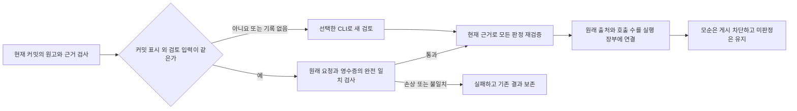

# 문서 사이의 계약을 소스와 대조하기

**완료·취소·소유권·정지 설명을 게시하기 전에 같은 소스 버전의 관련 문서와 영어판을 함께 대조하세요.** 문장에 유효한 인용이 붙었다는 사실만으로 문서 사이의 의미가 일치하지는 않습니다.

`paths.consistency_file`에 프로젝트별 계약 질문·기준 문서·관련 문서·검색 표현·근거 ID를 지정합니다. 공개 예제는 `examples/libcamera/config/contracts.yaml`입니다. 답변 문장이나 정답 판정을 이 설정에 넣지 않습니다. 기준 문서도 소스 검증 대상이며 무조건 옳다고 취급하지 않습니다.

```yaml
paths:
  consistency_file: config/contracts.yaml
```

1. 현재 소스로 facts를 추출하고 필요한 원고를 생성합니다. 같은 소스 SHA의 원고만 대조합니다.
2. 영어 카탈로그를 사용하는 경우 선택한 CLI로 변경된 표시 문자열을 번역합니다.
3. 같은 설정으로 `sdd audit-consistency`를 실행합니다. 생성기가 선택한 독립 CLI와 명시적 모델을 사용하며 다른 실행기나 직접 API로 전환하지 않습니다.
4. `build/consistency-review.json`의 양쪽 주장·조건·주체·시점·보장 범위·원문 위치와 판정 이유를 확인합니다. 결함이 있으면 질문·발췌·생성기를 고치고 원고를 재생성합니다.
5. `sdd export-site`와 `verify-site`를 실행합니다. 계약 설정이 있으면 원고·근거·정책과 일치하는 검토 및 원본 CLI 영수증이 없거나 확정 모순이 있으면 기존 사이트를 보존하고 중단합니다.

| 자동 판정 | 의미와 처리 |
|---|---|
| `compatible` | 제공된 소스와 조건에서 양립하는 설명입니다. 문서 전체의 참이나 실제 장치 검증을 보증하지 않습니다. |
| `contradiction` | 같은 조건의 주장이나 소스 계약과 명시적으로 양립하지 않는 설명입니다. 게시를 막습니다. |
| `ambiguous` | 조건·책임 주체·시점·범위가 빠져 판정하기 어렵습니다. 미해결 목록에 남깁니다. |
| `insufficient-evidence` | 제공한 소스가 주장을 뒷받침하기에 부족합니다. 제품의 불가능을 뜻하지 않으며 미해결 목록에 남깁니다. |

정상 처리의 마지막 버퍼 완료와 정지 중 요청 취소는 조건이 다를 수 있습니다. 조건을 생략한 설명을 무조건 보편적 단정으로 바꾸지 않습니다. 한영 대조에서는 같은 표시 문자열과 자리표시자를 연결하고 의무·금지·가능성·완료/취소의 변화를 확인합니다. 다른 문서의 우연히 같은 용어를 번역 대응으로 삼지 않습니다.

대조할 번역은 현재 관련 문서가 실제로 표시하는 문단에서 수집합니다. 코드 식별자와 링크 문구를 자리표시자에서 복원하여 모델에 전달하므로 `{{1}}` 뒤에 숨은 함수명을 추측하지 않습니다. 사용하지 않는 카탈로그 항목은 해당 문서의 주장으로 추가하지 않습니다. 보호된 코드 리터럴은 원문 그대로 유지합니다.

기본 템플릿의 마지막 `다음 단계` 링크는 문서 탐색이며 실행 순서나 완료 보장이 아닙니다. 현재 설정·시나리오 순서에서 생성한 제목과 상대 주소가 정확히 일치하고, 같은 소스 커밋의 로컬 Markdown 대상과 문서 제목을 확인한 경우에만 `excluded_navigation`으로 따로 기록합니다. 대상 파일의 SHA-256과 원래 링크를 보고서에 보존하고 게시 시 다시 검사합니다. 대상이 없거나 커밋이 다르면 대조 전에 실패합니다. 링크에 함수명이 포함됐다는 이유만으로 제품 소스의 근거를 요구하지 않습니다. 최종 HTML의 링크·앵커 유효성은 `verify-site`로 검사합니다.

설명과 링크가 섞인 문단, 사용자 정의 안내·템플릿, 본문이나 코드 예제의 링크, 앵커가 붙은 링크는 이 분리 규칙으로 제외하지 않습니다. LLM이 작성한 답변도 그대로 대조합니다. 탐색 분리는 자동 의미 판정이나 사람 승인이 아니며, 이전 미판정 보고서와 영수증을 고치지 않습니다. 대조 정책이 바뀌면 현재 입력으로 선택한 독립 CLI의 검토를 다시 실행해야 합니다.

각 대상은 제공한 전체 소스와 기준 문서의 모든 주장에 대조합니다. 기준 주장을 임의 개수로 잘라 입력 한도에 맞추지 않으며, 한도를 넘으면 호출 전에 실패합니다. 다른 관련 문서끼리는 같은 배치에 있을 때 서로 직접 비교되므로 모든 문장 쌍의 완전 탐색을 보증하지 않습니다. 이 범위는 보고서의 `comparison_scope`에도 기록합니다.

모델은 제공된 주장 ID와 소스 ID를 선택하고, 생성기가 해당 주장의 원문과 소스의 원문·해시·위치를 첨부합니다. 원문을 모델이 다시 복사하게 하지 않습니다. 모순이 있는 두 주장 중 소스로 옳은 쪽을 가릴 수 있으면 잘못된 대상에 모순을 표시합니다. 잘못된 번역 때문에 근거가 맞는 원문까지 모순으로 분류하지 않으며, 원어라는 이유로 원문을 정답으로 취급하지도 않습니다. API가 명시한 보장을 요약한 문장은 그 API 범위에서 읽고, 소스가 말하지 않은 예외를 만들어 미판정으로 바꾸지 않습니다. 실제로 명시된 조건과 정상 처리·정지의 차이는 유지합니다.

보고서의 주장 원문과 판정은 원본 완료 영수증과 다시 대조하므로 보고서를 수동으로 고쳐 모순을 없애는 방식으로 게시할 수 없습니다. 동일한 입력의 완료 대조는 재사용할 수 있지만 새 호출과 따로 집계합니다.

계약 대조의 재사용 단위는 실제 모델 요청 한 배치입니다. 대상 주장·표시된 번역·기준 문서의 모든 비교 주장·직접 및 공통 근거의 전체 원문과 위치·질문·schema·검토 정책·CLI 모델과 실제 인자가 같아야 합니다. 이 중 하나가 바뀌면 영향 배치를 새로 검토합니다. 기준 문서의 주장이 바뀌면 이를 비교 문맥으로 사용하는 모든 배치가 무효화됩니다. 본문 변경 파일 수만으로 재검토 범위를 정하지 않습니다. 배치 크기는 `review.contract_batch_size` 설정값(기본 24)이며 요청 내용의 일부이므로, 값을 바꾸면 기존 체크포인트를 재사용하지 않고 전체를 한 번 다시 호출합니다.

모든 원고와 근거가 현재 커밋에 속하는지 먼저 검사합니다. 원본 모델 요청에는 해당 검토의 소스 커밋을 그대로 보존합니다. 재사용 키를 비교할 때만 그 최상위 커밋 표시 한 값을 제외합니다. 나머지 요청·전체 비교 문맥이 같을 때 원본의 실제 요청·응답·CLI 영수증을 다시 검증하며, 요청에 추가 지시문이 붙은 기록도 대신 사용하지 않습니다. 제품 소스 발췌의 원문·파일·줄, 분석기의 정의와 실제 추출 결과는 줄이거나 생략하지 않습니다. 분석 표현의 중복 `project_source_commit`은 근거 레코드에 별도로 보존합니다. 서로 다른 커밋의 원고·facts·근거를 섞으면 캐시 조회 전에 실패하며, 옛 커밋의 보고서를 그대로 게시할 수도 없습니다.

재사용 키는 위치가 아니라 내용에 묶습니다. 주장 ID는 문서·주제와 문장(종류 포함) 또는 문단의 해시로 만들며, 같은 내용이 반복되면 등장 순서대로 `~2`, `~3`을 붙입니다. 앞쪽에 무관한 문단이 추가되어도 뒤 주장의 ID가 바뀌지 않습니다. 배치는 주장 순서를 유지합니다. 배치에 `크기÷2`개 이상이 모이면 ID 해시가 `크기 − 크기÷2 + 1`의 배수인 주장 뒤에서 끊고, `2×크기`에 도달하면 강제로 끊습니다. 최소 개수를 두었기 때문에 평균 배치 크기가 기존 고정 분할과 비슷하게 유지되어, 캐시가 없는 첫 실행의 호출 수는 크게 늘지 않습니다. 주장 하나를 끼워 넣어도 그 주장이 속한 배치(경계가 움직이면 바로 다음 배치까지)만 다시 호출합니다. 검토 정책 해시는 응답 해석과 판정 규칙을 정의하는 `consistency.py`·`consistency_sources.py`·`consistency_analysis.py`·`cli_schema.py`만 포함합니다. 요청 바이트와 CLI 실행 식별자는 이미 키에 있고 영수증은 읽을 때마다 현재 코드로 다시 검증하므로, 요청 구성·실행 기반 파일 변경만으로 배치를 무효화하지 않습니다. 새로 호출한 배치는 실행 장부 `decisions`의 `review-new` 기록에 원인 코드(`target-claims-changed`, `primary-peer-claims-changed`, `contract-sources-changed`, `contract-question-changed`)를 남깁니다. 같은 계약의 가장 가까운 체크포인트와 비교하는 진단일 뿐 재사용 허가에는 쓰이지 않습니다. 주장 ID 형식이 바뀐 이번 변경 후 첫 실행에서는 기존 체크포인트를 모두 다시 호출합니다.

`review_units`는 배치별 현재 커밋·원래 검토 커밋·양쪽 요청 해시·원본 영수증 경로를 남깁니다. 원래 커밋은 원본 요청의 커밋과 같아야 하며, 체크포인트의 출처만 바꾸어 재사용할 수 없습니다. `source_equivalent_batches`는 현재 커밋과 원본 검토 커밋이 다른 재사용 수입니다. `audit_run`은 실제 실행 장부의 완료 단위와 보고서 해시를 연결합니다. 게시 시 현재 근거·모든 판정·출처·신규/재사용 수·실행 장부를 다시 대조합니다. 미판정과 모순은 원래 판정 그대로 유지하며 사람 승인으로 승격하지 않습니다. 정책을 바꾼 최초 실행에는 새 검토가 필요하며 과거 정책의 기록을 새 정책으로 덮어쓰지 않습니다.

같은 프로젝트 설정의 `build/cli-checkpoints`와 원본 `build/prompts`를 보존해야 재사용할 수 있습니다. 별도 작업 폴더로 옮기면 두 디렉터리를 함께 보존하고 원본 영수증·stdout 경로도 유지하세요. 캐시가 없는 별도 두 작업을 각각 실행한 비용은 기존 검토가 준비된 증분 갱신 비용과 구분합니다. 캐시가 없거나 입력이 달라지면 새 실제 검토를 수행하며, 손상된 캐시는 실패합니다.

공개 #252의 [독립 검토 실행기](../../examples/libcamera/validation/issue252/audit.py)는 정확성·충분성·한영 검토를 각각 질문 단위로 실행합니다. 각 질문은 설정한 주제의 본문과 그림을 함께 읽습니다. 여러 질문이 사용하는 주제가 바뀌면 해당 질문을 모두 다시 검토합니다. 서두와 소스 부록은 별도 공통 단위입니다. 선택 경로의 전체 소스 창과 집필 규칙은 모든 단위에서 사용하므로 이 공통 입력이 바뀌면 모두 다시 검토합니다. 이전 검토 보고서를 매번 요청에 붙이지 않습니다. 새 CLI 호출과 원본 영수증을 확인한 재사용은 결과의 `fresh_units`, `reused_units`, `review_units`에서 확인할 수 있습니다. 같은 작업 디렉터리에서 `build/cli-checkpoints`와 `build/review-prompts`를 보존해 이어서 검토하세요. 최초 질문 단위 검토에는 새 CLI 호출이 필요합니다. `before`와 `--whole-document`는 한 원고 전체를 하나의 입력으로 검토합니다.



게시 검사는 영수증의 판정에서 모순과 미판정 목록을 다시 계산합니다. 보고서의 `status`만 통과로 바꾸거나 미판정 목록을 숨겨도 거부하며, 자동 평가를 사람 승인으로 바꾸는 메타데이터 편집도 거부합니다. 소스 인용은 원문 전체와 같아야 하므로 조건을 뺀 부분 인용으로 교체할 수 없습니다.

이 검사는 자동 모델 평가이며 사람 승인이 아닙니다. `sdd accept`를 기록하지 않습니다. 불확실성은 검토할 대상으로 남으며, 사내 HAL 소스·빌드·실행 환경·검토 책임자가 제공되기 전에는 사내 검증 완료로 표현하지 않습니다.

소스 계약과 미실시 관찰 계획은 질문의 별도 `parts`로 나누고, 계획에는 `statement_kind: limitation`을 지정합니다. 계획 문장은 `실행 확인 항목`으로 분리되며 답변 메타데이터에도 `kind: limitation`이 남습니다. 계약 대조 입력의 `statement_kinds`는 이 구분을 원문과 해당 영어 문단에 전달합니다. 이 표시는 실행 성공이나 사람 승인이 아니며, 계획에 근거 없는 실행 보장이 섞였는지도 계속 검토합니다.

## 소스 변경에서 회귀 조건을 검토하기

질문 단위 독립 검토를 구성하는 호출자는 현재 원고·현재 소스와 함께 이전 소스의 근거 창을 전달할 수 있습니다. `sdd.independent_review.review_unit(..., change_sources=(before, after))`에 각 커밋에서 검증한 질문별 파일 목록을 제공합니다. 각 파일에는 저장소 상대 `path`, 고정한 `git_blob`, 그리고 이름·시작 줄·끝 줄·원문을 담은 `windows`가 필요합니다. 배포 환경의 승인된 CLI 설정이 그대로 적용됩니다.

| 해당 질문의 근거 변화 | 검토 동작 |
|---|---|
| 근거가 같음 | 기존 검토 요청을 그대로 사용합니다. 재사용 시 원본 영수증을 확인합니다. |
| 함수 본문이 바뀜 | 현재 코드와 비교할 이전 코드 줄을 요청에 첨부합니다. 검토자가 이전 실패 조건, 변경 후 외부 관찰값, 두 동작을 구분할 회귀 시험을 원고와 대조합니다. |
| 파일은 바뀌었지만 지정한 창에서 차이를 확인할 수 없음 | 파일 지문 변경과 미확인 범위를 전달합니다. 해당 요청은 이전 판정과 다른 입력으로 처리합니다. |

검토자의 회귀 시험 제안은 실행 전 계획입니다. 실제 기기에서 관측한 결과는 별도 실행 근거가 있어야 기록할 수 있습니다. 변경 전후 자료를 연결하는 호출자가 간접 의존 파일까지 해당 질문의 근거에 포함해야 합니다. [실제 libcamera 대조 기록](../libcamera/records/stop-review-comparison/followup.md)

서로의 결과가 필요 없는 질문은 `sdd.independent_review.schedule_reviews(review, items, workers=2)`로 동시에 검토할 수 있습니다. 각 호출은 자기 실행 기록과 출력 경로를 사용해야 합니다. 같은 질문이나 동일한 체크포인트를 쓰는 작업은 함께 제출하지 마세요. 기본값은 한 번에 한 질문이며 반환값은 입력 순서를 따릅니다. 공개 비교 실행기에서는 `--workers 2`로 이 동작을 선택하고 `--arm incremental` 또는 `--arm full`로 측정할 방식을 정합니다.

한국어 주장 검토에서 원고에 없는 기전을 원고의 설명으로 돌리는 오류를 줄이려면 `review_unit(..., korean_candidate=원고_원문)`에 검토 대상 텍스트를 전달하세요. 검토자는 코드가 뒷받침하는 항목(`supported`)과 코드에 모순되는 항목(`stale`)의 `claim`에 원문의 해당 구절을 그대로 적습니다. 명시되지 않은 조건은 `missing`에 직접 쓰고 수정안에서 소스가 보여 주는 동작을 설명합니다. 자유 서술에서 원문을 인용할 때는 `«원문 구절»`로 표시합니다. 새 응답과 재사용 응답 모두 설명 필드의 한글·일본어 가나, 직접 인용의 원문 일치, 자유 서술에서 원고의 주장을 다시 서술하는 표현을 검사합니다. 인용이 실제로 소스와 모순되는지는 원고·소스의 의미 대조로 판단합니다.

다음으로 [재사용 경계](reuse-boundaries.md)에서 원고·체크포인트·검토 기록을 보존하는 조건을 확인하세요.
