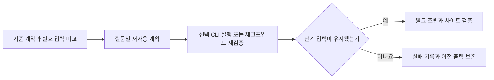

# 발행 입력과 실행 상태 확인

긴 모델 호출 전에 `build/publication-plan.json`을 확인하세요. 선택된 문서·질문, 원고 재사용 여부, 체크포인트 재검증 대상과 이유, 실제 CLI 선택, 입력 해시와 설정된 예산을 기록합니다. 이 계획은 기존 impact와 design_reuse의 결정을 설명하며 새 판정이나 사람 승인을 만들지 않습니다.



한 검증 단계에서는 읽은 파일 바이트와 YAML·JSON·frontmatter 해석을 재사용합니다. 호출자는 별도의 객체를 받으므로 반환값 수정이 다른 검사에 섞이지 않습니다. 게시·검토 프로필의 계약 범위·원고·번역·footer 내용과 영수증 디렉터리 비교는 계속 수행하며, 같은 입력의 계약 payload만 재사용합니다. 단계 종료와 사이트 반영 직전에 파일·입력 집합·메모리 모델의 변경을 검사합니다. 다음 단계는 빈 입력 저장소로 시작합니다. 설정이나 facts를 불러온 뒤 파일이 바뀌었다면 새로 불러와야 합니다.

성능을 위해 현재 정책 검사를 건너뛰지 않습니다. 계약 payload가 같더라도 정책 코드가 바뀌면 기존 검토는 stale 상태가 될 수 있습니다. 과거 정책에 묶인 영수증의 재검증과 현재 정책의 새 독립 검토를 구분하세요. 새 CLI 실행으로 만든 기록만 새 검토로 표시합니다.

## 기준 계약과 필수 보고서

발행용 복사 설정에는 선택적으로 `publication.baseline_config`를 지정합니다. 공통 코드는 특정 공개 프로젝트의 프로필을 강제하지 않습니다. 기준의 필수 질문·summary·필수 용어·출력 소유권과 용어집 항목이 누락되면 호출 전에 실패합니다. CLI 모델·인자 변경이나 사내 경로 자체는 누락으로 판정하지 않습니다. 의도적으로 바꾼 계약은 정확한 계약 키와 사유를 `allowed_contract_changes`에 적습니다. 모델 변경을 숨기거나 원래 질문을 삭제하기 위한 자동 허용 목록은 만들지 않습니다.

```yaml
publication:
  baseline_config: ./baseline/sdd.yaml
  operation_id: release-identifier
  allowed_contract_changes: {}
  shared_labels:
    특정 공통 문구:
      require: required-term
      reject: rejected-term
  reports:
    - path: reports/independent-review.json
      gate: before-export
      producer: independent-review
      sha256: <실제 보고서 SHA-256>
      bindings:
        status: passed
        input_sha256: <보고서가 검토한 실제 입력 SHA-256>
```

보고서는 `before-generation`, `before-export` 또는 패키지 조립기가 명시한 경계에서 검사합니다. 경로·생성 단계·내용 해시·상태와 입력 바인딩이 맞아야 합니다. 다른 단계의 보고서를 복사해서 경로만 맞추면 해시 또는 바인딩 검사에 실패합니다. 패키지 조립기는 복사 전에 `check_reports(cfg, gate)`를 호출해야 합니다. 선언되지 않은 임의의 외부 조립 스크립트까지 자동으로 검사한다는 뜻은 아닙니다.

카탈로그의 원문 키와 번역은 같은 placeholder를 같은 횟수로 가져야 합니다. 실제 표시 문장은 `display_pairs`의 치환 결과로 대조합니다. 템플릿의 `{{1}}`과 표시된 코드 이름을 그대로 비교하지 않습니다. 공통 `절 전체 근거` 레이블의 section→clause 퇴행도 호출 전과 export 전에 거절합니다.

## 진행과 복구

기존 그림의 생성 프로필을 유지하면서 다른 CLI로 번역하려면 `paths.translation_profile`에 별도 설정 파일을 지정합니다. 이 파일의 `agent`만 번역 호출에 적용하며 렌더링 입력·출력 경로와 기존 그림의 프로필은 발행 설정을 유지합니다. 실제 번역 영수증에는 선택한 CLI·모델·인자를 기록합니다.

`build/generation-runs/*.json`에는 단계별 시간, 현재 단계와 호출 tag, 완료·재사용·재검증·실패·미시작 수를 기록합니다. 긴 호출과 결정적 검증 중에도 30초 간격으로 갱신합니다. 문서 생성·번역·독립 검토는 각 기록을 유지합니다. 같은 `operation_id`의 누적 호출 수와 실행 시간 합을 별도로 집계합니다. 겹쳐 실행한 시간의 합은 실제 경과 시간과 다를 수 있습니다.

기존 `review`의 호출·시간 예산은 그대로 적용합니다. 작업 전체 예산이 별도로 승인됐다면 `publication.budget.max_calls`와 `max_seconds`에 명시합니다. 지정하지 않은 작업 전체 예산은 추가하지 않습니다. 같은 `operation_id`로 재개하면 완료·실패한 이전 호출도 작업 전체 예산에 포함합니다.

`build/execution-locks/*.json`과 OS 잠금으로 같은 작업의 중복 실행을 막습니다. 관측 도구의 대기 시간이 끝나도 살아 있는 실행을 다시 시작하지 않습니다. 이전 소유자가 사라져도 기록된 CLI worker가 살아 있으면 재시작을 거절합니다. 명시적인 CLI 실행 제한이나 사용자 중단이 발생하면 이 작업이 시작한 프로세스만 정리하고 실패 기록을 남깁니다. 다른 WSL 작업을 중단하지 않습니다. 재개할 때 완료된 체크포인트를 현재 근거·정책과 원본 영수증으로 다시 검사합니다.

입력 처리 흐름은 위 그림으로 설명했습니다. 기준 설정의 필드와 관측 파일은 짧은 참조 설명이므로 별도 그림을 생략합니다. 다음 단계는 [사이트 구성과 검증](site.md)을 따르세요.
