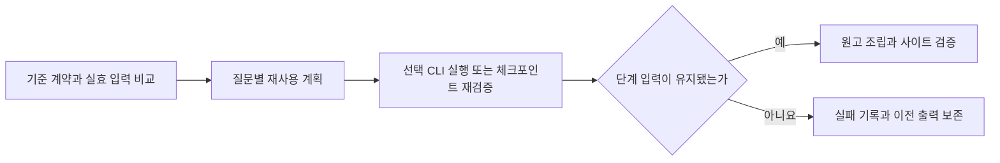
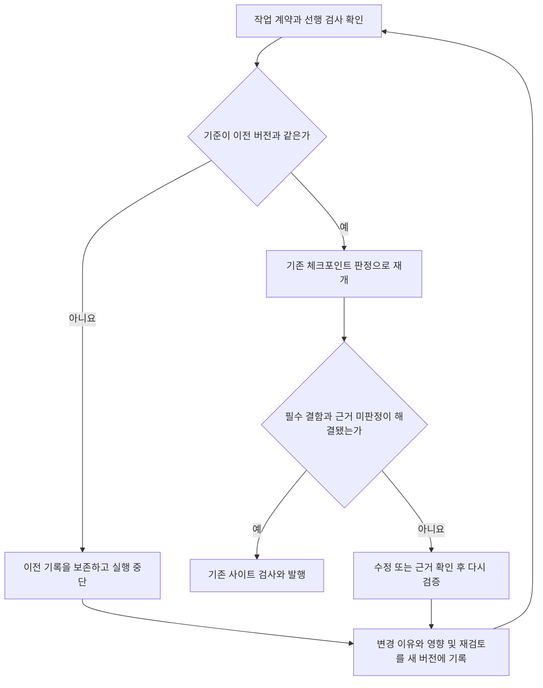

# 발행 입력과 실행 상태 확인

첫 병합 전 CI는 모듈 의존성·번역 전 표본 검사와 생성→번역→별도 프로필 검토→사이트 반영→저장 실패 복구를 연결한 통합 회귀를 전체 시험보다 먼저 실행합니다. 이 회귀의 CLI 프로세스는 명시적 대역이며 신규 모델 실행이나 사람 승인의 근거로 사용하지 않습니다. 실제 CLI 발행 시험과 원본 영수증은 별도로 남깁니다.

`python -m sdd.localization_cli --config <설정> --out <카탈로그> --translate`는 번역 호출 전에 임시 한국어 사이트의 생성된 다음 문서 연결·소스 커밋과 내부 링크·앵커·자산을 검사합니다. 실패하면 기존 원고·카탈로그를 유지하며 `generation-runs`의 `translation-preflight` 단계에 호출 0회와 원인을 기록합니다. 독립 검토 전 private preview의 보고서 링크는 명시적 pending 안내로 연결하며 통과 보고서나 현재 근거로 사용하지 않습니다. 최종 export는 기존 독립 보고서·영수증·내용·한영 검사를 그대로 적용합니다.

이 선행 검사는 독립 근거 대조나 최종 사이트 검증을 대신하지 않습니다. 아래 실행 흐름 그림에서 선택 CLI 실행 전에 수행하는 짧은 검사이므로 별도 그림은 생략합니다.

긴 모델 호출 전에 `build/publication-plan.json`을 확인하세요. 선택된 문서·질문, 원고 재사용 여부, 체크포인트 재검증 대상과 이유, 실제 CLI 선택, 입력 해시와 설정된 예산을 기록합니다. 이 계획은 기존 impact와 design_reuse의 결정을 설명하며 새 판정이나 사람 승인을 만들지 않습니다.



한 검증 단계에서는 읽은 파일 바이트와 YAML·JSON·frontmatter 해석을 재사용합니다. 호출자는 별도의 객체를 받으므로 반환값 수정이 다른 검사에 섞이지 않습니다. 게시·검토 프로필의 계약 범위·원고·번역·footer 내용과 영수증 디렉터리 비교는 계속 수행하며, 같은 입력의 계약 payload만 재사용합니다. 단계 종료와 사이트 반영 직전에 파일·입력 집합·메모리 모델의 변경을 검사합니다. 다음 단계는 빈 입력 저장소로 시작합니다. 설정이나 facts를 불러온 뒤 파일이 바뀌었다면 새로 불러와야 합니다.

성능을 위해 현재 정책 검사를 건너뛰지 않습니다. 계약 payload가 같더라도 정책 코드가 바뀌면 기존 검토는 stale 상태가 될 수 있습니다. 과거 정책에 묶인 영수증의 재검증과 현재 정책의 새 독립 검토를 구분하세요. 새 CLI 실행으로 만든 기록만 새 검토로 표시합니다.

## 기준 계약과 필수 보고서

발행용 복사 설정에는 선택적으로 `publication.baseline_config`를 지정합니다. 공통 코드는 특정 공개 프로젝트의 프로필을 강제하지 않습니다. 기준의 필수 질문·summary·필수 용어·출력 소유권과 용어집 항목이 누락되면 호출 전에 실패합니다. CLI 모델·인자 변경이나 사내 경로 자체는 누락으로 판정하지 않습니다. 의도적으로 바꾼 계약은 정확한 계약 키와 사유를 `allowed_contract_changes`에 적습니다. 모델 변경을 숨기거나 원래 질문을 삭제하기 위한 자동 허용 목록은 만들지 않습니다.

```yaml
publication:
  baseline_config: ./baseline/sdd.yaml
  operation_id: release-identifier
  allowed_contract_changes: {}
  shared_labels:
    특정 공통 문구:
      require: required-term
      reject: rejected-term
  reports:
    - path: reports/independent-review.json
      gate: before-export
      producer: independent-review
      sha256: <실제 보고서 SHA-256>
      bindings:
        status: passed
        input_sha256: <보고서가 검토한 실제 입력 SHA-256>
```

보고서는 `before-generation`, `before-export` 또는 패키지 조립기가 명시한 경계에서 검사합니다. 경로·생성 단계·내용 해시·상태와 입력 바인딩이 맞아야 합니다. 다른 단계의 보고서를 복사해서 경로만 맞추면 해시 또는 바인딩 검사에 실패합니다. 패키지 조립기는 복사 전에 `check_reports(cfg, gate)`를 호출해야 합니다. 선언되지 않은 임의의 외부 조립 스크립트까지 자동으로 검사한다는 뜻은 아닙니다.

카탈로그의 원문 키와 번역은 같은 placeholder를 같은 횟수로 가져야 합니다. 실제 표시 문장은 `display_pairs`의 치환 결과로 대조합니다. 템플릿의 `{{1}}`과 표시된 코드 이름을 그대로 비교하지 않습니다. 공통 `절 전체 근거` 레이블의 section→clause 퇴행도 호출 전과 export 전에 거절합니다.

## 진행과 복구

### 한 발행 작업의 계약과 변경 이력

`publication.operation_file`에 JSON 작업 계약을 지정하면 재개할 때 범위와 기준을 비교합니다. `operation_id`도 함께 지정하세요. 기존 설정에 이 필드를 추가하지 않아도 기존 CLI와 체크포인트 동작을 유지합니다. `operation_id`만 지정한 작업도 발행 계획의 과거 버전을 보존합니다.

```yaml
publication:
  operation_id: release-identifier
  operation_file: publication-operation.json
```

계약은 아래 필드를 가집니다. 생성·번역·검토의 프로필은 각각 `kind`, `runner`, `model`, `command`, `args`를 모두 선언합니다. 사내에서는 승인된 각 CLI 설정을 그대로 사용합니다.

| 필드 | 내용 |
|---|---|
| `schema`, `revision`, `reason` | schema는 1이며 revision은 1부터 연속으로 증가합니다. 최초 목적과 각 변경 이유를 기록합니다. |
| `sections`, `completion`, `excluded` | 대상 섹션 ID, 이 작업의 완료 조건, 명시적인 제외 범위를 문자열 목록으로 기록합니다. 질문은 현재 섹션 계약과 계획의 각 단위에 연결됩니다. 선택한 문서가 범위를 벗어나면 호출 전에 실패합니다. |
| `source_commit` | 이 작업이 사용할 facts·근거의 소스 커밋입니다. 새 커밋을 이전 검토와 섞지 않습니다. |
| `profiles` | `generation`, `translation`, `review`를 각각 선언합니다. 실제 단계의 CLI 식별자가 선언과 다르면 실패합니다. |
| `prerequisites` | 기존 필수 보고서와 같은 `path`, `gate`, `producer`, `sha256`, `bindings` 형식입니다. gate는 `before-generation`이며, 통합과 검증을 끝낸 실제 보고서를 먼저 검사합니다. 선행 변경이 없으면 빈 목록을 사용합니다. |
| `discoveries` | 발견별 `id`, `kind`, `status`, `reason`을 기록합니다. kind는 `required-defect`, `needs-evidence`, `follow-up`입니다. 필수 결함과 근거 미판정은 해결 전까지 사이트 발행을 막습니다. 비차단 후속 개선은 범위를 자동 확대하지 않습니다. |
| `integration` | 선택 필드이며 로컬 생성기 체크아웃의 `root`, 확인할 Git `ref`, 기대한 `commit`을 지정합니다. ref가 바뀌면 새 기준의 통합·검증과 변경 기록을 요구합니다. GitHub 또는 `origin/main`을 필수로 가정하지 않습니다. |
| `change` | revision 2부터 `kind`, `reason`, `affected_sections`, `recheck`를 기록합니다. kind는 `policy`, `input`, `integration`, `user-scope`, `defect` 중 하나입니다. recheck에는 필요한 재검토와 그 이유를 적습니다. |



공통 정책·검증기·렌더링 계약 변경을 먼저 통합하고 해당 검사 보고서를 준비한 뒤 대량 검토를 시작합니다. 실행 중 새로운 관련 변경을 발견하면 이전 계획과 원본 영수증을 보존하고 새 계약 버전에서 영향을 기록합니다. 이 절차는 다른 세션을 잠그거나 필요한 최신 검토를 생략하는 기능이 아닙니다. 알려진 정책 변경을 뒤늦게 적용하는 순서에서 생기는 중복 작업을 예방합니다.

`build/publication-operations/<작업 식별자 지문>/revisions/`에는 계약·입력 기준·이전 버전 지문을 보존합니다. `plans/`에는 실행 직전의 계획을 내용 지문별로 보존합니다. 파일 경로의 지문은 Windows 경로 길이를 줄인 접두사이며, 전체 식별자·SHA-256과 내용은 기록 안에서 대조합니다. 기존 `build/publication-plan.json`은 최신 계획을 가리키는 용도로 유지합니다. `generation-runs`는 실행이 따른 계약 버전과 계획 파일을 연결하며 기존 호출·단위 집계의 의미는 바꾸지 않습니다.

계약의 완료 조건과 발견 분류는 작업자의 명시적인 기록입니다. 자동으로 사람 승인이나 의미상 해결을 부여하지 않으며, 실제 생성·번역·독립 검토·배포 증거는 기존 검사와 원본 영수증으로 따로 확인해야 합니다. 필요한 재사용 판정과 실패 원인 진단도 기존 경로의 책임입니다.

기존 그림의 생성 프로필을 유지하면서 다른 CLI로 번역하려면 `paths.translation_profile`에 별도 설정 파일을 지정합니다. 이 파일의 `agent`만 번역 호출에 적용하며 렌더링 입력·출력 경로와 기존 그림의 프로필은 발행 설정을 유지합니다. 실제 번역 영수증에는 선택한 CLI·모델·인자를 기록합니다.

`build/generation-runs/*.json`에는 단계별 시간, 현재 단계와 호출 tag, 완료·재사용·재검증·실패·미시작 수를 기록합니다. 긴 호출과 결정적 검증 중에도 30초 간격으로 갱신합니다. 문서 생성·번역·독립 검토는 각 기록을 유지합니다. 같은 `operation_id`의 누적 호출 수와 실행 시간 합을 별도로 집계합니다. 겹쳐 실행한 시간의 합은 실제 경과 시간과 다를 수 있습니다.

기존 `review`의 호출·시간 예산은 그대로 적용합니다. 작업 전체 예산이 별도로 승인됐다면 `publication.budget.max_calls`와 `max_seconds`에 명시합니다. 지정하지 않은 작업 전체 예산은 추가하지 않습니다. 같은 `operation_id`로 재개하면 완료·실패한 이전 호출도 작업 전체 예산에 포함합니다.

`build/execution-locks/*.json`과 OS 잠금으로 같은 작업의 중복 실행을 막습니다. 관측 도구의 대기 시간이 끝나도 살아 있는 실행을 다시 시작하지 않습니다. 이전 소유자가 사라져도 기록된 CLI worker가 살아 있으면 재시작을 거절합니다. 명시적인 CLI 실행 제한이나 사용자 중단이 발생하면 이 작업이 시작한 프로세스만 정리하고 실패 기록을 남깁니다. 다른 WSL 작업을 중단하지 않습니다. 재개할 때 완료된 체크포인트를 현재 근거·정책과 원본 영수증으로 다시 검사합니다.

입력 처리 흐름은 위 그림으로 설명했습니다. 기준 설정의 필드와 관측 파일은 짧은 참조 설명이므로 별도 그림을 생략합니다. 다음 단계는 [사이트 구성과 검증](site.md)을 따르세요.

산출물 저장을 시작하면 같은 작업의 계약 버전 채택과 저장·복구를 하나의 짧은 구간으로 보호합니다. 같은 작업 공간의 다른 발행 작업도 이 저장 구간을 동시에 통과하지 못합니다. 잠금은 소스 저장소나 병행 세션에 적용하지 않으며, 저장 전 CLI 생성·검토는 계속 병행할 수 있습니다. 최종 실행 기록을 저장하지 못하면 이 작업이 쓴 원고와 사이트를 복구합니다.
