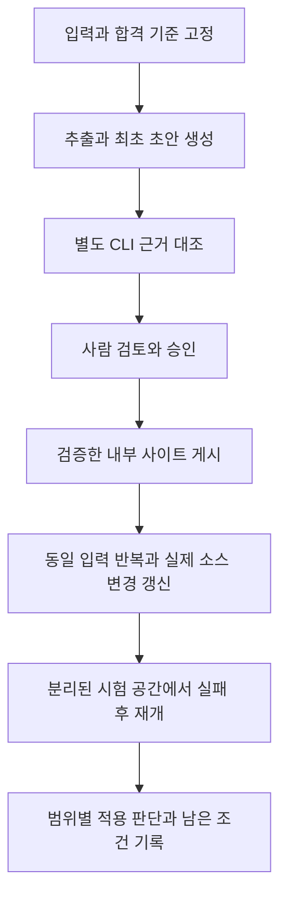

# 제품 하나의 적용 가능성 검증

**실행 전에 사내 설정 저장소의 `handoff.md`에 대상과 합격 기준을 고정하세요.** 제품 하나·빌드 변형 하나·요청 경로 하나를 검증하며, 결과를 다른 제품이나 실기기 경로로 확대하지 않습니다. 실제 입력이 없으면 준비 상태로 남기고 사내 적용 가능 여부는 판단 보류로 기록합니다.

## 실행 전에 고정할 것

[인수인계 양식](../../examples/inhouse-template/handoff.md)의 범위·사전 합격 기준을 승인된 내부 위치에서 채웁니다. 소스·제품 정보·참가자 정보와 파생 facts·원고·프롬프트·로그를 공개 채팅이나 이슈에 올리지 않습니다.

| 고정할 입력 | 확인할 내용 |
|---|---|
| 소스와 빌드 | 기준 SHA, 분석 체크아웃, 제품·ABI·변형, 실제 DB 생성 명령, 생성 헤더와 매크로, 포함·제외 TU를 기록합니다. NDK-build는 해당 제품이 사용할 때만 켭니다. |
| 요청 경로와 질문 | 실제 제출 진입점 → 처리 → 결과 반환과 정지·오류 경계를 정합니다. 질문 ID, 필수 조건·예외와 대상 문서·그림을 연결합니다. 정적으로 추적하지 못한 큐·콜백과 미검증 장치를 남깁니다. |
| 실행 설정 | 생성·번역 설정과 별도 근거 검토 설정의 최종 `kind`·`runner`·`command`·`model`·`args`, 버전·설정 해시를 각각 기록합니다. [CLI 선택 안내](cli-agents.md)에 따라 로컬 덮어쓰기까지 확인합니다. |
| 저장·게시·검토 | 허용된 내부 작업·백업·코드 링크·자산·게시 위치, 승인 정책과 사람 검토 담당자를 정합니다. 게시 위치가 없으면 로컬 초안까지만 진행합니다. |
| 비교할 시험 | 동일 입력 반복의 동일성, 실제 소스 변경 하나의 예상 영향·영향 밖 문서, 분리된 시험 공간의 CLI 실패 또는 중단 지점과 재개 기준을 실행 전에 적습니다. |

이 표는 입력 목록이므로 별도 그림을 생략합니다. 실제 사내 값과 사전 기준을 기록하기 전에는 실행 완료로 표시하지 않습니다.

## 실행과 증거 연결

첫 초안, 독립 근거 대조, 사람 승인과 게시본을 같은 입력·본문 해시로 연결합니다. 실패하면 그 단계에서 멈추고 직전 정상 출력을 보존합니다.

그림은 검증 순서입니다. 각 단계의 합격 증거가 있어야 다음 단계의 완료를 인정합니다. 사람 검토 대기 중에도 분리된 공간에서 반복·실패 시험을 준비할 수 있지만, 승인·게시 완료로 표시하지 않습니다.

| 단계 | 실행·대조할 증거 |
|---|---|
| 최초 생성 | [패키지 실행 순서](package.md#실행-순서)의 DB → doctor → extract → 계약 → generate → audit-docs를 수행합니다. 명령·종료 코드, SHA·DB·헤더·facts 지문, 질문별 원고·그림과 실제 CLI 영수증을 보관합니다. `doctor`의 설치 확인은 모델 호출 성공이 아닙니다. |
| 독립 근거 대조 | 생성과 별도로 승인된 검토 CLI를 실행합니다. 고정 SHA의 실제 소스 창, 질문별 최종 설명·그림, 조건·예외·수명·분기와 미검토 범위를 전달합니다. 검토 요청·원응답·실행 인자·종료 코드·입출력 해시와 판정을 보관합니다. 생성 중 같은 프로필의 자동 grounding을 별도 독립 실행으로 계산하지 않습니다. |
| 사람 검토·내부 게시 | [사람 검토](04-review.md)와 [품질 기준](package.md#품질-합격-기준)을 적용합니다. 사람이 지정한 범위만 `accept`로 기록하고 승인 본문 해시를 확인합니다. 승인 정책을 적용한 `export-site` → `verify-site` 후 허용된 내부 위치에 게시합니다. `verify-publication --url <내부 주소> --site <로컬 사이트>`로 manifest와 전체 산출물을 대조합니다. |
| 동일 입력 반복 | 소스·DB·헤더·설정·정책·CLI가 같은지 확인하고 같은 생성·사이트 명령을 반복합니다. 원고 본문·승인 장부, 파일별 해시·manifest, 새 호출·검증 후 재사용 기록을 전후 비교합니다. 실행 시각 등 달라지는 감사 기록은 문서 동일성과 구분합니다. |
| 실제 변경 갱신 | 실행 전 적은 예상 영향과 `impact.json` schema 1의 실제 영향·재생성 문서를 비교합니다. [갱신 절차](03-update-system.md)에 따라 DB·헤더도 해당 커밋으로 갱신합니다. 영향 밖 본문·승인 보존과 변경 본문의 재검토 상태를 대조하고, 새 근거 대조·사람 검토·게시를 필요한 범위에 수행합니다. |
| 실패·재개 | 운영 원본과 분리한 소스·설정·출력·상태 사본에서 지정 CLI의 대표 실패 또는 중단을 재현합니다. 정상 원고·사이트·승인 장부의 전후 해시, 실패 로그·실패 SHA·`last_done`을 보존합니다. 원인을 수정한 뒤 같은 설정·기준으로 재개하고 성공 SHA·영향 문서·승인 상태를 대조합니다. 다른 CLI·직접 API·저장 응답·수동 원고로 실패를 대체하지 않습니다. |

독립 검토가 실패하거나 사람이 없으면 해당 단계는 미완료입니다. 원고를 다시 생성하면 기존 검토가 새 본문을 다루는지 다시 확인합니다. `update`의 성공만으로 새 원고의 사람 승인과 게시를 인정하지 않습니다. 복구는 [공통 복구 절차](troubleshooting.md#공통-복구-절차)를 따르며 상태·장부를 삭제하지 않습니다.

## 범위별 판단과 재개

`handoff.md`에 적용 가능·조건부 가능·적용 불가 중 하나와 그 근거를 적습니다. 유효한 실제 시험에서 확인한 적용 불가도 검증 결과입니다. 입력 부재나 실행 환경 부재는 적용 불가의 증거가 아니므로 판단 보류로 남깁니다.

미충족 단계마다 원인·직전 정상 결과·보존 증거·필요한 입력 또는 담당자·정확한 재개 명령을 연결합니다. 실기기·다른 빌드·장치·요청 경로와 실제 독자 효과 중 수행하지 않은 범위도 적습니다. 이 절은 판단 기록의 짧은 지침이므로 별도 그림을 생략합니다.

다음 단계: 승인된 내부 위치의 [인수인계 양식](../../examples/inhouse-template/handoff.md)을 채우세요.
