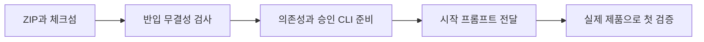

# 사내 Camera HAL 셋업 · 2026-11-12

**아래 반입 ZIP과 체크섬을 받아 새 폴더에서 검증한 뒤 `START_PROMPT.txt`를 사내 에이전트에게 전달하세요.** Hermes를 선택했다면 `START_PROMPT_HERMES.txt`를 사용합니다. 스킬을 별도로 설치하지 않아도 시작할 수 있습니다.

이 릴리스는 공개 생성기·가이드·스킬·템플릿을 묶은 사내 반입본입니다. 실제 사내 HAL 추출이나 사내 모델 호출을 완료했다는 뜻은 아닙니다.

## 다운로드

| 파일 | 용도 |
|---|---|
| [camera-hal-sdd-inhouse-2026-11-12.zip](https://github.com/TTolsun/camera-hal-sdd-generator/releases/download/inhouse-2026-11-12/camera-hal-sdd-inhouse-2026-11-12.zip) | 생성기·스킬 v11·설정 템플릿·가이드와 시작 프롬프트를 함께 반입합니다. |
| [ZIP 체크섬](https://github.com/TTolsun/camera-hal-sdd-generator/releases/download/inhouse-2026-11-12/camera-hal-sdd-inhouse-2026-11-12.zip.sha256) | 압축 해제 전에 ZIP의 SHA-256을 대조합니다. |
| [START_PROMPT.txt](https://github.com/TTolsun/camera-hal-sdd-generator/releases/download/inhouse-2026-11-12/START_PROMPT.txt) · [Hermes 선택본](https://github.com/TTolsun/camera-hal-sdd-generator/releases/download/inhouse-2026-11-12/START_PROMPT_HERMES.txt) | 사내 경로·제품·승인된 CLI와 허용 범위를 채웁니다. ZIP 안에도 같은 파일이 있습니다. |
| [RELEASE_NOTES.md](https://github.com/TTolsun/camera-hal-sdd-generator/releases/download/inhouse-2026-11-12/RELEASE_NOTES.md) | 이 설치 안내를 사내에 보관합니다. |
| [release-validation.json](https://github.com/TTolsun/camera-hal-sdd-generator/releases/download/inhouse-2026-11-12/release-validation.json) · [SHA256SUMS.txt](https://github.com/TTolsun/camera-hal-sdd-generator/releases/download/inhouse-2026-11-12/SHA256SUMS.txt) | 기준 SHA·시험 범위·공개 배포 확인과 첨부 파일 해시를 확인합니다. |

GitHub가 아래에 자동 표시하는 `Source code (zip)`과 `Source code (tar.gz)`는 반입 패키지가 아닙니다. 전용 ZIP에는 파일별 manifest와 사내 작업용 `AGENTS.md`가 들어 있습니다. 정확한 버전은 `IMPORT-MANIFEST.json`의 `source_commit`으로 확인합니다.

## 처음 설치하기

1. 같은 릴리스의 ZIP과 체크섬을 받습니다. [해시 검사 명령](package.md#github에서-받기)으로 대조하고 새 폴더에 압축을 풉니다. Windows에서는 짧은 경로와 긴 경로를 지원하는 압축 도구를 사용합니다.
2. Python 3.11 이상으로 **설치·파일 수정 전에** 생성기 루트에서 `python tools/verify_import.py`를 실행합니다. 종료 코드 0과 `source_commit`·`verified_files`를 기록합니다.
3. [의존성 준비 절차](package.md#무엇이-들어-있고-무엇을-따로-준비합니까)에 따라 대상 OS·CPU·Python에 맞는 wheel을 반입하여 별도 가상 환경에 설치합니다. ZIP에는 wheel·제품 툴체인·CLI·모델·인증·Mermaid 배포본이 없습니다. `uv`와 사내 GitHub·공개 CDN 접속은 필수가 아닙니다.
4. ZIP 안의 시작 프롬프트에 생성기 절대 경로와 아는 환경 값을 채워 사내 에이전트에게 전달합니다. 스킬 v11은 [반입 확인 → 제품 설정 → 생성·검토 → 사이트 검증](package.md#실행-순서)을 수행하며, 찾을 수 없는 필수 정보만 질문합니다.
5. 실제 제품 소스와 빌드 근거로 검증하고 [handoff.md](../../examples/inhouse-template/handoff.md)에 완료·미완료·재개 명령을 남깁니다. 게시와 예약은 허용된 사내 대상·범위에서만 수행합니다.

위 순서는 파일을 받는 단계와 실제 제품 검증을 구분합니다. 무결성 검사는 설치 전에 끝내고, 실제 모델 호출은 승인된 CLI 설정을 확인한 뒤 수행합니다.

## CLI 선택과 스킬 변경

Hermes·OpenCode·Claude Code·Codex 중 사내에서 승인하고 선택한 CLI를 독립 실행합니다. 기존 선택을 유지하며 공개 Codex/Terra High 예시를 사내 필수 조건으로 강제하지 않습니다. 실행기를 바꿀 때 `runner`·`command`·`model`·`args`를 함께 바꿉니다. 모델·제공자·추론 강도는 [CLI 선택 안내](cli-agents.md)에 따라 설정합니다.

| 이번 반입본에서 바뀐 점 | 셋업에 미치는 영향 |
|---|---|
| 범용·Hermes 프롬프트를 같은 안내 원문에서 생성하고 ZIP에 넣습니다. | 릴리스 첨부 사본과 ZIP 안의 파일이 같습니다. Hermes 선택본은 CLI 한 줄만 다릅니다. |
| 스킬 v11이 반입 검사와 별도 준비 항목을 먼저 확인합니다. | 스킬만 설치하고 생성기·가이드·의존성이 없는 상태를 셋업 완료로 표시하지 않습니다. |
| 최종 문서의 독립 질문별 그림 검토를 명시합니다. | 그림 ID 또는 생략 사유, 소스 창·입력 지문·미검토 범위를 남깁니다. 원고와 최종 사이트 판정을 구분합니다. |
| 장시간 작업의 감시와 재개 절차를 연결합니다. | 기준 커밋·build_id·항목별 판정·남은 발행 단계를 보존하고 동일 입력이 확인된 결과만 재사용합니다. |

이 ZIP은 이전 [11월 4일 반입본](https://github.com/TTolsun/camera-hal-sdd-generator/releases/tag/inhouse-2026-11-04) 이후 main에 병합된 생성기 수정도 포함합니다. 전체 변경은 [두 릴리스 비교](https://github.com/TTolsun/camera-hal-sdd-generator/compare/inhouse-2026-11-04...inhouse-2026-11-12)에서 확인합니다. 공개 libcamera용 설정·검토 기록은 참고 자료이며 사내 제품의 판정이나 승인으로 옮기지 않습니다.

## 업그레이드와 검증 범위

기존 설정·facts·원고·호출 기록·상태·승인 장부·정상 사이트를 함께 보존하고 새 ZIP은 별도 폴더에 풉니다. 설치된 스킬도 새 생성기와 같은 커밋으로 바꾸고 연결된 생성기 절대 경로를 갱신합니다. 복구할 때는 이전 생성기·설정·산출물·상태를 함께 사용합니다.

`release-validation.json`에서 실제로 수행한 테스트, CI, 반복 패키징과 압축 해제·CLI 검증을 확인합니다. 테스트 대역과 공개 mini HAL 결과는 새 사내 모델 호출이나 실제 사내 HAL 검증을 대신하지 않습니다. CLI가 없거나 실패하면 해당 원인과 미완료 단계를 보고하며 다른 CLI·직접 API·저장 응답·수동 원고로 대체해 성공으로 표시하지 않습니다.

이번 셋업 안내·스킬·패키징 변경은 공개 SDD의 원고·집필 규칙·사이트 생성 코드를 바꾸지 않습니다. 기존 Pages와 공개 산출물은 따로 확인하며 이 변경 때문에 빈 배포 커밋을 만들지 않습니다. 실제 사내 소스·제품 빌드·승인 모델·사내 게시·사람 승인·실기기 시험은 해당 환경에서 남아 있는 검증 단계입니다. 사내 소스와 파생 설정·facts·원고·프롬프트·로그는 사내에 보관합니다.

다음 단계: [반입 패키지 시작 안내](package.md)를 열고 무결성 검사부터 수행하세요.
