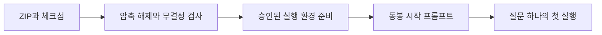

# 사내 Camera HAL 반입 · 2026-11-14 · 스킬 v12

**반입 ZIP과 체크섬을 받아 새 폴더에서 검증한 뒤, 동봉한 시작 프롬프트를 사내 에이전트에게 전달하세요.** 이번 반입본은 스킬 v12와 같은 커밋의 생성기·가이드·템플릿을 묶습니다. 질문 하나로 실행 계획과 한도를 확인하고, 실패하면 원본 증거와 장부를 보존한 채 재개하도록 안내합니다.

## 다운로드와 설치

| 파일 | 용도 |
|---|---|
| [camera-hal-sdd-inhouse-2026-11-14.zip](https://github.com/TTolsun/camera-hal-sdd-generator/releases/download/inhouse-2026-11-14/camera-hal-sdd-inhouse-2026-11-14.zip) · [ZIP 체크섬](https://github.com/TTolsun/camera-hal-sdd-generator/releases/download/inhouse-2026-11-14/camera-hal-sdd-inhouse-2026-11-14.zip.sha256) | 같은 커밋의 생성기·스킬 v12·가이드·설정 템플릿을 반입합니다. |
| [START_PROMPT.txt](https://github.com/TTolsun/camera-hal-sdd-generator/releases/download/inhouse-2026-11-14/START_PROMPT.txt) · [Hermes 선택본](https://github.com/TTolsun/camera-hal-sdd-generator/releases/download/inhouse-2026-11-14/START_PROMPT_HERMES.txt) | 사내 경로와 승인된 생성·검토 CLI를 채웁니다. ZIP 안에도 같은 파일이 있습니다. |
| [RELEASE_NOTES.md](https://github.com/TTolsun/camera-hal-sdd-generator/releases/download/inhouse-2026-11-14/RELEASE_NOTES.md) | 설치 안내와 변경 내용을 사내에 보관합니다. |
| [release-validation.json](https://github.com/TTolsun/camera-hal-sdd-generator/releases/download/inhouse-2026-11-14/release-validation.json) · [SHA256SUMS.txt](https://github.com/TTolsun/camera-hal-sdd-generator/releases/download/inhouse-2026-11-14/SHA256SUMS.txt) | 정확한 기준 SHA·시험 결과·검증 범위와 첨부 파일 해시를 대조합니다. |

GitHub의 자동 `Source code (zip)` 대신 위 전용 ZIP을 사용하세요. 체크섬을 대조한 뒤 짧은 경로에 압축을 풀고, **의존성 설치나 파일 수정 전에** 생성기 루트에서 `python tools/verify_import.py`를 실행합니다. 종료 코드 0, `source_commit`, `verified_files`를 기록합니다.

그림은 파일 반입과 실제 제품 검증 사이의 순서를 보여 줍니다. 무결성 검사를 마친 뒤 [의존성 준비](package.md#무엇이-들어-있고-무엇을-따로-준비합니까)와 [첫 실행](02-first-run.md)을 진행합니다. Python wheel·제품 툴체인·CLI·인증·모델·Mermaid 자산은 ZIP에 포함되지 않으며, 승인된 사내 환경에 맞게 별도로 준비합니다.

## 이전 반입본과 달라진 점

| 변경 | 사용 방법 |
|---|---|
| 스킬 v12에 첫 실행·재개 절차와 흐름도를 추가했습니다. | 제품·빌드 변형·요청 경로 하나의 질문부터 검증합니다. |
| 계획 전에 호출·시간 한도를 확인합니다. | `generate --plan-only`로 범위와 실제 실행 설정을 확인하고, 설정·한도 변경 후에는 계획을 다시 확인합니다. |
| 실행별 한도와 누적 예산 소진을 구분합니다. | 누적 예산이 소진되면 추가 작업·예산이 승인된 경우에만 같은 작업 ID에서 예산을 조정합니다. 승인되지 않았으면 남은 일을 기록하고 멈춥니다. |
| 범용·Hermes 시작 프롬프트에 첫 실행 절차를 연결했습니다. | 두 파일은 같은 안내 원문에서 자동 생성됩니다. 기존 11월 13일판의 `START_PROMPT_ISSUE251.txt`는 해당 릴리스에 보존하며 이번 ZIP에는 넣지 않습니다. |

이전 기준은 [11월 13일 반입본](https://github.com/TTolsun/camera-hal-sdd-generator/releases/tag/inhouse-2026-11-13)입니다. [전체 변경 비교](https://github.com/TTolsun/camera-hal-sdd-generator/compare/inhouse-2026-11-13...inhouse-2026-11-14)에서 공개 libcamera 예제·검토 기록의 변경도 확인할 수 있습니다. 이번 릴리스 준비 자체는 공통 생성기와 공개 SDD의 집필 규칙·생성 입력을 바꾸지 않습니다.

## 업그레이드와 검증 범위

기존 설정·facts·원고·CLI 기록·승인 장부·정상 사이트를 보존하고 새 ZIP을 별도 폴더에 풉니다. 스킬만 덮어쓰지 말고 생성기와 스킬의 경로를 함께 갱신합니다. 복구할 때도 이전 생성기·설정·산출물·상태를 함께 사용합니다.

이번 패키지의 반복 생성, 무결성, 압축 해제 후 실행과 CI 결과는 첨부 `release-validation.json`에 기록합니다. 공개 mini HAL의 모델 없는 고정 계약 시험과 새 실제 CLI 모델 호출을 구분하며, 이번 릴리스를 실제 사내 HAL·사내 모델·실기기·사람 승인·사내 게시 검증 완료로 해석하지 않습니다.

생성·번역과 별도 근거 대조에는 사내에서 승인한 Hermes·OpenCode·Claude Code·Codex 설정을 각각 사용합니다. CLI 누락·실패를 다른 CLI·직접 API·저장 응답·수동 원고로 대체해 성공으로 표시하지 않습니다. 사내 소스와 파생 facts·원고·프롬프트·로그는 사내에 보관합니다.

다음 단계: [반입 패키지 시작 안내](package.md)에서 무결성 검사부터 수행하세요.
