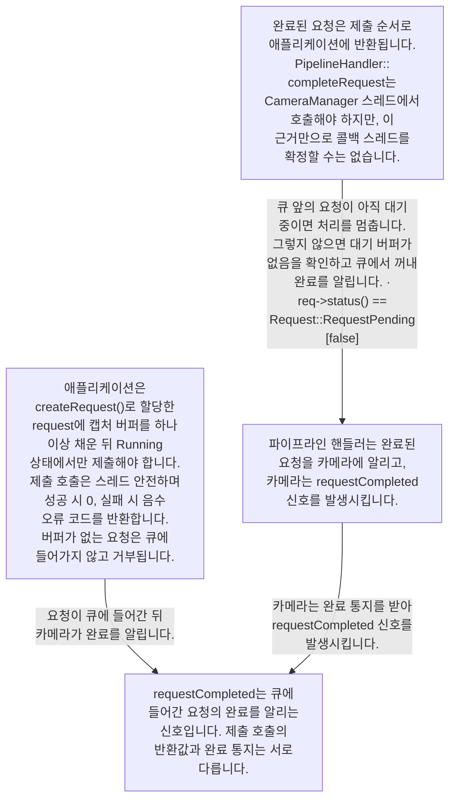
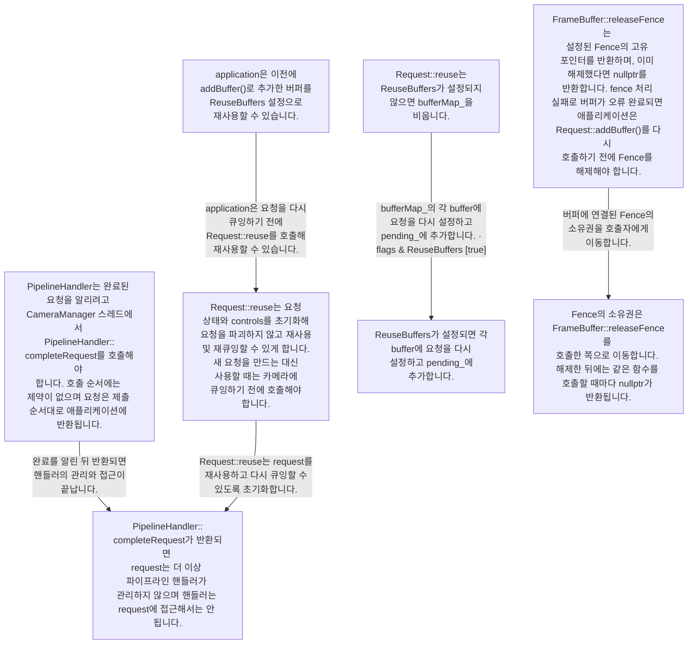

# 요청 완료와 버퍼 수명

**촬영 정지와 요청·버퍼 수명에 관한 연동 계약을 확인하세요.**

| 지금 확인할 내용 | 이동할 절 |
|---|---|
| 제출할 때 애플리케이션은 `createRequest()`로 할당한 요청에 캡처 버퍼를 하나 이상 채워야 하며, 버퍼가 없는 요청은 큐에 들어가지 않고 거부됩니다. | [제출·완료·정지](#제출완료정지) |
| 애플리케이션은 새 요청을 만드는 대신 `Request::reuse()`로 요청을 재사용할 수 있으며, 다시 카메라에 큐에 넣기 전에 이 함수를 호출해야 합니다. | [요청과 버퍼 수명](#요청과-버퍼-수명) |

## 제출·완료·정지

제출할 때 애플리케이션은 `createRequest()`로 할당한 요청에 캡처 버퍼를 하나 이상 채워야 하며, 버퍼가 없는 요청은 큐에 들어가지 않고 거부됩니다. 요청 제출은 카메라가 Running 상태일 때만 호출할 수 있고, 성공하면 0, 실패하면 음수 오류 코드를 반환합니다. 큐에 들어간 요청의 완료는 `requestCompleted` 시그널로 통지됩니다. `src/libcamera/camera.cpp:1308`

<!-- sdd:visual:request-flow -->
### 요청 제출과 결과 통지



[Mermaid 원문](vendor-contract.request-flow.mmd)

??? note "그림 근거와 확인 범위"
    요청 제출의 반환과 결과 통지를 구분해 호출·큐·콜백의 연결을 보여 주세요. 정적 호출 목록만으로 실행 순서나 콜백 스레드를 확정하지 마세요.
    
    소스에 연결한 설계 해석입니다. 자동 연결 검사는 의미 승인이나 기기 실행 검증이 아닙니다.
    
    LLM 그림 초안 · 사람 검토 전
    
    작성 모델: `cli/codex/gpt-6.1-terra`
    
    | 요소·전이 | 소스 근거 |
    |---|---|
    | <span data-sdd-label-en="The application must fill a request allocated with createRequest() with at least one capture buffer and submit it only in the Running state. The submission call is thread-safe and returns 0 on success or a negative error code on failure. A request without buffers is rejected without being queued.">애플리케이션은 createRequest&#40;&#41;로 할당한 request에 캡처 버퍼를 하나 이상 채운 뒤 Running 상태에서만 제출해야 합니다. 제출 호출은 스레드 안전하며 성공 시 0, 실패 시 음수 오류 코드를 반환합니다. 버퍼가 없는 요청은 큐에 들어가지 않고 거부됩니다.</span> | [src/libcamera/camera.cpp:1308](#source-010d3fed3b0ea81f) |
    | <span data-sdd-label-en="requestCompleted is the signal that reports completion of a queued request. The submission call&#x27;s return value and the completion notification are distinct.">requestCompleted는 큐에 들어간 요청의 완료를 알리는 신호입니다. 제출 호출의 반환값과 완료 통지는 서로 다릅니다.</span> | [src/libcamera/camera.cpp:1308](#source-010d3fed3b0ea81f) |
    | <span data-sdd-label-en="Completed requests are returned to the application in submission order. PipelineHandler::completeRequest must be called from the CameraManager thread, but this evidence alone does not establish the callback thread.">완료된 요청은 제출 순서로 애플리케이션에 반환됩니다. PipelineHandler::completeRequest는 CameraManager 스레드에서 호출해야 하지만, 이 근거만으로 콜백 스레드를 확정할 수는 없습니다.</span> | [src/libcamera/pipeline_handler.cpp:571](#source-42c919763b1cba9c) |
    | <span data-sdd-label-en="The pipeline handler notifies the camera of a completed request, and the camera emits the requestCompleted signal.">파이프라인 핸들러는 완료된 요청을 카메라에 알리고, 카메라는 requestCompleted 신호를 발생시킵니다.</span> | [src/libcamera/camera.cpp:1431](#source-d7e4c04042a7214c) · [src/libcamera/pipeline_handler.cpp:571](#source-42c919763b1cba9c) |
    | <span data-sdd-label-en="Once the request has been queued, the camera reports its completion.">요청이 큐에 들어간 뒤 카메라가 완료를 알립니다.</span> | [src/libcamera/camera.cpp:1308](#source-010d3fed3b0ea81f) |
    | <span data-sdd-label-en="If the request at the front of the queue is still pending, processing stops. Otherwise, the handler checks that it has no pending buffers, removes it from the queue, and reports its completion. · req-&gt;status() == Request::RequestPending [false]">큐 앞의 요청이 아직 대기 중이면 처리를 멈춥니다. 그렇지 않으면 대기 버퍼가 없음을 확인하고 큐에서 꺼내 완료를 알립니다. · req-&gt;status&#40;&#41; == Request::RequestPending &#91;false&#93;</span> | [src/libcamera/pipeline_handler.cpp:571](#source-42c919763b1cba9c) |
    | <span data-sdd-label-en="The camera receives the completion notification and emits the requestCompleted signal.">카메라는 완료 통지를 받아 requestCompleted 신호를 발생시킵니다.</span> | [src/libcamera/camera.cpp:1431](#source-d7e4c04042a7214c) |
<!-- /sdd:visual:request-flow -->

완료 시 파이프라인 핸들러는 `CameraManager` 스레드에서 `PipelineHandler::completeRequest()`를 호출해야 하며, 이 함수가 반환된 뒤에는 해당 요청에 접근해서는 안 됩니다. 핸들러는 완료된 요청을 순서 제약 없이 전달할 수 있고, 함수는 요청이 제출 순서대로 애플리케이션에 반환되도록 합니다. 구현에서는 요청 상태를 완료로 갱신한 뒤 큐 앞에서 대기 중인 요청을 만나면 순회를 멈추고, 그 전에 완료된 요청은 `Camera::requestComplete()`로 통지합니다. `src/libcamera/pipeline_handler.cpp:571`, `src/libcamera/request.cpp:119`, `src/libcamera/camera.cpp:1431`

정지할 때 `Camera::stop()`은 캡처와 요청 처리를 즉시 멈추며, 대기 중인 모든 요청은 취소되어 오류 상태로 동기적으로 완료됩니다. 호출자는 카메라 상태에 영향을 주는 다른 함수와 이 호출을 동기화해야 하며, 카메라가 실행 중이 아니면 호출은 아무 작업도 하지 않습니다. `PipelineHandler::stop()` 구현은 기다리는 요청을 따로 보관하고 `stopDevice()`를 호출한 뒤, 그 요청들을 취소하고 `doQueueRequest()`에 전달합니다. `src/libcamera/camera.cpp:1431`, `src/libcamera/pipeline_handler.cpp:359`

근거 원문: [src/libcamera/camera.cpp:1308](#source-010d3fed3b0ea81f) · [src/libcamera/camera.cpp:1431](#source-d7e4c04042a7214c) · [src/libcamera/pipeline_handler.cpp:359](#source-157b13c64bf3b261) · [src/libcamera/pipeline_handler.cpp:571](#source-42c919763b1cba9c) · [src/libcamera/request.cpp:119](#source-867f8a720f885d0a)

## 요청과 버퍼 수명

애플리케이션은 새 요청을 만드는 대신 `Request::reuse()`로 요청을 재사용할 수 있으며, 다시 카메라에 큐에 넣기 전에 이 함수를 호출해야 합니다. `ReuseBuffers`를 설정하면 이전에 `addBuffer()`로 요청에 추가한 버퍼를 재사용할 수 있습니다. `src/libcamera/request.cpp:376`

<!-- sdd:visual:buffer-ownership -->
### 요청과 버퍼를 유지할 기간



[Mermaid 원문](vendor-contract.buffer-ownership.mmd)

??? note "그림 근거와 확인 범위"
    실제 소스가 정한 요청·버퍼·fence의 소유자와 참조·반환·재사용 경계를 보여 주세요. 제공되지 않은 객체나 안전성 보장을 추가하지 마세요.
    
    소스에 연결한 설계 해석입니다. 자동 연결 검사는 의미 승인이나 기기 실행 검증이 아닙니다.
    
    LLM 그림 초안 · 사람 검토 전
    
    작성 모델: `cli/codex/gpt-6.1-terra`
    
    | 요소·전이 | 소스 근거 |
    |---|---|
    | <span data-sdd-label-en="PipelineHandler must call PipelineHandler::completeRequest on the CameraManager thread to report a completed request. Calls have no ordering constraint, and requests are returned to the application in submission order.">PipelineHandler는 완료된 요청을 알리려고 CameraManager 스레드에서 PipelineHandler::completeRequest를 호출해야 합니다. 호출 순서에는 제약이 없으며 요청은 제출 순서대로 애플리케이션에 반환됩니다.</span> | [src/libcamera/pipeline_handler.cpp:571](#source-42c919763b1cba9c) |
    | <span data-sdd-label-en="Once PipelineHandler::completeRequest returns, request is no longer managed by the pipeline handler, and the handler must not access it.">PipelineHandler::completeRequest가 반환되면 request는 더 이상 파이프라인 핸들러가 관리하지 않으며 핸들러는 request에 접근해서는 안 됩니다.</span> | [src/libcamera/pipeline_handler.cpp:571](#source-42c919763b1cba9c) |
    | <span data-sdd-label-en="The application can reuse buffers previously added with addBuffer() by setting ReuseBuffers.">application은 이전에 addBuffer&#40;&#41;로 추가한 버퍼를 ReuseBuffers 설정으로 재사용할 수 있습니다.</span> | [src/libcamera/request.cpp:376](#source-e999bc2d14c7955d) |
    | <span data-sdd-label-en="Request::reuse resets the request status and controls so the request can be reused and requeued without destruction. When used instead of constructing a new request, it must be called before queueing the request to the camera.">Request::reuse는 요청 상태와 controls를 초기화해 요청을 파괴하지 않고 재사용 및 재큐잉할 수 있게 합니다. 새 요청을 만드는 대신 사용할 때는 카메라에 큐잉하기 전에 호출해야 합니다.</span> | [src/libcamera/request.cpp:376](#source-e999bc2d14c7955d) |
    | <span data-sdd-label-en="Request::reuse clears bufferMap_ when ReuseBuffers is not set.">Request::reuse는 ReuseBuffers가 설정되지 않으면 bufferMap&#95;을 비웁니다.</span> | [src/libcamera/request.cpp:376](#source-e999bc2d14c7955d) |
    | <span data-sdd-label-en="When ReuseBuffers is set, each buffer is associated with the request again and inserted into pending_.">ReuseBuffers가 설정되면 각 buffer에 요청을 다시 설정하고 pending&#95;에 추가합니다.</span> | [src/libcamera/request.cpp:376](#source-e999bc2d14c7955d) |
    | <span data-sdd-label-en="FrameBuffer::releaseFence returns a unique pointer to the Fence if set, or nullptr if it has already been released. If a buffer completes with errors due to a fence handling failure, applications must release the Fence before calling Request::addBuffer() again.">FrameBuffer::releaseFence는 설정된 Fence의 고유 포인터를 반환하며, 이미 해제했다면 nullptr를 반환합니다. fence 처리 실패로 버퍼가 오류 완료되면 애플리케이션은 Request::addBuffer&#40;&#41;를 다시 호출하기 전에 Fence를 해제해야 합니다.</span> | [src/libcamera/framebuffer.cpp:433](#source-82dd94c553fa84c5) |
    | <span data-sdd-label-en="Ownership of the Fence moves to the caller of FrameBuffer::releaseFence. After it is released, every subsequent call to the same function returns nullptr.">Fence의 소유권은 FrameBuffer::releaseFence를 호출한 쪽으로 이동합니다. 해제한 뒤에는 같은 함수를 호출할 때마다 nullptr가 반환됩니다.</span> | [src/libcamera/framebuffer.cpp:433](#source-82dd94c553fa84c5) |
    | <span data-sdd-label-en="Once the completion notification call returns, the handler no longer manages or may access the request.">완료를 알린 뒤 반환되면 핸들러의 관리와 접근이 끝납니다.</span> | [src/libcamera/pipeline_handler.cpp:571](#source-42c919763b1cba9c) |
    | <span data-sdd-label-en="The application can call Request::reuse before requeueing the request to reuse it.">application은 요청을 다시 큐잉하기 전에 Request::reuse를 호출해 재사용할 수 있습니다.</span> | [src/libcamera/request.cpp:376](#source-e999bc2d14c7955d) |
    | <span data-sdd-label-en="Request::reuse resets the request so it can be reused and requeued.">Request::reuse는 request를 재사용하고 다시 큐잉할 수 있도록 초기화합니다.</span> | [src/libcamera/request.cpp:376](#source-e999bc2d14c7955d) |
    | <span data-sdd-label-en="Each buffer in bufferMap_ is associated with the request again and inserted into pending_. · flags &amp; ReuseBuffers [true]">bufferMap&#95;의 각 buffer에 요청을 다시 설정하고 pending&#95;에 추가합니다. · flags &amp; ReuseBuffers &#91;true&#93;</span> | [src/libcamera/request.cpp:376](#source-e999bc2d14c7955d) |
    | <span data-sdd-label-en="It moves ownership of the Fence associated with the buffer to the caller.">버퍼에 연결된 Fence의 소유권을 호출자에게 이동합니다.</span> | [src/libcamera/framebuffer.cpp:433](#source-82dd94c553fa84c5) |
<!-- /sdd:visual:buffer-ownership -->

`FrameBuffer::releaseFence()`는 버퍼의 펜스 소유권을 호출자에게 옮기며, 펜스가 설정돼 있으면 그 펜스의 고유 포인터를 반환합니다. 펜스를 해제한 뒤에는 항상 `nullptr`을 반환합니다. 펜스 처리 실패로 버퍼가 오류와 함께 완료되면 애플리케이션은 `Request::addBuffer()`를 다시 호출하기 전에 펜스를 해제해야 합니다. `src/libcamera/framebuffer.cpp:433`

근거 원문: [src/libcamera/pipeline_handler.cpp:571](#source-42c919763b1cba9c) · [src/libcamera/request.cpp:376](#source-e999bc2d14c7955d) · [src/libcamera/framebuffer.cpp:433](#source-82dd94c553fa84c5)

??? note "설계 질문과 검증 범위"
    질문별 답변과 근거 연결을 검사했습니다. 의미와 실행 결과는 사람 검토가 필요합니다.
    
    | 설계 질문 | 설명 위치 | 확인 범위 |
    |---|---|---|
    | 제출과 완료, 정지를 어떻게 구분합니까? | [제출·완료·정지](#제출완료정지) | 코드 근거와 설명 연결 |
    | 요청과 버퍼를 누가 유지하고 반환합니까? | [요청과 버퍼 수명](#요청과-버퍼-수명) | 코드 근거와 설명 연결 |

## 소스 근거

같은 발췌는 한 번만 싣습니다. 필요한 원문을 펼쳐 설명과 대조하세요.

<a id="source-010d3fed3b0ea81f"></a>

??? note "소스 근거: src/libcamera/camera.cpp:1308"
    `src/libcamera/camera.cpp:1308`에서 시작하는 발췌입니다. 종료 줄은 1328이며, 아래 원문을 설명과 대조할 수 있습니다.
    
    SHA-256: `5cacb8f93607bd93309d57165feb6ccfd7f6b9a077b878a302182baaeed3cbad`
    
    ```text
    \brief Queue a request to the camera
     * \param[in] request The request to queue to the camera
     *
     * This function queues a \a request to the camera for capture.
     *
     * After allocating the request with createRequest(), the application shall
     * fill it with at least one capture buffer before queuing it. Requests that
     * contain no buffers are invalid and are rejected without being queued.
     *
     * Once the request has been queued, the camera will notify its completion
     * through the \ref requestCompleted signal.
     *
     * \context This function is \threadsafe. It may only be called when the camera
     * is in the Running state as defined in \ref camera_operation.
     *
     * \return 0 on success or a negative error code otherwise
     * \retval -ENODEV The camera has been disconnected from the system
     * \retval -EACCES The camera is not running so requests can't be queued
     * \retval -EXDEV The request does not belong to this camera
     * \retval -EINVAL The request is invalid
     * \retval -ENOMEM
    ```

<a id="source-d7e4c04042a7214c"></a>

??? note "소스 근거: src/libcamera/camera.cpp:1431"
    `src/libcamera/camera.cpp:1431`에서 시작하는 발췌입니다. 종료 줄은 1481이며, 아래 원문을 설명과 대조할 수 있습니다.
    
    SHA-256: `964a94f7fd4a0c4e8a44304bffd95c13ec8bd8a8216c5b041b66a5e8949826f0`
    
    ```text
    \brief Stop capture from camera
     *
     * This function stops capturing and processing requests immediately. All
     * pending requests are cancelled and complete synchronously in an error state.
     *
     * \context This function may be called in any camera state as defined in \ref
     * camera_operation, and shall be synchronized by the caller with other
     * functions that affect the camera state. If called when the camera isn't
     * running, it is a no-op.
     *
     * \return 0 on success or a negative error code otherwise
     * \retval -ENODEV The camera has been disconnected from the system
     * \retval -EACCES The camera is not running so can't be stopped
     */
    int Camera::stop()
    {
    	Private *const d = _d();
    
    	/*
    	 * \todo Make calling stop() when not in 'Running' part of the state
    	 * machine rather than take this shortcut
    	 */
    	if (!d->isRunning())
    		return 0;
    
    	int ret = d->isAccessAllowed(Private::CameraRunning);
    	if (ret < 0)
    		return ret;
    
    	LOG(Camera, Debug) << "Stopping capture";
    
    	d->setState(Private::CameraStopping);
    
    	d->pipe_->invokeMethod(&PipelineHandler::stop, ConnectionTypeBlocking,
    			       this);
    
    	ASSERT(!d->pipe_->hasPendingRequests(this));
    
    	d->setState(Private::CameraConfigured);
    
    	return 0;
    }
    
    /**
     * \brief Handle request completion and notify application
     * \param[in] request The request that has completed
     *
     * This function is called by the pipeline handler to notify the camera that
     * the request has completed. It emits the requestCompleted signal.
     */
    void Camera::requestComplete(Request *request)
    ```

<a id="source-157b13c64bf3b261"></a>

??? note "소스 근거: src/libcamera/pipeline_handler.cpp:359"
    `src/libcamera/pipeline_handler.cpp:359`에서 시작하는 발췌입니다. 종료 줄은 401이며, 아래 원문을 설명과 대조할 수 있습니다.
    
    SHA-256: `198f0c0e4aa6bf055258fc2b327e4f8c554b42085b1f8a06534afd34757f5bf2`
    
    ```text
    \brief Stop capturing from all running streams and cancel pending requests
     * \param[in] camera The camera to stop
     *
     * This function stops capturing and processing requests immediately. All
     * pending requests are cancelled and complete immediately in an error state.
     *
     * \context This function is called from the CameraManager thread.
     */
    void PipelineHandler::stop(Camera *camera)
    {
    	/*
    	 * Take all waiting requests so that they are not requeued in response
    	 * to completeRequest() being called inside stopDevice(). Cancel them
    	 * after the device to keep them in order.
    	 */
    	Camera::Private *data = camera->_d();
    	std::queue<Request *> waitingRequests;
    	waitingRequests.swap(data->waitingRequests_);
    
    	/* Stop the pipeline handler and let the queued requests complete. */
    	stopDevice(camera);
    
    	/* Cancel and signal as complete all waiting requests. */
    	while (!waitingRequests.empty()) {
    		Request *request = waitingRequests.front();
    		waitingRequests.pop();
    
    		/*
    		 * Cancel all requests by marking them as cancelled and calling
    		 * doQueueRequest() instead of cancelRequest(). This ensures
    		 * that the requests get a sequence number and are temporarily
    		 * added to queuedRequests_ so they can be properly completed in
    		 * completeRequest().
    		 */
    		request->_d()->cancel();
    		doQueueRequest(request);
    	}
    
    	/* Make sure no requests are pending. */
    	ASSERT(data->queuedRequests_.empty());
    	ASSERT(data->waitingRequests_.empty());
    
    	data->requestSequence_ = 0;
    ```

<a id="source-42c919763b1cba9c"></a>

??? note "소스 근거: src/libcamera/pipeline_handler.cpp:571"
    `src/libcamera/pipeline_handler.cpp:571`에서 시작하는 발췌입니다. 종료 줄은 603이며, 아래 원문을 설명과 대조할 수 있습니다.
    
    SHA-256: `fefd7a68cdeabca8183feece84437ac4bc2a05d953871c6d516389471dd522bd`
    
    ```text
    \brief Signal request completion
     * \param[in] request The request that has completed
     *
     * The pipeline handler shall call this function to notify the \a camera that
     * the request has completed. The request is no longer managed by the pipeline
     * handler and shall not be accessed once this function returns.
     *
     * This function ensures that requests will be returned to the application in
     * submission order, the pipeline handler may call it on any complete request
     * without any ordering constraint.
     *
     * \context This function shall be called from the CameraManager thread.
     */
    void PipelineHandler::completeRequest(Request *request)
    {
    	Camera *camera = request->_d()->camera();
    
    	request->_d()->complete();
    
    	Camera::Private *data = camera->_d();
    
    	while (!data->queuedRequests_.empty()) {
    		Request *req = data->queuedRequests_.front();
    		if (req->status() == Request::RequestPending)
    			break;
    
    		ASSERT(!req->hasPendingBuffers());
    		data->queuedRequests_.pop_front();
    		camera->requestComplete(req);
    	}
    
    	/* Allow any waiting requests to be queued to the pipeline. */
    	doQueueRequests(camera);
    ```

<a id="source-867f8a720f885d0a"></a>

??? note "소스 근거: src/libcamera/request.cpp:119"
    `src/libcamera/request.cpp:119`에서 시작하는 발췌입니다. 종료 줄은 178이며, 아래 원문을 설명과 대조할 수 있습니다.
    
    SHA-256: `ca94f53cc519279f9921b3d3ecfd008479f2a83c8a67993737a89cb89f193ebb`
    
    ```text
    \brief Complete a queued request
     *
     * Mark the request as complete by updating its status to RequestComplete,
     * unless buffers have been cancelled in which case the status is set to
     * RequestCancelled.
     */
    void Request::Private::complete()
    {
    	Request *request = _o<Request>();
    
    	ASSERT(request->status() == RequestPending);
    	ASSERT(!hasPendingBuffers());
    
    	request->status_ = cancelled_ ? RequestCancelled : RequestComplete;
    
    	LOG(Request, Debug) << request->toString();
    
    	LIBCAMERA_TRACEPOINT(request_complete, this);
    }
    
    void Request::Private::doCancelRequest()
    {
    	Request *request = _o<Request>();
    
    	for (FrameBuffer *buffer : pending_) {
    		buffer->_d()->cancel();
    		camera_->bufferCompleted.emit(request, buffer);
    	}
    
    	cancelled_ = true;
    	pending_.clear();
    	notifiers_.clear();
    	timer_.reset();
    }
    
    /**
     * \brief Cancel a queued request
     *
     * Mark the request and its associated buffers as cancelled and complete it.
     *
     * Set each pending buffer in error state and emit the buffer completion signal
     * before completing the Request.
     */
    void Request::Private::cancel()
    {
    	LIBCAMERA_TRACEPOINT(request_cancel, this);
    
    	Request *request = _o<Request>();
    	ASSERT(request->status() == RequestPending);
    
    	doCancelRequest();
    }
    
    /**
     * \brief Reset the request internal data to default values
     *
     * After calling this function, all request internal data will have default
     * values as if the Request::Private instance had just been constructed.
     */
    void Request::Private::reset()
    ```

<a id="source-e999bc2d14c7955d"></a>

??? note "소스 근거: src/libcamera/request.cpp:376"
    `src/libcamera/request.cpp:376`에서 시작하는 발췌입니다. 종료 줄은 403이며, 아래 원문을 설명과 대조할 수 있습니다.
    
    SHA-256: `f6c7ce9d8783ac8fd67e608fe5ed4e89af046ff5cf94fa0674ae76f5bb65cee7`
    
    ```text
    \brief Reset the request for reuse
     * \param[in] flags Indicate whether or not to reuse the buffers
     *
     * Reset the status and controls associated with the request, to allow it to
     * be reused and requeued without destruction. This function shall be called
     * prior to queueing the request to the camera, in lieu of constructing a new
     * request. The application can reuse the buffers that were previously added
     * to the request via addBuffer() by setting \a flags to ReuseBuffers.
     */
    void Request::reuse(ReuseFlag flags)
    {
    	LIBCAMERA_TRACEPOINT(request_reuse, this);
    
    	_d()->reset();
    
    	if (flags & ReuseBuffers) {
    		for (const auto &[stream, buffer] : bufferMap_) {
    			buffer->_d()->setRequest(this);
    			_d()->pending_.insert(buffer);
    		}
    	} else {
    		bufferMap_.clear();
    	}
    
    	status_ = RequestPending;
    
    	controls_.clear();
    	_d()->metadata_.clear();
    ```

<a id="source-82dd94c553fa84c5"></a>

??? note "소스 근거: src/libcamera/framebuffer.cpp:433"
    `src/libcamera/framebuffer.cpp:433`에서 시작하는 발췌입니다. 종료 줄은 448이며, 아래 원문을 설명과 대조할 수 있습니다.
    
    SHA-256: `697089e2b0a1bea08ed1f9deb9f6573b8da84fb737ea2dc48978848e5b79c1f6`
    
    ```text
    \brief Extract the Fence associated with this Framebuffer
     *
     * This function moves the buffer's fence ownership to the caller.
     * After the fence has been released, calling this function always return
     * nullptr.
     *
     * If buffer with a Fence completes with errors due to a failure in handling
     * the fence, applications are responsible for releasing the Fence before
     * calling Request::addBuffer() again.
     *
     * \return A unique pointer to the Fence if set, or nullptr if the fence has
     * been released already
     */
    std::unique_ptr<Fence> FrameBuffer::releaseFence()
    {
    	return std::move(_d()->fence_);
    ```

??? note "근거와 검토 정보"
    - 생성 방식: 추출 사실과 LLM 설명
    - 검증 범위: 표·그림은 facts로 만들고 설명은 LLM이 작성합니다. 인용·문장 및 설정된 구조 검사를 적용합니다.
    - 근거 파일: `src/libcamera/camera.cpp`, `src/libcamera/framebuffer.cpp`, `src/libcamera/pipeline_handler.cpp`, `src/libcamera/request.cpp`
    - 근거 수준: 코드 확인 (정적 분석, simple_compdb 구성, commit `adfa719f8e`)
    - 자동 검사 (인용·문장 및 설정된 구조 검사): 통과
    - 검토 상태 기록일: 2026-11-27 · 사람 검토 전

다음 단계: [Camera 구현 소스](https://github.com/TTolsun/libcamera-sdd/blob/adfa719f8ed67d18fd8a0739fc088a1f8b9e7252/src/libcamera/camera.cpp)
