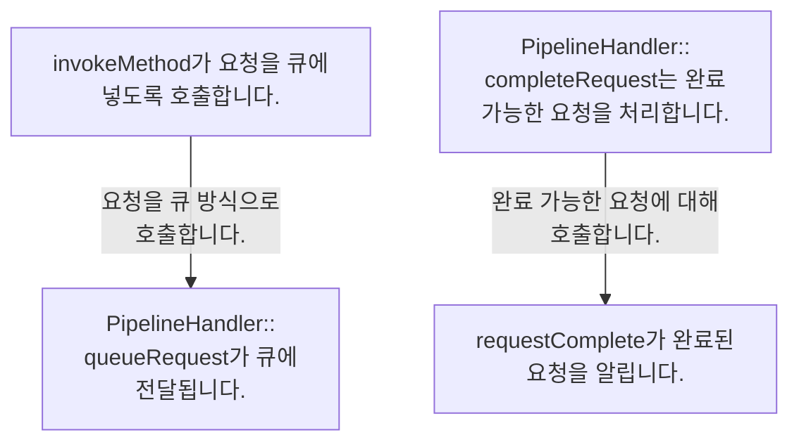
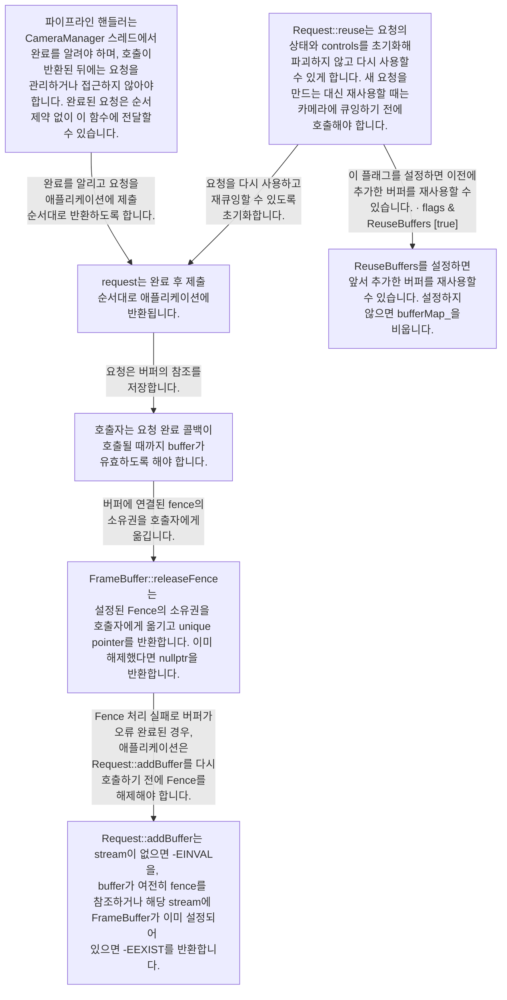

# 요청 완료와 버퍼 수명

**촬영 정지와 요청·버퍼 수명에 관한 연동 계약을 확인하세요.**

| 지금 확인할 내용 | 이동할 절 |
|---|---|
| 요청이 정상 완료됐는지 취소됐는지는 완료 알림으로 전달된 요청의 상태에서 확인합니다. | [제출·완료·정지](#제출완료정지) |
| 카메라에 큐에 넣은 요청의 버퍼가 완료되면 `Camera::bufferCompleted`가, 요청이 완료되면 `Camera::requestCompleted`가 발생합니다. | [요청과 버퍼 수명](#요청과-버퍼-수명) |

## 제출·완료·정지

요청이 정상 완료됐는지 취소됐는지는 완료 알림으로 전달된 요청의 상태에서 확인합니다. `Request::Private::complete()`는 취소 표시가 있으면 `RequestCancelled`, 없으면 `RequestComplete`로 설정합니다. 버퍼 완료 처리에서 버퍼 상태가 `FrameMetadata::FrameCancelled`이면 요청에 취소 표시를 설정합니다. `src/libcamera/request.cpp:107`

<!-- sdd:visual:request-flow -->
### 요청 제출과 결과 통지



[Mermaid 원문](vendor-contract.request-flow.mmd)

??? note "그림 근거와 확인 범위"
    요청 제출의 반환과 결과 통지를 구분해 호출·큐·콜백의 연결을 보여 주세요. 정적 호출 목록만으로 실행 순서나 콜백 스레드를 확정하지 마세요.
    
    소스에 연결한 설계 해석입니다. 자동 연결 검사는 의미 승인이나 기기 실행 검증이 아닙니다.
    
    LLM 그림 초안 · 사람 검토 전
    
    작성 모델: `cli/codex/gpt-6.1-terra`
    
    | 요소·전이 | 소스 근거 |
    |---|---|
    | <span data-sdd-label-en="invokeMethod schedules the request to be queued.">invokeMethod가 요청을 큐에 넣도록 호출합니다.</span> | [src/libcamera/camera.cpp:1373](#source-997ecce495182b6b) |
    | <span data-sdd-label-en="PipelineHandler::queueRequest is dispatched through the queue.">PipelineHandler::queueRequest가 큐에 전달됩니다.</span> | [src/libcamera/camera.cpp:1373](#source-997ecce495182b6b) |
    | <span data-sdd-label-en="PipelineHandler::completeRequest processes requests that can be completed.">PipelineHandler::completeRequest는 완료 가능한 요청을 처리합니다.</span> | [src/libcamera/pipeline_handler.cpp:584](#source-b1d601578d313e1c) |
    | <span data-sdd-label-en="requestComplete reports the completed request.">requestComplete가 완료된 요청을 알립니다.</span> | [src/libcamera/pipeline_handler.cpp:584](#source-b1d601578d313e1c) |
    | <span data-sdd-label-en="Invokes the request through a queued connection.">요청을 큐 방식으로 호출합니다.</span> | [src/libcamera/camera.cpp:1373](#source-997ecce495182b6b) |
    | <span data-sdd-label-en="Calls it for a request that can be completed.">완료 가능한 요청에 대해 호출합니다.</span> | [src/libcamera/pipeline_handler.cpp:584](#source-b1d601578d313e1c) |
<!-- /sdd:visual:request-flow -->

제출 경로는 `patchControlList()`로 컨트롤을 전처리하고 `PipelineHandler::queueRequest`를 `ConnectionTypeQueued`로 전달한 뒤 0을 반환합니다. `Camera::stop()`은 실행 중이 아니면 0을 반환하고, 실행 중일 때 접근 확인 결과가 음수이면 그 값을 반환합니다. 접근이 허용되면 `CameraStopping`으로 바꾸고 `PipelineHandler::stop`을 `ConnectionTypeBlocking`으로 호출한 뒤, 미결 요청이 없다는 assertion을 거쳐 `CameraConfigured`로 바꾸고 0을 반환합니다. `src/libcamera/camera.cpp:1373`, `src/libcamera/camera.cpp:1445`

`PipelineHandler::completeRequest()`는 요청을 완료 처리한 뒤 큐 앞에서부터 `RequestPending`이 아닌 요청을 꺼내 `Camera::requestComplete()`에 전달하고, 큐 앞 요청이 `RequestPending`이면 반복을 중단합니다. `Camera::requestComplete()`는 `requestCompleted` 신호를 보냅니다. 따라서 이미 완료된 요청은 그 요청의 상태로 결과를 확인합니다. `src/libcamera/pipeline_handler.cpp:584`, `src/libcamera/camera.cpp:1481`

`PipelineHandler::stop()`은 대기 요청을 별도 큐로 옮긴 후 `stopDevice()`를 호출하고, 그 다음 대기 요청을 순서대로 취소해 `doQueueRequest()`로 전달합니다. `Request::Private::cancel()`은 각 대기 버퍼를 취소하고 `bufferCompleted` 신호를 보낸 뒤 요청에 취소 표시를 설정합니다. 취소된 요청은 시퀀스 번호를 받고 완료 처리 경로에 들어가며, `RequestCancelled` 상태로 요청 완료 알림에 전달됩니다. `src/libcamera/pipeline_handler.cpp:367`, `src/libcamera/request.cpp:107`, `src/libcamera/pipeline_handler.cpp:489`, `src/libcamera/pipeline_handler.cpp:584`, `src/libcamera/camera.cpp:1481`

`FrameMetadata::FrameSuccess`는 유효한 프레임 데이터를, `FrameError`는 일부 또는 전체가 손상되거나 유효하지 않은 데이터를 뜻합니다. `FrameCancelled`는 프레임 완료 전에 촬영이 정지되어 데이터가 유효하지 않은 상태이며, 메타데이터에서는 상태 필드만 유효합니다. `FrameStartup`은 캡처에 성공했지만 IPA의 콜드 스타트 또는 리셋 단계로 인해 이미지를 사용할 수 없는 상태이며, 애플리케이션은 이 프레임을 사용하지 않도록 권장됩니다. `src/libcamera/framebuffer.cpp:42`

실행 확인 항목: 공통 정지 경로에서 `PipelineHandler::stop()`은 `stopDevice()`를 호출해 큐에 들어간 요청을 완료하도록 한 뒤 별도로 보관한 대기 요청을 취소합니다. 장치별 요청 처리 방식은 해당 `stopDevice()` 구현을 확인해야 합니다. `src/libcamera/pipeline_handler.cpp:367`

근거 원문: [src/libcamera/camera.cpp:1373](#source-997ecce495182b6b) · [src/libcamera/camera.cpp:1445](#source-96a432196b4d7557) · [src/libcamera/camera.cpp:1481](#source-d53c87090347ce81) · [src/libcamera/pipeline_handler.cpp:367](#source-b0b287336d0f66dc) · [src/libcamera/pipeline_handler.cpp:489](#source-90700e077cb19bfb) · [src/libcamera/pipeline_handler.cpp:584](#source-b1d601578d313e1c) · [src/libcamera/request.cpp:107](#source-1ea6489f0666d597) · [src/libcamera/framebuffer.cpp:42](#source-69e1d6ff17b52be7)

## 요청과 버퍼 수명

카메라에 큐에 넣은 요청의 버퍼가 완료되면 `Camera::bufferCompleted`가, 요청이 완료되면 `Camera::requestCompleted`가 발생합니다. 버퍼별 프레임 상태를 읽는 구체적인 접근 방법은 확인 필요입니다. `src/libcamera/camera.cpp:907`, `src/libcamera/framebuffer.cpp:42`

<!-- sdd:visual:buffer-ownership -->
### 요청과 버퍼를 유지할 기간



[Mermaid 원문](vendor-contract.buffer-ownership.mmd)

??? note "그림 근거와 확인 범위"
    실제 소스가 정한 요청·버퍼·fence의 소유자와 참조·반환·재사용 경계를 보여 주세요. 제공되지 않은 객체나 안전성 보장을 추가하지 마세요.
    
    소스에 연결한 설계 해석입니다. 자동 연결 검사는 의미 승인이나 기기 실행 검증이 아닙니다.
    
    LLM 그림 초안 · 사람 검토 전
    
    작성 모델: `cli/codex/gpt-6.1-terra`
    
    | 요소·전이 | 소스 근거 |
    |---|---|
    | <span data-sdd-label-en="The request is returned to the application in submission order after completion.">request는 완료 후 제출 순서대로 애플리케이션에 반환됩니다.</span> | [src/libcamera/pipeline_handler.cpp:571](#source-42c919763b1cba9c) |
    | <span data-sdd-label-en="The caller must ensure that the buffer remains valid until the request completion callback is called.">호출자는 요청 완료 콜백이 호출될 때까지 buffer가 유효하도록 해야 합니다.</span> | [src/libcamera/request.cpp:447](#source-4cdce80c57526221) |
    | <span data-sdd-label-en="The pipeline handler must report completion from the CameraManager thread and must not manage or access the request after the call returns. It may pass any completed request to this function without an ordering constraint.">파이프라인 핸들러는 CameraManager 스레드에서 완료를 알려야 하며, 호출이 반환된 뒤에는 요청을 관리하거나 접근하지 않아야 합니다. 완료된 요청은 순서 제약 없이 이 함수에 전달할 수 있습니다.</span> | [src/libcamera/pipeline_handler.cpp:571](#source-42c919763b1cba9c) |
    | <span data-sdd-label-en="Request::reuse resets the request&#x27;s status and controls so it can be reused without destruction. When reusing it instead of constructing a new request, it must be called before queueing it to the camera.">Request::reuse는 요청의 상태와 controls를 초기화해 파괴하지 않고 다시 사용할 수 있게 합니다. 새 요청을 만드는 대신 재사용할 때는 카메라에 큐잉하기 전에 호출해야 합니다.</span> | [src/libcamera/request.cpp:376](#source-e999bc2d14c7955d) |
    | <span data-sdd-label-en="Setting ReuseBuffers allows previously added buffers to be reused. Otherwise, bufferMap_ is cleared.">ReuseBuffers를 설정하면 앞서 추가한 버퍼를 재사용할 수 있습니다. 설정하지 않으면 bufferMap&#95;을 비웁니다.</span> | [src/libcamera/request.cpp:376](#source-e999bc2d14c7955d) |
    | <span data-sdd-label-en="FrameBuffer::releaseFence moves ownership of a set Fence to the caller and returns a unique pointer. It returns nullptr if the fence has already been released.">FrameBuffer::releaseFence는 설정된 Fence의 소유권을 호출자에게 옮기고 unique pointer를 반환합니다. 이미 해제했다면 nullptr을 반환합니다.</span> | [src/libcamera/framebuffer.cpp:433](#source-82dd94c553fa84c5) |
    | <span data-sdd-label-en="Request::addBuffer returns -EINVAL if stream is missing, or -EEXIST if the buffer still references a fence or a FrameBuffer is already set for that stream.">Request::addBuffer는 stream이 없으면 -EINVAL을, buffer가 여전히 fence를 참조하거나 해당 stream에 FrameBuffer가 이미 설정되어 있으면 -EEXIST를 반환합니다.</span> | [src/libcamera/request.cpp:475](#source-7bf317a602ff9778) |
    | <span data-sdd-label-en="The request stores a reference to the buffer.">요청은 버퍼의 참조를 저장합니다.</span> | [src/libcamera/request.cpp:447](#source-4cdce80c57526221) |
    | <span data-sdd-label-en="It reports completion and ensures that requests are returned to the application in submission order.">완료를 알리고 요청을 애플리케이션에 제출 순서대로 반환하도록 합니다.</span> | [src/libcamera/pipeline_handler.cpp:571](#source-42c919763b1cba9c) |
    | <span data-sdd-label-en="Setting this flag allows previously added buffers to be reused. · flags &amp; ReuseBuffers [true]">이 플래그를 설정하면 이전에 추가한 버퍼를 재사용할 수 있습니다. · flags &amp; ReuseBuffers &#91;true&#93;</span> | [src/libcamera/request.cpp:376](#source-e999bc2d14c7955d) |
    | <span data-sdd-label-en="It moves ownership of the fence associated with the buffer to the caller.">버퍼에 연결된 fence의 소유권을 호출자에게 옮깁니다.</span> | [src/libcamera/framebuffer.cpp:433](#source-82dd94c553fa84c5) |
    | <span data-sdd-label-en="If a buffer completes with errors due to a Fence handling failure, the application must release the Fence before calling Request::addBuffer again.">Fence 처리 실패로 버퍼가 오류 완료된 경우, 애플리케이션은 Request::addBuffer를 다시 호출하기 전에 Fence를 해제해야 합니다.</span> | [src/libcamera/framebuffer.cpp:433](#source-82dd94c553fa84c5) |
    | <span data-sdd-label-en="It resets the request so it can be reused and requeued.">요청을 다시 사용하고 재큐잉할 수 있도록 초기화합니다.</span> | [src/libcamera/request.cpp:376](#source-e999bc2d14c7955d) |
<!-- /sdd:visual:buffer-ownership -->

`FrameMetadata::FrameSuccess`는 영상 데이터와 모든 메타데이터 필드가 유효합니다. `FrameMetadata::FrameError`는 영상 데이터가 일부 또는 전부 손상되었거나 없거나 유효하지 않으며, `sequence`와 `timestamp`는 유효하지만 나머지 필드는 유효하지 않을 수 있습니다. `FrameMetadata::FrameCancelled`는 영상 데이터가 유효하지 않고 `status`를 제외한 모든 메타데이터 필드도 유효하지 않습니다. `FrameMetadata::FrameStartup`은 캡처에 성공했지만 영상 품질 파라미터가 사용할 수 없는 이미지를 생성하므로 애플리케이션이 프레임을 소비하지 않도록 권고하며, 나머지 메타데이터 필드는 모두 유효합니다. `src/libcamera/framebuffer.cpp:42`

호출자는 요청 완료 콜백이 호출될 때까지 요청에 참조된 버퍼가 유효하도록 해야 합니다. `Object`에 속한 슬롯은 다른 스레드에서 시그널이 발생하면 시그널 인자를 복사하여 해당 객체의 스레드 이벤트 루프에서 비동기로 호출되므로, 시그널 발생자는 전달한 포인터나 참조가 시그널 발생 후에도 유효하도록 해야 합니다. 지연된 콜백과 소비 작업이 버퍼 사용을 끝냈는지 확인하는 구체적인 조건은 확인 필요입니다. `src/libcamera/base/signal.cpp:99`, `src/libcamera/request.cpp:447`

새 요청을 생성하는 대신 기존 요청을 다시 큐에 넣으려면 애플리케이션은 큐에 넣기 전에 `Request::reuse()`를 호출해야 합니다. `ReuseBuffers`를 설정하면 이전에 추가한 버퍼를 재사용할 수 있으며, 구현은 각 버퍼를 요청에 다시 연결하고 대기 목록에 넣습니다. 이 플래그가 없으면 구현은 버퍼 맵을 비웁니다. `src/libcamera/request.cpp:376`

버퍼를 다시 추가할 때 `Request::addBuffer()`는 스트림이 없으면 `-EINVAL`을 반환하고, 버퍼에 fence가 남아 있거나 해당 스트림에 버퍼가 이미 설정되어 있으면 `-EEXIST`를 반환합니다. `Fence` 처리 실패로 오류 완료된 버퍼를 다시 추가하기 전에 애플리케이션은 `FrameBuffer::releaseFence()`로 fence를 해제해야 합니다. 이 함수는 fence의 소유권을 호출자에게 옮기며, 이미 해제했다면 `nullptr`을 반환합니다. `src/libcamera/framebuffer.cpp:433`, `src/libcamera/request.cpp:475`

호출자는 카메라가 `Running` 상태일 때만 요청을 큐에 넣어야 합니다. 큐에 넣은 요청의 완료는 `requestCompleted` 시그널로 통지되며, 큐에 넣는 호출은 성공하면 0을, 실패하면 음수 오류 코드를 반환합니다. `src/libcamera/camera.cpp:1317`

근거 원문: [src/libcamera/camera.cpp:907](#source-bc7c64d1f0673254) · [src/libcamera/framebuffer.cpp:42](#source-69e1d6ff17b52be7) · [src/libcamera/pipeline_handler.cpp:571](#source-42c919763b1cba9c) · [src/libcamera/request.cpp:447](#source-4cdce80c57526221) · [src/libcamera/base/signal.cpp:99](#source-7b25986708099878) · [src/libcamera/request.cpp:376](#source-e999bc2d14c7955d) · [src/libcamera/request.cpp:475](#source-7bf317a602ff9778) · [src/libcamera/framebuffer.cpp:433](#source-82dd94c553fa84c5) · [src/libcamera/camera.cpp:1317](#source-304669ca965aaaa2)

??? note "설계 질문과 검증 범위"
    질문별 답변과 근거 연결을 검사했습니다. 의미와 실행 결과는 사람 검토가 필요합니다.
    
    | 설계 질문 | 설명 위치 | 확인 범위 |
    |---|---|---|
    | 촬영을 정지할 때 요청이 정상 완료됐는지 취소됐는지 어디에서 판단합니까? | [제출·완료·정지](#제출완료정지) | 코드 근거와 설명 연결 · 실행 확인 항목 별도 |
    | 완료 알림을 받은 뒤 요청과 버퍼를 재사용하기 전에 어떤 조건을 확인해야 합니까? | [요청과 버퍼 수명](#요청과-버퍼-수명) | 코드 근거와 설명 연결 |

## 소스 근거

같은 발췌는 한 번만 싣습니다. 필요한 원문을 펼쳐 설명과 대조하세요.

<a id="source-997ecce495182b6b"></a>

??? note "소스 근거: src/libcamera/camera.cpp:1373"
    `src/libcamera/camera.cpp:1373`에서 시작하는 발췌입니다. 종료 줄은 1380이며, 아래 원문을 설명과 대조할 수 있습니다.
    
    SHA-256: `e45022d3fce2d8886d9ff5afa6e10f4c6687e85b7eec1ed64af80c775e36e030`
    
    ```text
    /* Pre-process AeEnable. */
    	patchControlList(request->controls());
    
    	d->pipe_->invokeMethod(&PipelineHandler::queueRequest,
    			       ConnectionTypeQueued, request);
    
    	return 0;
    }
    ```

<a id="source-96a432196b4d7557"></a>

??? note "소스 근거: src/libcamera/camera.cpp:1445"
    `src/libcamera/camera.cpp:1445`에서 시작하는 발췌입니다. 종료 줄은 1472이며, 아래 원문을 설명과 대조할 수 있습니다.
    
    SHA-256: `8a1acdc0c0263c5453e024b1fc0c119960d8c291dc3ff6dffa38f38ff37af63d`
    
    ```text
    int Camera::stop()
    {
    	Private *const d = _d();
    
    	/*
    	 * \todo Make calling stop() when not in 'Running' part of the state
    	 * machine rather than take this shortcut
    	 */
    	if (!d->isRunning())
    		return 0;
    
    	int ret = d->isAccessAllowed(Private::CameraRunning);
    	if (ret < 0)
    		return ret;
    
    	LOG(Camera, Debug) << "Stopping capture";
    
    	d->setState(Private::CameraStopping);
    
    	d->pipe_->invokeMethod(&PipelineHandler::stop, ConnectionTypeBlocking,
    			       this);
    
    	ASSERT(!d->pipe_->hasPendingRequests(this));
    
    	d->setState(Private::CameraConfigured);
    
    	return 0;
    }
    ```

<a id="source-d53c87090347ce81"></a>

??? note "소스 근거: src/libcamera/camera.cpp:1481"
    `src/libcamera/camera.cpp:1481`에서 시작하는 발췌입니다. 종료 줄은 1488이며, 아래 원문을 설명과 대조할 수 있습니다.
    
    SHA-256: `b8dfbcf8a903847aa98db2793e682faae22e8fb4fd0d2eba3d80a00ffd4b835c`
    
    ```text
    void Camera::requestComplete(Request *request)
    {
    	/* Disconnected cameras are still able to complete requests. */
    	if (_d()->isAccessAllowed(Private::CameraStopping, Private::CameraRunning,
    				  true))
    		LOG(Camera, Fatal) << "Trying to complete a request when stopped";
    
    	requestCompleted.emit(request);
    ```

<a id="source-b0b287336d0f66dc"></a>

??? note "소스 근거: src/libcamera/pipeline_handler.cpp:367"
    `src/libcamera/pipeline_handler.cpp:367`에서 시작하는 발췌입니다. 종료 줄은 401이며, 아래 원문을 설명과 대조할 수 있습니다.
    
    SHA-256: `8764582e8bae0aef3ae86abb8d0d6f7a73cca9adaf3b3887a47af5e4b828c7f3`
    
    ```text
    void PipelineHandler::stop(Camera *camera)
    {
    	/*
    	 * Take all waiting requests so that they are not requeued in response
    	 * to completeRequest() being called inside stopDevice(). Cancel them
    	 * after the device to keep them in order.
    	 */
    	Camera::Private *data = camera->_d();
    	std::queue<Request *> waitingRequests;
    	waitingRequests.swap(data->waitingRequests_);
    
    	/* Stop the pipeline handler and let the queued requests complete. */
    	stopDevice(camera);
    
    	/* Cancel and signal as complete all waiting requests. */
    	while (!waitingRequests.empty()) {
    		Request *request = waitingRequests.front();
    		waitingRequests.pop();
    
    		/*
    		 * Cancel all requests by marking them as cancelled and calling
    		 * doQueueRequest() instead of cancelRequest(). This ensures
    		 * that the requests get a sequence number and are temporarily
    		 * added to queuedRequests_ so they can be properly completed in
    		 * completeRequest().
    		 */
    		request->_d()->cancel();
    		doQueueRequest(request);
    	}
    
    	/* Make sure no requests are pending. */
    	ASSERT(data->queuedRequests_.empty());
    	ASSERT(data->waitingRequests_.empty());
    
    	data->requestSequence_ = 0;
    ```

<a id="source-90700e077cb19bfb"></a>

??? note "소스 근거: src/libcamera/pipeline_handler.cpp:489"
    `src/libcamera/pipeline_handler.cpp:489`에서 시작하는 발췌입니다. 종료 줄은 494이며, 아래 원문을 설명과 대조할 수 있습니다.
    
    SHA-256: `a4a8a384045651ef47ba64f3aa29c41bc1f070426d953395381104c609f71dbd`
    
    ```text
    data->queuedRequests_.push_back(request);
    
    	request->_d()->sequence_ = data->requestSequence_++;
    
    	if (request->_d()->cancelled_) {
    		completeRequest(request);
    ```

<a id="source-b1d601578d313e1c"></a>

??? note "소스 근거: src/libcamera/pipeline_handler.cpp:584"
    `src/libcamera/pipeline_handler.cpp:584`에서 시작하는 발췌입니다. 종료 줄은 603이며, 아래 원문을 설명과 대조할 수 있습니다.
    
    SHA-256: `29265b8586e739c85926354dd859229596e57a2d50ccfe6821b6232848616180`
    
    ```text
    void PipelineHandler::completeRequest(Request *request)
    {
    	Camera *camera = request->_d()->camera();
    
    	request->_d()->complete();
    
    	Camera::Private *data = camera->_d();
    
    	while (!data->queuedRequests_.empty()) {
    		Request *req = data->queuedRequests_.front();
    		if (req->status() == Request::RequestPending)
    			break;
    
    		ASSERT(!req->hasPendingBuffers());
    		data->queuedRequests_.pop_front();
    		camera->requestComplete(req);
    	}
    
    	/* Allow any waiting requests to be queued to the pipeline. */
    	doQueueRequests(camera);
    ```

<a id="source-1ea6489f0666d597"></a>

??? note "소스 근거: src/libcamera/request.cpp:107"
    `src/libcamera/request.cpp:107`에서 시작하는 발췌입니다. 종료 줄은 169이며, 아래 원문을 설명과 대조할 수 있습니다.
    
    SHA-256: `8e8dd359c466b09c285bfeea93783e52712b0b1dfe65faa4db0e2167779abad3`
    
    ```text
    int ret = pending_.erase(buffer);
    	ASSERT(ret == 1);
    
    	buffer->_d()->setRequest(nullptr);
    
    	if (buffer->metadata().status == FrameMetadata::FrameCancelled)
    		cancelled_ = true;
    
    	return !hasPendingBuffers();
    }
    
    /**
     * \brief Complete a queued request
     *
     * Mark the request as complete by updating its status to RequestComplete,
     * unless buffers have been cancelled in which case the status is set to
     * RequestCancelled.
     */
    void Request::Private::complete()
    {
    	Request *request = _o<Request>();
    
    	ASSERT(request->status() == RequestPending);
    	ASSERT(!hasPendingBuffers());
    
    	request->status_ = cancelled_ ? RequestCancelled : RequestComplete;
    
    	LOG(Request, Debug) << request->toString();
    
    	LIBCAMERA_TRACEPOINT(request_complete, this);
    }
    
    void Request::Private::doCancelRequest()
    {
    	Request *request = _o<Request>();
    
    	for (FrameBuffer *buffer : pending_) {
    		buffer->_d()->cancel();
    		camera_->bufferCompleted.emit(request, buffer);
    	}
    
    	cancelled_ = true;
    	pending_.clear();
    	notifiers_.clear();
    	timer_.reset();
    }
    
    /**
     * \brief Cancel a queued request
     *
     * Mark the request and its associated buffers as cancelled and complete it.
     *
     * Set each pending buffer in error state and emit the buffer completion signal
     * before completing the Request.
     */
    void Request::Private::cancel()
    {
    	LIBCAMERA_TRACEPOINT(request_cancel, this);
    
    	Request *request = _o<Request>();
    	ASSERT(request->status() == RequestPending);
    
    	doCancelRequest();
    ```

<a id="source-69e1d6ff17b52be7"></a>

??? note "소스 근거: src/libcamera/framebuffer.cpp:42"
    `src/libcamera/framebuffer.cpp:42`에서 시작하는 발췌입니다. 종료 줄은 58이며, 아래 원문을 설명과 대조할 수 있습니다.
    
    SHA-256: `f1beaf6919ab1848b6d45a1923c0c9e34de9a4f92db0f1547cd575a5ff8dcb32`
    
    ```text
    \var FrameMetadata::FrameSuccess
     * The frame has been captured with success and contains valid data. All fields
     * of the FrameMetadata structure are valid.
     * \var FrameMetadata::FrameError
     * The frame data is partly or fully corrupted, missing or otherwise invalid.
     * This can for instance indicate a hardware transmission error, or invalid data
     * produced by the sensor during its startup phase. The sequence and timestamp
     * fields of the FrameMetadata structure is valid, all the other fields may be
     * invalid.
     * \var FrameMetadata::FrameCancelled
     * Capture stopped before the frame completed. The frame data is not valid. All
     * fields of the FrameMetadata structure but the status field are invalid.
     * \var FrameMetadata::FrameStartup
     * The frame has been successfully captured. However, the IPA is in a
     * cold-start or reset phase and will result in image quality parameters
     * producing unusable images. Applications are recommended to not consume these
     * frames. All other fields of the FrameMetadata structure are valid.
    ```

<a id="source-bc7c64d1f0673254"></a>

??? note "소스 근거: src/libcamera/camera.cpp:907"
    `src/libcamera/camera.cpp:907`에서 시작하는 발췌입니다. 종료 줄은 914이며, 아래 원문을 설명과 대조할 수 있습니다.
    
    SHA-256: `4eeede3f18a61baf69f7ad9c25656b79e423d4dc4e034ba32f7c132ae9730dcf`
    
    ```text
    \var Camera::bufferCompleted
     * \brief Signal emitted when a buffer for a request queued to the camera has
     * completed
     */
    
    /**
     * \var Camera::requestCompleted
     * \brief Signal emitted when a request queued to the camera has completed
    ```

<a id="source-42c919763b1cba9c"></a>

??? note "소스 근거: src/libcamera/pipeline_handler.cpp:571"
    `src/libcamera/pipeline_handler.cpp:571`에서 시작하는 발췌입니다. 종료 줄은 603이며, 아래 원문을 설명과 대조할 수 있습니다.
    
    SHA-256: `fefd7a68cdeabca8183feece84437ac4bc2a05d953871c6d516389471dd522bd`
    
    ```text
    \brief Signal request completion
     * \param[in] request The request that has completed
     *
     * The pipeline handler shall call this function to notify the \a camera that
     * the request has completed. The request is no longer managed by the pipeline
     * handler and shall not be accessed once this function returns.
     *
     * This function ensures that requests will be returned to the application in
     * submission order, the pipeline handler may call it on any complete request
     * without any ordering constraint.
     *
     * \context This function shall be called from the CameraManager thread.
     */
    void PipelineHandler::completeRequest(Request *request)
    {
    	Camera *camera = request->_d()->camera();
    
    	request->_d()->complete();
    
    	Camera::Private *data = camera->_d();
    
    	while (!data->queuedRequests_.empty()) {
    		Request *req = data->queuedRequests_.front();
    		if (req->status() == Request::RequestPending)
    			break;
    
    		ASSERT(!req->hasPendingBuffers());
    		data->queuedRequests_.pop_front();
    		camera->requestComplete(req);
    	}
    
    	/* Allow any waiting requests to be queued to the pipeline. */
    	doQueueRequests(camera);
    ```

<a id="source-4cdce80c57526221"></a>

??? note "소스 근거: src/libcamera/request.cpp:447"
    `src/libcamera/request.cpp:447`에서 시작하는 발췌입니다. 종료 줄은 449이며, 아래 원문을 설명과 대조할 수 있습니다.
    
    SHA-256: `996424643a0de2ec5fbd8b8491639ae1afea030ab989179410e7a1eaa48c1673`
    
    ```text
    A reference to the buffer is stored in the request. The caller is responsible
     * for ensuring that the buffer will remain valid until the request complete
     * callback is called.
    ```

<a id="source-7b25986708099878"></a>

??? note "소스 근거: src/libcamera/base/signal.cpp:99"
    `src/libcamera/base/signal.cpp:99`에서 시작하는 발췌입니다. 종료 줄은 106이며, 아래 원문을 설명과 대조할 수 있습니다.
    
    SHA-256: `5a71dc72639c9c41ee24da19b681ece191b743aa1e2ba64bc14abec8a9e8248d`
    
    ```text
    When a slot belongs to an instance of the Object class, the slot is called
     * in the context of the thread that the object is bound to. If the signal is
     * emitted from the same thread, the slot will be called synchronously, before
     * Signal::emit() returns. If the signal is emitted from a different thread,
     * the slot will be called asynchronously from the object's thread's event
     * loop, after the Signal::emit() function returns, with a copy of the signal's
     * arguments. The emitter shall thus ensure that any pointer or reference
     * passed through the signal will remain valid after the signal is emitted.
    ```

<a id="source-e999bc2d14c7955d"></a>

??? note "소스 근거: src/libcamera/request.cpp:376"
    `src/libcamera/request.cpp:376`에서 시작하는 발췌입니다. 종료 줄은 403이며, 아래 원문을 설명과 대조할 수 있습니다.
    
    SHA-256: `f6c7ce9d8783ac8fd67e608fe5ed4e89af046ff5cf94fa0674ae76f5bb65cee7`
    
    ```text
    \brief Reset the request for reuse
     * \param[in] flags Indicate whether or not to reuse the buffers
     *
     * Reset the status and controls associated with the request, to allow it to
     * be reused and requeued without destruction. This function shall be called
     * prior to queueing the request to the camera, in lieu of constructing a new
     * request. The application can reuse the buffers that were previously added
     * to the request via addBuffer() by setting \a flags to ReuseBuffers.
     */
    void Request::reuse(ReuseFlag flags)
    {
    	LIBCAMERA_TRACEPOINT(request_reuse, this);
    
    	_d()->reset();
    
    	if (flags & ReuseBuffers) {
    		for (const auto &[stream, buffer] : bufferMap_) {
    			buffer->_d()->setRequest(this);
    			_d()->pending_.insert(buffer);
    		}
    	} else {
    		bufferMap_.clear();
    	}
    
    	status_ = RequestPending;
    
    	controls_.clear();
    	_d()->metadata_.clear();
    ```

<a id="source-7bf317a602ff9778"></a>

??? note "소스 근거: src/libcamera/request.cpp:475"
    `src/libcamera/request.cpp:475`에서 시작하는 발췌입니다. 종료 줄은 499이며, 아래 원문을 설명과 대조할 수 있습니다.
    
    SHA-256: `7f3987ebf2a25b32e0533bac27594d55a59475eb7ddca125a67b9b9756cc9851`
    
    ```text
    int Request::addBuffer(const Stream *stream, FrameBuffer *buffer,
    		       std::unique_ptr<Fence> &&fence)
    {
    	if (!stream) {
    		LOG(Request, Error) << "Invalid stream reference";
    		return -EINVAL;
    	}
    
    	/*
    	 * Make sure the fence has been extracted from the buffer
    	 * to avoid waiting on a stale fence.
    	 */
    	if (buffer->_d()->fence()) {
    		LOG(Request, Error) << "Can't add buffer that still references a fence";
    		return -EEXIST;
    	}
    
    	auto [it, inserted] = bufferMap_.try_emplace(stream, buffer);
    	if (!inserted) {
    		LOG(Request, Error) << "FrameBuffer already set for stream";
    		return -EEXIST;
    	}
    
    	buffer->_d()->setRequest(this);
    	_d()->pending_.insert(buffer);
    ```

<a id="source-82dd94c553fa84c5"></a>

??? note "소스 근거: src/libcamera/framebuffer.cpp:433"
    `src/libcamera/framebuffer.cpp:433`에서 시작하는 발췌입니다. 종료 줄은 448이며, 아래 원문을 설명과 대조할 수 있습니다.
    
    SHA-256: `697089e2b0a1bea08ed1f9deb9f6573b8da84fb737ea2dc48978848e5b79c1f6`
    
    ```text
    \brief Extract the Fence associated with this Framebuffer
     *
     * This function moves the buffer's fence ownership to the caller.
     * After the fence has been released, calling this function always return
     * nullptr.
     *
     * If buffer with a Fence completes with errors due to a failure in handling
     * the fence, applications are responsible for releasing the Fence before
     * calling Request::addBuffer() again.
     *
     * \return A unique pointer to the Fence if set, or nullptr if the fence has
     * been released already
     */
    std::unique_ptr<Fence> FrameBuffer::releaseFence()
    {
    	return std::move(_d()->fence_);
    ```

<a id="source-304669ca965aaaa2"></a>

??? note "소스 근거: src/libcamera/camera.cpp:1317"
    `src/libcamera/camera.cpp:1317`에서 시작하는 발췌입니다. 종료 줄은 1323이며, 아래 원문을 설명과 대조할 수 있습니다.
    
    SHA-256: `7f4cde0b1e3bf8c280168abb6066226976abc5f1018af1c5bf5a24d3a02db16e`
    
    ```text
    Once the request has been queued, the camera will notify its completion
     * through the \ref requestCompleted signal.
     *
     * \context This function is \threadsafe. It may only be called when the camera
     * is in the Running state as defined in \ref camera_operation.
     *
     * \return 0 on success or a negative error code otherwise
    ```

??? note "근거와 검토 정보"
    - 생성 방식: 추출 사실과 LLM 설명
    - 검증 범위: 표·그림은 facts로 만들고 설명은 LLM이 작성합니다. 인용·문장 및 설정된 구조 검사를 적용합니다.
    - 근거 파일: `src/libcamera/base/signal.cpp`, `src/libcamera/camera.cpp`, `src/libcamera/framebuffer.cpp`, `src/libcamera/pipeline_handler.cpp`, `src/libcamera/request.cpp`
    - 근거 수준: 코드 확인 (정적 분석, simple_compdb 구성, commit `adfa719f8e`)
    - 자동 검사 (인용·문장 및 설정된 구조 검사): 통과
    - 검토 상태 기록일: 2026-11-27 · 사람 검토 전

다음 단계: [Camera 구현 소스](https://github.com/TTolsun/libcamera-sdd/blob/adfa719f8ed67d18fd8a0739fc088a1f8b9e7252/src/libcamera/camera.cpp)
