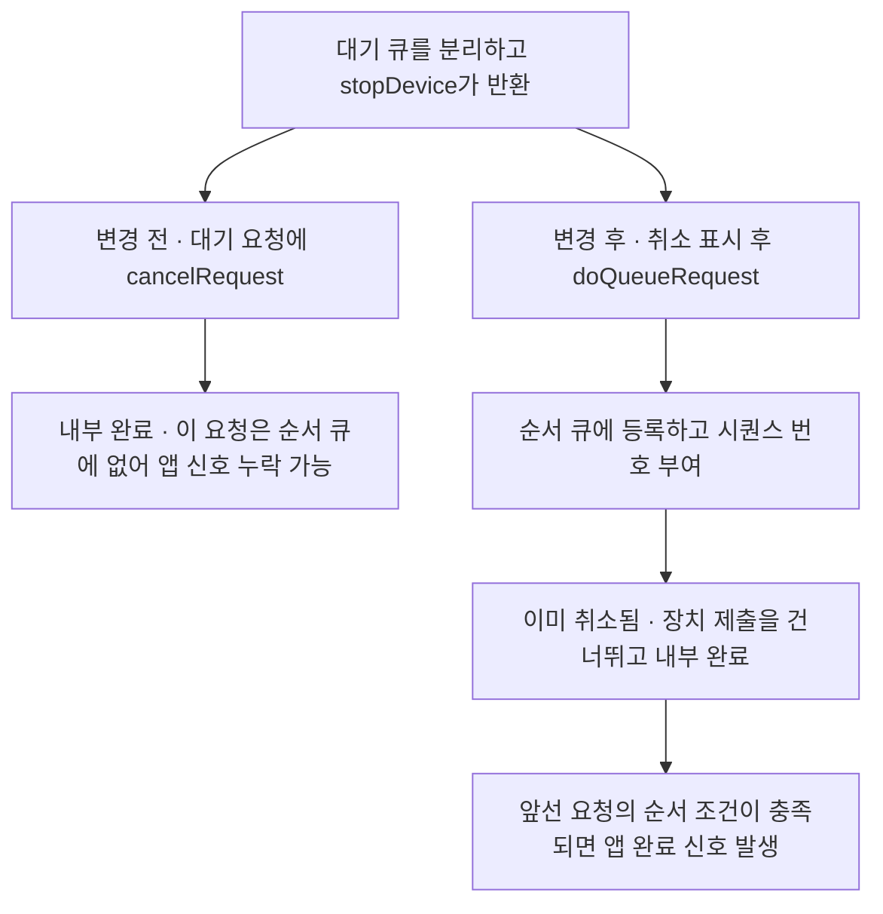

# 대기 요청의 완료 신호 수정으로 비교한 전체·증분 검토

이후 같은 원고와 채점 기준으로 [앱 완료 신호 회귀 조건을 찾는 검토](followup.md)를 실행했습니다. 아래는 개선 전의 측정값입니다.

공개 libcamera의 같은 변경과 같은 후보 원고에서 **증분 검토는 40,316토큰(42.7%)과 18.67초(23.6%)를 절약했습니다. 두 방식 모두 중요 항목 3개 중 2개를 완전히 찾았고, 앱에서 확인할 회귀 조건 1개를 일부만 찾았습니다.** 증분 검토에서만 발생한 중요 누락은 0개였습니다. 사전에 정한 품질 합격 기준에는 두 방식 모두 미달했습니다. [사전 기준](preregistered.txt) · [원본 영수증·채점·재현 자료](evidence.zip)

## 어떤 판단이 달라졌나요?

장치에 아직 제출되지 않은 요청이 정지 직전까지 기다리고 있을 수 있습니다. 이전 구현에서는 이 요청을 내부적으로 취소하고 완료해도, 앱에 신호를 보낼 순서 큐에 등록하지 않아 앱이 요청 완료 신호를 받지 못할 수 있었습니다. 변경 후에는 취소된 요청도 순서 큐에 잠시 등록합니다. 이때 시퀀스 번호가 있다는 사실만으로 장치에 제출됐다고 판단하면 진단 지점을 잘못 고르게 됩니다. [공식 수정과 부모 코드의 차이](https://gitlab.freedesktop.org/camera/libcamera/-/commit/731a340c8064843075cb9a41e22908eadadbf1bd)



| 사전에 정한 중요 항목 | 전체 | 증분 | 실제 판정 근거 |
|---|---|---|---|
| 대기 요청의 임시 큐 등록과 시퀀스 부여 | 충족 | 충족 | 두 검토 모두 정지 절에서 취소 표시 뒤 `doQueueRequest()`를 호출하는 순서를 보완하라고 지적했습니다. |
| 이미 취소된 요청의 실제 장치 제출 여부 | 충족 | 충족 | 두 검토 모두 `queueRequestDevice()`에 도달하기 전에 완료한다고 지적했습니다. 장치를 먼저 정지하는 순서도 확인했습니다. |
| 앱 완료 통지 누락 진단과 회귀 확인 | 일부 충족 | 일부 충족 | 두 검토 모두 내부 완료와 순서에 따른 앱 통지를 구분했습니다. 이전 구현에서 신호가 빠질 수 있었던 이유와 **장치에 한 번도 제출되지 않은 대기 요청을 정지시키고 그 요청의 앱 완료 신호를 관찰하는 시험**은 제시하지 않았습니다. |

## 얼마나 절약했나요?

| 변경 후 검토 | 새 CLI 호출 | 이전 판정 재사용 | 입력 토큰 | 출력 토큰 | 합계 | 경과 시간 |
|---|---:|---:|---:|---:|---:|---:|
| 전체 | 4 | 0 | 90,960 | 3,510 | 94,470 | 79.02초 |
| 증분 | 2 | 2 | 51,246 | 2,908 | 54,154 | 60.34초 |
| 전체에서 증분을 뺀 값 | 2 | — | 39,714 | 602 | 40,316 | 18.67초 |

시간은 각 방식의 시작부터 마지막 판정까지의 벽시계로 측정했습니다. 선택과 기존 영수증 확인을 포함합니다. 차이와 비율은 반올림 전 값으로 계산했습니다. 증분을 먼저, 전체를 나중에 한 번씩 직렬로 실행했습니다. 두 방식 모두 실패·재시도는 0회였습니다. 캐시된 입력은 전체 74,752토큰, 증분 35,328토큰이며 각각 입력 합계에 포함됩니다. 금액과 사람 검토 시간은 미측정입니다.

공통 준비에서 검토 입력을 고정하는 데 0.89초, 변경 전 원고 4개 작성과 별도 기준 검토 4건에 117.78초와 179,616토큰이 들었습니다. 실험 도구를 구현한 `gpt-6.2-sol` 호출은 50,575토큰이었습니다. 사후 블라인드 채점 1회는 28.03초와 34,604토큰이었습니다. 이 비용은 위 두 검토의 차액에서 제외했습니다. 빌드·환경 준비 전체를 포괄하는 경과 시간은 계측하지 않았습니다.

## 무엇을 고정했고 무엇을 재사용했나요?

- 부모 `517b863b`와 변경 `731a340c`에서 같은 Meson UVC 설정으로 `camera.cpp`, `pipeline_handler.cpp`, `request.cpp`를 각각 컴파일했습니다. 체크아웃 경로를 정규화한 세 컴파일 명령이 일치했습니다. 생성기의 실제 facts 추출은 양쪽 모두 3개 TU, 파싱 오류 0개였습니다. 별도 시나리오 추출에서 정지 진입점 2개를 확인했습니다. 모델에는 공식 Git blob과 대조한 질문별 함수 발췌를 제공했습니다. [빌드 및 추출 기록](build-evidence.json)
- 변경 전 소스에서 독립 CLI가 작성한 한국어 원고 네 개를 수정 없이 변경 후 후보로 사용했습니다. 두 방식은 각 질문에 대해 같은 후보·코드 창·모델·인자·검토 프롬프트를 받았습니다. 사전 정답, Git diff와 상대 방식의 답변은 제공하지 않았습니다. 사후 채점에서만 두 방식을 익명으로 섞고 정답·diff·원고·소스·판정을 함께 제공했습니다. 생성·검토·채점에는 별도 Codex CLI의 `gpt-6.1-terra`, reasoning effort `high`를 사용했습니다.
- 정지 처리와 앱 콜백 진단은 미리 지정한 의존 파일이 바뀌었고 부모 검토도 이미 보완 판정이어서 양쪽에서 새로 검토했습니다. 버퍼 연결과 요청 재사용은 부모가 통과했고 원고·근거 파일 전체·질문·실행 설정의 지문이 같았습니다. 증분 검토는 기존 원본 영수증을 검증한 뒤 이 두 판정을 재사용했습니다. 전체 검토가 새로 수행한 같은 두 건도 모두 통과했습니다.
- 이 시험은 **미리 의존 관계를 정한 텍스트 네 항목**을 다룹니다. 검토 방식이 미등록 간접 의존을 자동 발견하는 능력, 이전에 승인된 중요 설명이 다음 변경에서 깨지는 경우, 전체 사이트·그림의 품질, 실기기 및 사내 HAL은 검증 범위 밖입니다. 변경 후 코드만 주어진 두 검토가 이전 결함과 회귀 조건을 스스로 복원하지 못했다는 점도 결과에 포함합니다.

## 재현과 배포 범위

기준 생성기는 `29a6412e326b470b5bad3a9b7f945566e1a5a162`, CLI는 `0.169.1`입니다. 증거 ZIP의 `sha256.json`은 원본 요청·응답, CLI 이벤트, 실행 설정, 비교 결과와 채점 자료를 파일별로 연결합니다. `run/report.json`의 단계별 합계는 14개 원본 영수증의 사용량과 대조했습니다. 채점의 L은 증분, M은 전체입니다. 기록을 다시 읽을 때는 모델 호출이 필요 없습니다. 새 측정에는 지정한 모델을 사용할 수 있는 Codex CLI와 두 공식 커밋이 있는 로컬 Git 저장소가 필요합니다.

생성기 저장소 루트에서 다음 명령을 실행하세요. 첫 명령은 ZIP 최상위의 측정 도구와 원본 영수증을 새 폴더에 풉니다. 이미 공식 Git 이력이 있다면 두 번째 명령을 생략하고 `--git`에 해당 Git 디렉터리를 지정할 수 있습니다. 마지막 명령은 모델을 실제로 호출하므로 새 출력 경로를 사용하세요.

```powershell
python -m zipfile -e docs/libcamera/records/stop-review-comparison/evidence.zip build/stop-review-evidence
git clone --bare https://gitlab.freedesktop.org/camera/libcamera.git build/stop-review-source.git
python build/stop-review-evidence/paired_review.py --git build/stop-review-source.git --out build/stop-review-new-run
```

2026년 11월 20일 확인한 공식 HEAD와 공개 SDD의 `upstream/master`는 모두 `5efdc682`였습니다. 공개 Pages 빌드 `5a305f234aa96743b2162c5a2bf097ba179ac035564ba9c00d2497ea19a1cccd`의 정지·요청 수명 HTML 두 개가 manifest에 기록된 해시와 일치했습니다. 해당 정지 페이지에는 취소 뒤 순서 큐 등록 동작이 이미 설명돼 있습니다. 이 비교는 역사적 변경에 대한 검토 실험이며 공개 원고나 배포 입력을 바꾸지 않아 별도 Pages 배포가 필요하지 않았습니다. [공개 정지 시나리오](https://ttolsun.github.io/libcamera-sdd/scenarios/camera_stop.html) · [공개 요청 수명 문서](https://ttolsun.github.io/libcamera-sdd/request-lifecycle.html)
