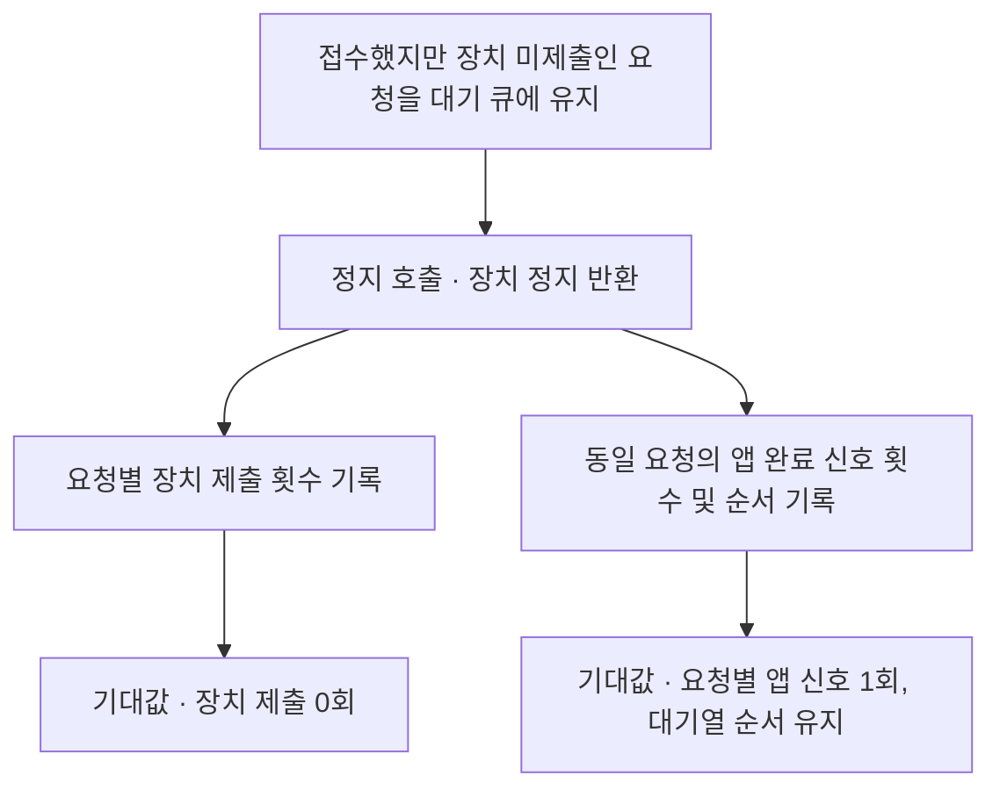

# 앱 완료 신호의 회귀 조건을 찾는 검토

**전체·증분 검토가 모두 중요 항목 3개를 충족했습니다.** 두 방식 모두 이전에 놓쳤던 앱 완료 신호의 회귀 시험을 원고에 추가하라고 지적했습니다. 이번 증분 검토는 전체보다 **52,835토큰(50.0%)과 17.28초(15.1%)**를 덜 사용했습니다. [최초 비교 결과](README.md) · [후속 실행 영수증과 블라인드 채점](followup-evidence.zip)

## 무엇을 관찰하면 결함을 찾을 수 있나요?

두 검토 모두 **앱이 제출했지만 아직 장치에는 제출되지 않은 요청**을 대기 큐에 남긴 채 카메라를 정지시키는 시험을 제시했습니다. 해당 요청의 시퀀스 번호나 버퍼 완료만 관찰하면 앱의 요청 완료 신호가 빠져도 알아차리기 어렵습니다. 검토자가 제안한 시험은 같은 요청의 장치 제출과 앱 신호를 따로 기록합니다.

| 사전 중요 항목 | 검토가 찾아낸 내용 | 전체 | 증분 |
|---|---|---|---|
| 정지 중 대기 요청의 등록 | 요청을 취소 표시한 뒤 순서 큐에 등록하고 시퀀스 번호를 부여하는 단계를 원고에 보완합니다. | 충족 | 충족 |
| 실제 장치 제출 여부 | 이미 취소됐으므로 장치 제출을 건너뛰는 분기가 정지 중인 요청에도 적용됨을 설명합니다. | 충족 | 충족 |
| 앱 완료 신호 회귀 | 변경 전에는 내부에서 완료한 대기 요청이 앱 신호를 보내는 순서 큐에 없을 수 있습니다. 동일 조건에서 장치 제출은 **0회**, 앱의 `requestCompleted`는 **요청별 1회**인지 관찰하고 여러 요청의 반환 순서도 대조합니다. | 충족 | 충족 |



이 결과는 검토자가 원고의 누락을 발견하고 검증 가능한 시험을 제안했다는 뜻입니다. 두 버전에서 정지를 재현해 실제 콜백을 계측하는 기기 시험은 수행하지 않았습니다. [공식 libcamera 수정](https://gitlab.freedesktop.org/camera/libcamera/-/commit/731a340c8064843075cb9a41e22908eadadbf1bd)

## 비용은 어떻게 달라졌나요?

| 변경 후 검토 | 새 호출 | 판정 재사용 | 입력 토큰 | 출력 토큰 | 합계 | 경과 시간 | 중요 항목 |
|---|---:|---:|---:|---:|---:|---:|---:|
| 이전 전체 | 4 | 0 | 90,960 | 3,510 | 94,470 | 79.02초 | 2/3 |
| 이전 증분 | 2 | 2 | 51,246 | 2,908 | 54,154 | 60.34초 | 2/3 |
| 개선 후 전체 | 4 | 0 | 100,274 | 5,311 | 105,585 | 114.57초 | 3/3 |
| 개선 후 증분 | 2 | 2 | 47,763 | 4,987 | 52,750 | 97.30초 | 3/3 |

같은 회차의 전체 검토 대비 토큰 절감률은 **42.7% → 50.0%**, 시간 절감률은 **23.6% → 15.1%**였습니다. 개선 후 증분 검토 자체는 이전 증분보다 1,404토큰을 덜 썼지만 36.95초 더 걸렸습니다. 두 회차 모두 증분을 먼저 실행했으며 각 조건은 1회 측정했습니다. 모델 응답 길이와 서비스 대기가 달라질 수 있어 시간 차이를 개선 코드만의 효과로 추정할 수 없습니다.

두 방식 모두 재시도와 실패는 0회입니다. 캐시된 입력은 전체 70,656토큰, 증분 39,424토큰이며 각각 입력 합계에 포함됩니다. 시간은 선별·재사용 판정 검증을 포함한 시작부터 마지막 판정까지입니다. 반올림 전 값으로 차이와 절감률을 계산했습니다. 공통 준비와 기존 영수증 가져오기는 1.12초로 새 모델 호출은 없었습니다. 별도 블라인드 채점은 1회, 37,487토큰과 29.82초였습니다.

## 어떤 입력을 바꿨나요?

부모 `517b863b`와 변경 `731a340c`, UVC 빌드 설정, 네 질문과 원고, 근거 창, 세 중요 항목과 채점 지침을 그대로 사용했습니다. 새 프로그램은 원본 Git에서 소스·창을 다시 검증했습니다. 변경된 함수는 `PipelineHandler::stop()` 하나였습니다. 부모 원고·판정 8건은 원본 영수증에서 읽어 해시와 CLI 응답을 검증했습니다. [기존 빌드·추출 근거](build-evidence.json) · [사전 판정 기준](preregistered.txt)

- **정지 처리와 콜백 진단**에는 현재 코드와 대조할 수 있도록 변경 전 함수의 해당 줄을 붙였습니다. 공통 검토 지침은 호출자가 관찰할 실패·기대 결과, 실행 조건, 관찰 지점과 판정 기준을 원고에서 확인하도록 합니다. 특정 함수명, 기대 횟수, 커밋 메시지나 채점 정답은 새 지침에 넣지 않았습니다.
- **버퍼 연결과 요청 재사용**은 검토 요청 바이트와 원본 영수증이 일치했습니다. 증분 방식은 부모의 통과 판정을 재사용했고, 전체 방식은 두 항목을 새로 검토해 모두 통과했습니다.
- 양쪽 검토와 별도 채점은 독립 Codex CLI `gpt-6.1-terra` High로 수행했습니다. 구현은 `gpt-6.2-sol`을 사용했습니다. 이전 채점 입력에서 블라인드 응답 두 묶음만 교체했습니다. 결과의 L은 증분, M은 전체입니다.
- 채점기는 증분 정지 항목에서 `Camera::requestComplete()` 정의가 보이지 않는다는 설명을 부정확하다고 덧붙였습니다. 보관된 입력을 대조하면 **정지 항목에는 그 정의가 없고 콜백 진단 항목에만 있습니다**. 채점기는 두 항목의 소스를 함께 받았습니다. 원래 채점 결과와 이 확인 사항을 함께 보존합니다.

범위는 미리 지정한 네 텍스트 항목입니다. 전체 사이트와 그림, 자동 의존성 발견, 사람 검토 시간, 실제 사내 HAL은 이 시험의 평가 대상에 포함되지 않았습니다. 현재 공개 Pages 빌드 `5a305f23…`의 정지와 요청 수명 HTML이 기존 manifest와 일치했고, 실제 배포 입력은 바뀌지 않았습니다.

## 재현

생성기 저장소 루트에서 다음 명령을 실행합니다. 첫 명령은 이전에 고정한 실행기·부모 원고·영수증을 꺼냅니다. 두 번째 명령은 공식 이력을 준비합니다. 이미 준비한 경우 해당 Git 디렉터리를 세 번째 명령에 지정할 수 있습니다. 새 실험 출력 경로가 필요합니다.

```powershell
python -m zipfile -e docs/libcamera/records/stop-review-comparison/evidence.zip build/stop-review-evidence
git clone --bare https://gitlab.freedesktop.org/camera/libcamera.git build/stop-review-source.git
python examples/libcamera/validation/stop_review/followup.py --original-script build/stop-review-evidence/paired_review.py --baseline-run build/stop-review-evidence/run --git build/stop-review-source.git --out build/stop-review-followup
```

부모 영수증을 재사용하려면 이전 실행의 CLI 실행 파일 지문·버전·모델·인자도 일치해야 합니다. 기록을 감사할 때는 새 호출 없이 후속 증거 ZIP의 `run/report.json`, 각 항목의 `decisions`, 원본 응답, 익명 채점과 `sha256.json`을 대조할 수 있습니다. [공통 검토 API와 재사용 조건](../../../concepts/contract-consistency.md) · [후속 실행기](../../../../examples/libcamera/validation/stop_review/followup.py)
