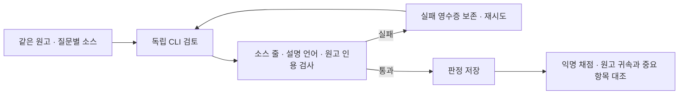

# 한국어와 원고 귀속을 고친 뒤 다시 측정한 정지 검토

**최종 세 회차에서 전체·증분 모두 앱 진단의 일본어 출력과 정지 처리의 원고 과장이 재발하지 않았습니다.** 중요 항목 3/3과 시간 절감은 매번 재현되지 않았습니다. 토큰은 증분이 세 번 모두 적었습니다. [최종 원본 영수증·익명 채점·사전 기준](grounded-final-evidence.zip)

## 검토가 여섯 번 모두 알아낸 것은 무엇인가요?

| 최종 블라인드 판정 | 1회차 전체 / 증분 | 2회차 전체 / 증분 | 3회차 전체 / 증분 |
|---|---|---|---|
| 앱 진단 설명이 한국어인가? | 통과 / 통과 | 통과 / 통과 | 통과 / 통과 |
| 정지 처리 검토가 원고의 의미를 과장하지 않았는가? | 통과 / 통과 | 통과 / 통과 | 통과 / 통과 |
| 대기 요청의 취소·순서 큐 등록·시퀀스 부여를 찾았는가? | 충족 / 충족 | 충족 / 충족 | 충족 / 충족 |
| 취소한 요청이 장치 제출 전에 완료되는 분기를 찾았는가? | 충족 / 충족 | 충족 / 충족 | 충족 / 충족 |
| 이전 앱 완료 신호 누락의 원인과 이를 드러낼 회귀 시험을 모두 찾았는가? | **부분 / 부분** | 충족 / 충족 | 충족 / 충족 |
| **엄격한 중요 항목 집계** | **2/3 · 2/3** | **3/3 · 3/3** | **3/3 · 3/3** |

1회차도 장치에 제출된 적 없는 대기 요청의 장치 제출 **0회**, 앱 완료 신호 **요청별 1회**를 확인하는 시험을 제안했습니다. 다만 두 방식 모두 이전 직접 취소 경로에서 요청이 순서 큐에 등록되지 않아 내부 처리가 끝나도 앱 신호를 받지 못할 수 있다는 연결을 회귀 시험의 확인 과제로 남겼습니다. 고정 채점표는 시험 조건과 실패 원인의 설명을 모두 요구하므로 부분 판정을 미검출로 집계했습니다. 실제 장치에서 이 시험을 수행하지는 않았습니다.

최종 검증기는 코드가 뒷받침하는 주장과 코드에 모순되는 주장에 원고의 정확한 구절을 요구합니다. 빠진 조건·수정안·결과에는 소스가 보여 주는 동작이나 관찰 결과를 직접 적게 하고, 자유 서술에서 원문 표현이 필요하면 «구절»을 원고와 대조합니다. 여섯 결과의 설명 필드 322개를 다시 검사했고, 독립 채점으로 귀속의 의미를 확인했습니다. 같은 검사로 첫 수정의 과장 문장도 거부했습니다. 이 결과는 원고의 모든 문장과 소스 인용이 정확하다는 보증이 아닙니다. 예를 들어 증분에서 재사용한 버퍼 연결 판정 중에는 인용 범위가 실제 연결 코드가 있는 498–499행을 가리키지 않는 항목이 있었습니다.

## 최종 버전에서 절감 효과가 재현됐나요?

| 회차 | 전체 토큰 | 증분 토큰 | 증분 토큰 절감 | 전체 시간 | 증분 시간 | 전체 대비 증분 시간 |
|---|---:|---:|---:|---:|---:|---|
| 1 | 102,301 | 56,838 | 44.4% | 54.72초 | 46.38초 | 8.34초 단축 |
| 2 | 94,498 | 56,963 | 39.7% | 60.75초 | 48.07초 | 12.68초 단축 |
| 3 | 90,066 | 77,900 | 13.5% | 59.81초 | 103.56초 | 43.75초 증가 |
| **합계** | **286,865** | **191,701** | **33.2%** | **175.28초** | **198.00초** | **22.72초 증가** |

증분은 버퍼 연결과 요청 재사용 질문을 매번 재사용해 세 회차 모두 토큰을 줄였습니다. 최종 버전의 시간 절감은 2회만 재현됐습니다. 3회차 증분 정지 처리 응답은 `request.cpp`의 두 함수 창(120–132행과 134–147행)을 120–147행이라는 하나의 인용으로 묶었습니다. 첫 시도에 51.88초와 28,712토큰을 썼고 검증기는 이를 거부했습니다. 같은 모델로 다시 검토한 비용까지 포함하면 세 회차 합계에서 증분이 13.0% 느렸습니다. 3회차 전체의 공통 준비는 Windows 임시 파일 접근 오류로 한 번 재개됐습니다. 이때는 자식 검토 단계가 시작되기 전이었고 모델 호출도 없었습니다.

시간표는 부모를 이미 검토한 뒤 한 변경을 반영하는 비용을 보여 줍니다. 최종 부모 판정 네 개를 새로 만들 때는 원문의 어미를 바꿔 인용한 시도 1건을 포함해 5회 호출, 113,910토큰을 썼습니다. 첫 수정에서는 별도로 공통 부모 준비에 86,400토큰, 그 전에 중단한 준비에 126,326토큰을 사용했습니다. 첫 준비 때는 가나 문자 범위 오타가 `bufferCompleted`의 영문 `f`를 잘못 거부했습니다. 이를 수정하고 원래 응답이 통과하는지 확인한 후 각 실험의 부모 판정을 다시 만들었습니다.

최종 자식 검토에는 478,566토큰, 별도 익명 채점에는 106,745토큰을 사용했습니다. 첫 수정의 자식 검토와 별도 채점 비용은 각각 494,128토큰과 115,552토큰입니다. 일회성 Sol 6.2 구현 두 호출에는 총 69,917토큰을 사용했습니다.

## 이전 두 응답은 어떻게 검증을 통과했나요?

| 이전 3회차 병렬 증분의 결과 | 당시 검사에서 빠진 근거 | 처음 추가한 검사 |
|---|---|---|
| 앱 진단의 주장 10개가 모두 일본어였습니다. | 지침에서 한국어를 지정한 대상은 수정안과 기술적 결과였습니다. 검증기는 주장·수정안·결과의 언어를 검사하지 않았습니다. | 세 필드의 설명을 모두 한국어로 요청합니다. 자연어 부분에 한글이 있는지, 일본어 가나가 섞였는지 응답을 채택하기 전에 점검합니다. 기술 식별자와 원고의 짧은 직접 인용은 구분합니다. |
| 정지 처리 원고가 대기 요청을 `cancelRequest()`로 취소한다고 설명했다는 지적이 나왔습니다. 실제 원문은 “장치 정지가 끝나면 별도 큐의 요청을 앞에서부터 꺼내 취소한다.”였습니다. | 당시 검증기는 소스 줄 범위는 확인했지만, 틀렸다고 지적한 설명을 원고가 실제로 했는지는 대조하지 않았습니다. 변경 전 코드의 함수명이 원고의 진술로 옮겨졌습니다. | 원고가 어떤 사실을 명시했고 그것이 코드와 모순되면 `stale`로 판정하고 해당 원문을 그대로 인용합니다. 원고에 기전이나 조건이 빠졌으면 `missing`으로 기록합니다. 인용은 원문과 대조하고, 그 구절의 의미를 과장했는지는 별도로 채점합니다. |

새 검증기에 당시 실제 응답과 원고를 입력하자 앱 진단은 첫 주장에 포함된 가나로, 정지 처리는 두 번째 주장의 원고 인용 불일치로 거부됐습니다. 같은 두 응답을 사용하는 회귀 테스트를 추가했습니다. 당시 모델이 일본어를 선택한 내부 원인은 영수증에서 확인할 수 없습니다. [이전 3회차 원본과 측정](repeat.md)

## 첫 수정에서 무엇이 남았나요?

처음에는 `stale`에만 원문 인용을 강제했습니다. 앱 진단은 여섯 결과 모두 한국어였고 중요 항목도 모두 3/3이었습니다. 하지만 **정지 처리의 원고 귀속은 6건 중 5건만 통과**했습니다. 3회차 전체 검토에서 “원고는 `doQueueRequests(camera)`가 호출된다고 설명하지만”이라는 주장이 `missing`에 들어갔습니다. 원고의 실제 표현은 “대기 요청을 큐에 넣는 처리가 호출된다”였고 함수명은 소스에만 있었습니다. 앞 문장에서 원고에 없는 동작을 원고의 말로 돌리면, 뒤 문장에서 올바른 누락을 지적해도 그 주장은 부정확합니다.

| 첫 수정 후 회차 | 전체 토큰 | 증분 토큰 | 전체 시간 | 증분 시간 | 앱 언어 / 정지 처리 귀속 |
|---|---:|---:|---:|---:|---|
| 1 | 93,203 | 56,992 | 56.48초 | 50.96초 | 양쪽 모두 통과 |
| 2 | 97,791 | 75,520 | 59.70초 | 79.22초 | 양쪽 모두 통과 |
| 3 | 121,829 | 48,793 | 99.72초 | 58.00초 | 전체의 원고 귀속 실패, 나머지 통과 |

첫 수정에서 증분은 합계 42.0%의 토큰과 12.8%의 시간을 줄였습니다. 2회차 증분과 3회차 전체는 각각 소스 줄 범위 오류로 한 번씩 재시도했습니다. 3회차 채점자는 정지 처리의 귀속 오류를 언어 항목에도 기록했지만 앱 진단의 언어에는 통과 판정을 내렸습니다. 이 채점 원본을 보존했으며 최종 채점에서는 언어와 기술적 귀속의 판정 차이를 명시했습니다. [첫 수정의 전체 영수증과 블라인드 채점](grounded-first-evidence.zip)

## 무엇을 고정하고 비교했나요?

공개 libcamera의 부모 `517b863b`와 변경 `731a340c`, UVC 설정, 한국어 원고 네 개, 질문별 소스 창과 중요 항목 세 개를 고정했습니다. 검토 기준이 달라져 부모의 원고는 바이트 단위로 검증해 가져왔고 부모 판정은 새로 만들었습니다. 전체와 증분 모두 독립 Codex CLI `gpt-6.1-terra` High를 사용하며, 동시에 실행할 수 있는 질문 수는 두 개입니다. 구현은 `gpt-6.2-sol`로 수행했습니다.

세 회차에서 증분→전체, 전체→증분, 증분→전체 순으로 각각 별도 경로에서 검토했습니다. 새 자식 응답은 조건 간에 공유하지 않습니다. 전체는 네 질문을 새로 검토하고, 증분은 질문·원고·소스·정책·실행 설정이 같고 부모 통과 영수증을 검증할 수 있는 항목을 재사용합니다. 토큰은 캐시된 입력을 포함한 입력·출력 합계입니다. 시간은 해당 검토 단계의 시작부터 선별·재사용 검증·필요한 재시도·판정 저장을 마칠 때까지의 경과 시간입니다.



채점자는 각 회차의 두 방식 이름을 가린 상태에서 원고, 실제 검토 결과, 소스, 질문별로 제공된 함수 목록을 받았습니다. 기존 세 기준은 정지 중 대기 요청의 순서 큐 등록과 시퀀스 부여, 이미 취소한 요청의 장치 제출 생략, 장치 미제출 대기 요청의 앱 완료 신호를 관찰하는 회귀 시험입니다. 일부만 발견하면 미검출로 집계했습니다. 설명 언어와 정지 처리 원고의 의미를 과장했는지는 별도 항목으로 판정했습니다. 이번 결과의 범위는 이 공개 변경과 네 질문입니다.

## 원본 확인과 재실행

증거 ZIP의 `control/summary.json`에는 회차별 비용과 판정, `grade*/`에는 익명 채점 입력과 판정·대응표, `block*/`에는 새 검토 응답과 실패 영수증이 들어 있습니다. `verified-parent/`에는 최종 기준으로 새로 만든 부모 판정이 있습니다. 첫 수정에서 중단된 준비 시도는 첫 수정의 증거 ZIP에 들어 있습니다. `sha256.json`으로 파일별 무결성을 확인할 수 있습니다. [검토와 채점 원본](grounded-final-evidence.zip)

같은 CLI 실행 파일·모델·추론 설정이 준비된 프로젝트 환경에서 아래 명령을 실행하세요. 기존 자료가 있다면 처음 두 명령은 생략할 수 있습니다. 재측정에는 새 `build/quality-final` 디렉터리를 사용합니다. 중단된 동일 입력의 작업은 같은 경로에서 이어집니다.

```powershell
python -m zipfile -e docs/libcamera/records/stop-review-comparison/evidence.zip build/stop-review-evidence
git clone --bare https://gitlab.freedesktop.org/camera/libcamera.git build/libcamera-history.git
python -c "from zipfile import ZipFile; ZipFile('docs/libcamera/records/stop-review-comparison/grounded-final-evidence.zip').extract('study.py','build/quality-final')"
uv run python build/quality-final/study.py reviews
uv run python build/quality-final/study.py grade
```
