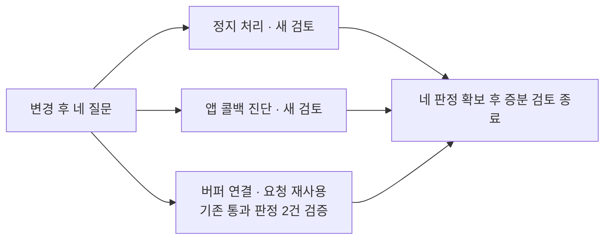

# 같은 libcamera 변경을 세 번 검토한 시간과 품질

**병렬 증분 검토는 세 번 모두 중요 항목 3/3을 찾았고 42.59~47.50초에 끝났습니다.** 두 질문의 근거와 검토 지침을 보존하고 실행 순서만 바꿨습니다. 같은 병렬 전체 검토와 비교하면 매 회차 시간과 토큰이 모두 줄었습니다. [실행 영수증과 블라인드 채점](repeat-evidence.zip)

이후 발견한 일본어 출력과 원고 귀속 문제의 수정 결과는 [한국어와 원고 귀속을 고친 뒤 다시 측정한 정지 검토](grounded.md)에서 확인할 수 있습니다.

## 어떤 누락을 찾아냈나요?

| 블라인드 판정 항목 | 직렬 증분 | 병렬 전체 | 병렬 증분 |
|---|---:|---:|---:|
| 정지 처리에서 대기 요청을 취소하고 순서 큐에 등록하며 시퀀스를 부여하는 단계 | 3회 중 3회 | 3회 중 3회 | 3회 중 3회 |
| 이미 취소한 요청이 장치 제출 전에 완료되는 분기 | 3회 중 3회 | 3회 중 3회 | 3회 중 3회 |
| 앱이 접수했지만 장치에는 제출되지 않은 대기 요청의 완료 신호를 관찰하는 회귀 조건 | 3회 중 3회 | 3회 중 3회 | 3회 중 3회 |

병렬 증분 검토는 세 번 모두 장치에 제출되지 않은 대기 요청을 고정한 뒤 정지를 호출하고, 그 요청의 앱 완료 신호를 따로 기록하는 시험을 제안했습니다. 예를 들어 2회차에는 대기 요청 두 개를 구별하고, 각 요청의 장치 제출은 0회, 취소 상태의 `requestCompleted`는 1회인지 확인하라고 지적했습니다. 전체·증분 양쪽에서 버퍼 연결과 요청 재사용에 대해 잘못된 변경을 제안한 사례는 채점에서 발견되지 않았습니다.

세 기준을 모두 찾은 결과에도 편집상 결함은 있었습니다. 3회차 병렬 증분의 앱 진단 응답은 일본어였고, 정지 처리 응답은 원고가 `cancelRequest()`를 직접 언급한 것처럼 기술했습니다. 원고에는 대기 요청을 취소한다고만 적혀 있습니다. 별도로 채점자는 세 응답에서 정지 처리 질문에 `Camera::requestComplete` 정의가 제공되었다고 보았지만, 실제로 해당 정의는 앱 진단 질문에만 들어 있었습니다. 원본 판정과 이 소스 범위 대조를 함께 보존했습니다. 독립 채점 3회에는 총 121,844토큰이 들었습니다.

## 같은 회차의 전체 검토보다 얼마나 줄었나요?

| 회차 | 직렬 증분 시간 | 병렬 전체 시간 | 병렬 증분 시간 | 병렬 전체 토큰 | 병렬 증분 토큰 | 증분 시간 절감 | 증분 토큰 절감 |
|---|---:|---:|---:|---:|---:|---:|---:|
| 1 | 74.48초 | 70.07초 | 47.44초 | 89,257 | 56,466 | 22.63초 (32.3%) | 32,791 (36.7%) |
| 2 | 88.16초 | 61.47초 | 42.59초 | 92,943 | 47,604 | 18.89초 (30.7%) | 45,339 (48.8%) |
| 3 | 145.58초 | 53.46초 | 47.50초 | 100,268 | 51,695 | 5.96초 (11.1%) | 48,573 (48.4%) |

회차별 절감률의 중앙값은 시간 30.7%, 토큰 48.4%였습니다. 증분에서 새로 호출한 두 검토는 각각 42.68초, 41.08초, 33.28초 동안 겹쳐 실행됐습니다. 순서만 바꿔도 각 호출의 응답 시간과 길이는 달라집니다. 실제로 1회차 직렬 증분은 55,413토큰으로 병렬 증분보다 1,053토큰 적었습니다. 전체 대비 토큰 절감의 원인은 변경되지 않은 두 질문의 판정을 재사용한 데 있습니다.

3회차 직렬 증분은 정지 처리의 소스 인용 한 건이 제공된 근거 창 밖이어서 응답 검증에 실패했습니다. 표에는 실패한 호출의 23,412토큰·39.81초와 재개까지의 약 12.96초가 포함돼 있습니다. 직렬 증분의 토큰은 회차 순서대로 55,413개, 52,063개, 75,798개였습니다. 3회차에서 유효한 직렬 호출 두 건만 더해도 92.54초였습니다. 병렬 전체와 병렬 증분은 세 회차 모두 첫 시도에 유효한 응답을 받았습니다. 전체 9개 조건에서 유효한 새 검토 24건과 실패한 시도 1건에 621,507토큰을 사용했습니다.

검토 시간표와 별도로, 일회성 Sol 6.2 구현 두 시도에는 입력·출력 합계 570,283토큰(캐시된 입력 504,704개 포함)을 사용했습니다. 첫 시도는 Windows 작업 환경에서 파일을 기록하지 못했고, 두 번째 시도에서 필요한 소스를 전달해 변경안을 받아 적용했습니다. 전체 회귀 테스트는 검토와 같은 컴퓨터에서 별도로 실행했습니다.

## 36.95초는 어디에서 늘어났나요?

| 기존 증분 실행 | 정지 처리 | 앱 콜백 진단 | 두 호출 밖에서 쓴 시간 | 입력 토큰 | 출력 토큰 | 중요 항목 |
|---|---:|---:|---:|---:|---:|---:|
| 회귀 조건 검토를 추가하기 전 | 26.22초 | 33.99초 | 0.13초 | 51,246 | 2,908 | 2/3 |
| 회귀 조건 검토를 추가한 후 | 45.85초 | 51.30초 | 0.14초 | 47,763 | 4,987 | 3/3 |

이전에는 정지 처리 결과를 받은 뒤 앱 콜백 진단을 시작했습니다. 첫 호출이 19.63초, 두 번째가 17.31초 길어져 두 증가분이 사용자의 대기 시간에 그대로 더해졌습니다. 질문마다 추가한 변경 전 근거와 지침은 1,600바이트였습니다. 두 응답이 다룬 주장 수는 16개에서 20개로, 출력은 2,079토큰 늘었습니다. 네이티브 CLI 영수증에는 서버 대기·추론·출력 생성의 개별 시간이 없어 응답 길이만으로 36.95초 전체의 원인을 설명할 수 없습니다. [최초 비교](README.md) · [회귀 조건을 추가한 비교](followup.md)

## 세 조건에서 무엇을 같게 유지했나요?

부모 `517b863b`에서 자식 `731a340c`로 바뀐 공개 libcamera의 정지 경로를 검토했습니다. 전체는 기존 네 원고를 모두 새로 검토합니다. 증분은 같은 네 원고 중 정지 처리와 앱 콜백 진단만 새로 검토하고, 버퍼 연결과 요청 재사용은 부모의 통과 판정·원본 응답·입력 지문을 다시 확인합니다. 세 조건에서 질문별 모델 입력은 이전 3/3 실행과 바이트 단위로 일치합니다. 각 새 질문은 독립 Codex CLI `gpt-6.1-terra` High로 실행했고 병렬 구현에는 `gpt-6.2-sol`을 사용했습니다.

| 회차 | 첫 번째 | 두 번째 | 세 번째 |
|---|---|---|---|
| 1 | 직렬 증분 | 병렬 증분 | 병렬 전체 |
| 2 | 병렬 증분 | 병렬 전체 | 직렬 증분 |
| 3 | 병렬 전체 | 직렬 증분 | 병렬 증분 |

조건 사이에 새 응답을 재사용하지 않았습니다. 병렬 조건은 최대 두 질문을 동시에 실행하며 각 질문은 전용 작업 경로와 영수증을 사용합니다. 시간은 증분 선별과 영수증 검증을 포함해 해당 검토 단계의 시작부터 종료까지 측정했습니다. 공통 준비·구현·별도 채점은 표에서 제외했습니다. 토큰은 CLI가 보고한 입력과 출력의 합이며 캐시된 입력을 포함합니다. 같은 시점의 직렬 증분이 병렬화 효과를 판단하는 대조군입니다. 최초 60.34초와 후속 97.30초는 각 한 번의 관측값입니다.

각 회차의 세 결과를 임의의 이름으로 가린 다음 독립 Terra High CLI에 고정된 채점표·원고·소스와 함께 전달했습니다. 정지 때 대기 요청을 취소하고 순서 큐에 등록하는 단계, 이미 취소된 요청의 장치 제출을 건너뛰는 분기, 장치에 제출된 적 없는 대기 요청의 앱 완료 신호를 관찰하는 회귀 시험이 평가 대상입니다. 해당 질문에서 일부만 발견한 경우 미검출로 집계했습니다. 기기에서 콜백을 계측하거나 사내 HAL을 검토하는 작업은 이번 측정 범위 밖입니다.



## 같은 측정을 다시 실행하려면

기존 실험과 일치하는 Codex CLI 실행 파일과 승인된 로그인 환경이 필요합니다. 저장소 루트에서 프로젝트 의존성을 설치하고 새 작업 경로에 아래와 같이 준비합니다. 반복 실행기만 새 실험 폴더에 꺼내면 측정 결과와 함께 묶인 과거 응답을 새 측정에 가져오는 일을 피할 수 있습니다.

```powershell
python -m zipfile -e docs/libcamera/records/stop-review-comparison/evidence.zip build/stop-review-evidence
git clone --bare https://gitlab.freedesktop.org/camera/libcamera.git build/libcamera-history.git
python -c "from zipfile import ZipFile; ZipFile('docs/libcamera/records/stop-review-comparison/repeat-evidence.zip').extract('study.py','build/repeat3')"
uv run python build/repeat3/study.py reviews
uv run python build/repeat3/study.py grade
```

실패한 시도를 포함한 새 호출의 원본 응답과 토큰 수는 증거 묶음의 각 `block*/`에, 실행 방식과 익명 표기의 대응 관계 및 소스 대조 결과는 `grade*/`에 들어 있습니다. 세 기준의 항목별 판정과 호출별 시작·종료 시각은 `control/summary.json`에서 확인할 수 있습니다. [원본 영수증과 채점](repeat-evidence.zip)
