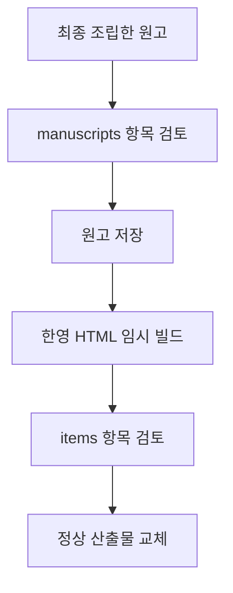

# 항목별 시각화 검사

최종 한영 사이트의 모든 항목을 조사한 뒤, 검토 장부가 현재 입력과 일치할 때만 발행하도록 설정합니다. 이 검사는 그림의 의미를 스스로 승인하거나 사람 승인 상태를 변경하지 않습니다.

## 목록을 먼저 만들기

기존 배포를 조사할 때는 manifest의 HTML 목록을 사용합니다. 홈·참조·시나리오와 영어 대응 페이지도 포함합니다.

```powershell
python -m sdd.visual_audit --site build/site --config sdd.yaml --source-commit <facts의-커밋> --out build/item-inventory.json
```

각 H2와 H3 이하 제목을 별도 항목으로 기록합니다. 독립 질문인지 판단하기 전에는 작은 제목도 조사 목록에 남깁니다. 제목 앞의 페이지 설명은 별도 항목입니다. 실제 앵커가 없는 HTML 제목은 `$heading-N`이라는 조사 식별자를 쓰며 `url`은 실제 페이지 주소를 가리킵니다. 존재하지 않는 앵커 URL을 만들지 않습니다.

본문은 가장 가까운 제목의 항목에 한 번만 계산합니다. 그림 제목도 `role: visual_title`인 보조 항목으로 남겨 주석 범위가 실제 질문을 숨기지 않도록 검사합니다. 독립 질문이 아닌 캡션은 해당 그림과의 관계를 기록해 생략 판정할 수 있습니다. 표, 소스 발췌·검증 로그·코드와 그림 근거는 설명 분량과 분리합니다. 일반 설명을 접어 숨겨도 본문에 포함합니다. 부모 항목의 지문은 자식 구조도 포함하므로 절을 분할하거나 옮기면 관련 검토를 다시 요구합니다.

600자 또는 문단 3개는 후보를 찾는 초기 기준입니다. 상태·순서·분기·책임·소유권 신호는 짧은 항목도 후보로 표시합니다. 신호는 정규식에 따른 조사 보조 정보이며, 신호가 없다는 이유로 검토를 생략하지 않습니다. 모든 항목의 최초 상태는 `unreviewed`입니다.

## 프로젝트 설정

```yaml
visual_audit:
  enabled: true
  reviews: config/item-visual-reviews.json
  thresholds:
    ko:
      chars: 600
      paragraphs: 3
      rationale: 실제 한국어 항목의 분량과 질문을 대조한 기록입니다.
    en:
      chars: 600
      paragraphs: 3
      rationale: 대응 영어 항목의 분량과 같은 질문을 대조한 기록입니다.
  deferred_pages:
    unfinished.html: 다른 작업의 병합 뒤 통합 검토가 필요합니다.
```

`enabled`의 기본값은 `false`입니다. 언어별 수치를 지정하면 `rationale`이 필요합니다. `signals`에는 기본 신호를 보완하거나 교체할 이름별 정규식을 지정할 수 있습니다. 프로젝트·언어 설정을 바꾸면 해당 정책에 연결된 지문을 다시 검토합니다. `deferred_pages`에 남아 있는 페이지는 장부에 통과 판정이 있어도 발행할 수 없습니다.

## 판정과 검토 범위

장부의 `schema`는 1이며 `items`는 최종 HTML 항목 ID를 키로 사용합니다. 아래는 표로 충분하다고 검토한 항목의 형식 예시입니다. 해시와 사유는 실제 조사 결과로 작성합니다.

```json
{
  "schema": 1,
  "items": {
    "reference.html#values": {
      "fingerprint": "현재 조사 목록의 fingerprint",
      "status": "omit",
      "question": "각 값은 무엇을 뜻합니까?",
      "reason": "독립된 세 값의 뜻을 두 열 표가 직접 설명하며 순서·분기 관계가 없습니다.",
      "source_windows": ["item:reference.html#values"],
      "unreviewed_scope": []
    }
  },
  "manuscripts": {}
}
```

| 상태 | 요구하는 기록 |
|---|---|
| `appropriate` | 질문, 적절성의 개별 사유, `figures`의 로컬 그림 ID, 실제 검토한 창과 미검토 범위를 기록합니다. |
| `needs_visual` | 빠진 관계와 보완할 질문을 기록하며 발행은 차단합니다. |
| `omit` | 짧고 단순함 또는 표로 충분함 등 항목별 사유와 검토 범위를 기록합니다. |
| `unreviewed` | 부족한 근거와 미검토 범위를 보존하며 발행은 차단합니다. |

같은 페이지에서 바로 인접한 형제 항목의 그림을 검토한 경우에만 `adjacent_item`, `adjacent_fingerprint`와 `figures`로 연결할 수 있습니다. 연결할 때 같은 질문을 설명하는 이유를 적습니다. 먼 항목이나 다른 페이지의 그림 링크는 그림으로 인정하지 않습니다. 그림이 있더라도 장식·중복·무관한 관계라면 `appropriate`로 판정하지 않습니다.

`source_windows`는 항목의 `source_window_hashes`에 있는 실제 창을 선택합니다. `item:<항목 ID>`는 조사 목록에서 설명·표에 결합된 문서 창이며 웹 앵커 URL이 아닙니다. 로컬 발췌·절 앵커와 로컬 파일은 실재 여부와 내용 지문을 검사합니다. 확보하지 않은 외부 URL이나 존재하지 않는 줄 범위는 검토한 근거로 인정하지 않습니다.

지문은 설명·표·제목 구조·하위 항목·그림 원문·로컬 소스 창과 소스 커밋에 연결됩니다. 새 장문, 절 이동·분할, 그림 삭제, stale로 생략된 그림과 근거 변경은 기존 판정의 재사용을 막습니다. 한영 항목의 대응·그림 구조와 상반된 판정도 검사합니다. 레이블의 의미가 같은지는 별도 내용 검토가 필요합니다.

## 생성과 발행의 검사 경계



`generate`는 원고를 조립한 뒤 같은 항목 검사기를 사용합니다. 원고 렌더링과 최종 사이트의 지문은 서로 다를 수 있으므로 원고 판정은 장부의 `manuscripts`에 따로 기록합니다. 원고 판정이 최종 한영 사이트 판정을 대신하지 않습니다. 새 초안을 별도 출력 경로에서 준비할 때는 검사를 끄고 조사할 수 있으나, 이 결과를 발행 검증 통과로 보고하지 않습니다. focused 생성 응답의 JSON 필드는 변경하지 않습니다.

`export-site`는 한영 HTML과 링크 검사를 끝낸 임시 디렉터리에서 전체 항목을 검사합니다. 미해결 항목이나 불일치가 있으면 기존 사이트를 교체하지 않습니다. 통과하면 `item-visual-audit.json`을 사이트 manifest의 소유 산출물에 포함합니다. `verify-site`는 보고서 해시뿐 아니라 현재 HTML의 항목 지문도 다시 계산합니다. 그림 근거·노드 한도·원고 커밋 검사는 기존 생성 경로가 계속 담당합니다.

생성 중 뒤 항목이 실패하면 이번 실행에서 앞서 저장한 원고도 되돌립니다. 프롬프트·실패 응답·검토 기록은 원인 조사용으로 남깁니다. 자동 검사와 LLM 검토는 사람 승인, 실제 독자 평가, 기기 실행 또는 사내 HAL 검증을 뜻하지 않습니다.

다음 단계: [사이트 실행·화면 검증](../concepts/site.md)에 따라 데스크톱과 모바일에서 실제 그림을 확인합니다.
