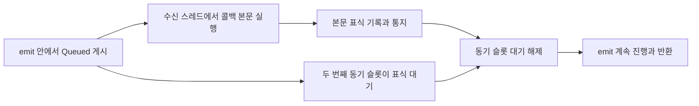

# 요청·버퍼 경로의 근거 충분성 검증

이 실험은 [이슈 #252](https://github.com/TTolsun/camera-hal-sdd-generator/issues/252)의 일곱 질문을 대상으로 합니다. 상세 계약의 소유 문서는 `request-lifecycle.md`이며, 공통 요청 처리와 UVC/V4L2 경계를 연결합니다. 전체 문서의 그림 보완(#215), 실제 비작성자 평가(#163·#253), 사내 HAL 검증(#251)은 완료 대상으로 포함하지 않습니다.

## 생성 전에 고정한 기준

- 질문은 [questions.yaml](questions.yaml)의 Q1–Q7입니다. 제출 성공 뒤 완료 누락, 제어·QBUF 실패의 부작용, 프레임과 요청의 서로 다른 완료, 포인터·fence 수명, 정지 실패, 콜백 전달·재진입, 변경 후 불변조건을 묻습니다.
- 초기 분석 커밋은 공식 libcamera `293d751a814e0d4c34e85ad457ccd9d5eefd1a61`입니다. 병행 공개 갱신 뒤 최종 생성 전에는 upstream HEAD `be7e83e91348250c015aad6d6f59f1468555bae8`로 기준을 옮기고 별도 새 빌드·추출을 수행했습니다. 최종 관련 소스 27개 창은 두 커밋에서 바이트가 같습니다. 이전 원고·검토·신호 프로브는 당시 커밋의 증거로 유지하며 새 HEAD의 실행으로 바꾸지 않습니다.
- 공개 문서의 전체 구조 facts와 비선택 원고는 최신 공개 manifest에 결합한 같은 커밋의 입력을 보존합니다. 별도 새 UVC 빌드·추출은 그 facts 전체를 새로 검증했다고 표시하지 않습니다. 동시 작업의 #249 수명 질문과 그림도 보존합니다.
- 별도 깨끗한 소스와 새 외부 빌드 디렉터리에서 Meson과 Ninja를 실행했습니다. UVC만 선택하고 IPA·GStreamer·qcam·문서·테스트·lc-compliance는 비활성화하며 cam은 활성화했습니다. 새 구성과 전체 빌드는 성공했습니다. 빌드 옵션·컴파일 DB·생성 헤더/소스 16개의 해시를 추출 전후에 대조했습니다.
- 최종 독립 추출은 135개 번역 단위에서 파싱 오류가 없고 필수 클래스 6개가 있습니다. GCC가 허용하는 C99 배열 지정 초기화 때문에 `controls.cpp`의 분석 명령에만 `-Wno-error=c99-designator`를 추가했습니다. 다른 진단을 숨기거나 원래 빌드 옵션을 바꾸지 않습니다.
- 원래 빌드의 lc-compliance 자동 활성화와 141개 번역 단위 기록도 보존합니다. 최종 증거는 새 구성의 135개 번역 단위 기록이며 두 결과를 같은 실행으로 합치지 않습니다.

초기 검토 창은 20개였으며, Signal 주석의 반환 선후 표현을 구현과 대조하는 과정에서 Thread·메시지·기본 Poll 디스패처와 관련 헤더 5개를 추가했습니다. 기존 범위와 실패 판정은 보존하고 교정 생성 전에 26개 창을 다시 고정했습니다.

생성에 선택한 발췌 외에도 camera, request, pipeline handler, UVC, V4L2 device/video device, framebuffer, Object·Signal·BoundMethod, notifier·timer와 관련 헤더·스레드 계약의 전체 27개 파일을 독립 검토에 제공합니다. 실제 목록·해시는 실행의 `scope.json`과 `source-windows/`에 기록합니다. 커널 UVC 드라이버·다른 파이프라인·IPA·물리 장치·DMA·성능은 검토하지 않았습니다.

## 기존 공백과 반례

기존 자원 소유권·재사용 설명과 과거 가상 프로브 관찰은 보존합니다. 사전 독립 검토는 필수 질문별로 이미 있는 답과 누락을 구분했습니다. 보완의 기준은 다음 판단을 근거와 함께 할 수 있는지입니다.

| 질문 | 기존에 부족했던 판단 | 연결한 조사·변경 경계 |
| --- | --- | --- |
| Q1 | 제출 0 뒤 어느 비동기 단계가 멈췄는가 | queued 메서드 진입, 준비 생산자·timeout, 선두·큐 한도, 재진입 전 pop, 제출 순서 |
| Q2 | 실패 전에 제어가 이미 적용됐을 수 있는가 | 변환 오류 무시, setControls의 부분 쓰기, error_idx, QBUF 실패와 취소 |
| Q3 | 요청 완료가 프레임 성공을 뜻하는가 | DQBUF 실패·인덱스·플레인·bytesused, FrameError, 명시적 요청 완료와 선두 반환 |
| Q4 | 버퍼 신호에서 재사용해도 되는가 | 신호 뒤 pending 제거, 이전 완료가 새 Request 연결을 지우는 반례, 지연된 포인터 수명 |
| Q5 | stop 0을 반환·배출 보장으로 읽어도 되는가 | 대기 분리, 무시된 STREAMOFF/releaseBuffers 오류, cache 해제 뒤 잔존 알림의 조건부 접근 |
| Q6 | Blocking stop이면 다른 수신자도 끝났는가 | Auto/Direct/Queued/Blocking과 비Object 즉시 호출, 이벤트 루프·호출자 동기화·중첩 호출 |
| Q7 | 변경 후 어느 실패를 주입하고 무엇을 기록해야 하는가 | 정상 erase와 bulk 취소 clear의 차이, 요청별 완료·순서·pending, 정지와 queued 제출 교차 |

STREAMOFF 실패 뒤 유효한 DQBUF가 실제 발생하는지, 정지 후 queued 메서드 실행 조건이 실제 성립하는지는 조사·시험 조건입니다. 소스의 조건부 위험을 새 실기기 관측이나 지원·복구 보장으로 바꾸지 않습니다. 오류 주입 계획을 실행 완료로 표시하지 않습니다.

## 생성과 검토의 구분

새 생성·번역과 독립 검토는 각각 실제 Codex CLI의 `gpt-6.1-terra`, `-c 'model_reasoning_effort="high"'`를 사용합니다. 독립 검토 프로필은 생성 프로필과 별개이며, 정확성·충분성·한영 대조는 서로 다른 호출입니다. 원본 요청·응답·native stdout·receipt와 실패·재시도 기록을 보존합니다. 다른 CLI나 직접 API로 새 성공을 대체하지 않습니다.

문장 정확성 검토는 인용·조건·주체·시점을 대조합니다. 충분성 검토는 생성 발췌 밖의 전체 관련 소스에서 반례를 찾아 Q1–Q7 각각의 답 위치·관찰 값·다음 분기·변경 검증 조건을 확인합니다. 정확한 인용만으로 충분성을 승인하지 않습니다. 질문별 그림 또는 구체적인 생략 사유도 별도로 확인합니다. 자동 검토 결과는 사람 승인이나 실제 독자 평가가 아닙니다.

공통 생성기의 그림 검사는 `->` 접근을 비교 연산으로 오인하지 않으면서 비교식의 숫자·수신자·식 확장을 구분합니다. 간선 양 끝의 심볼이 실제 인용에 있는지 대조합니다. 한 함수의 두 발췌를 연결하는 정상 흐름도 있으므로 단일 발췌 안의 동시 출현을 요구하지 않습니다. 실험 중 추가했던 이 과도한 제한은 기존 정상 흐름 여섯 그림의 오탐으로 철회했습니다. 이 검사는 어휘·인용 결합 검사이며 관계·순서의 의미 분석이나 충분성 검토를 대체하지 않습니다. 숫자에 붙은 마침표는 C++ 실수 표기와 모호하므로 명확한 레이블로 다시 작성해야 합니다.

기존 그림의 이전 정책 fingerprint는 입력·CLI·스타일이 정확히 일치할 때만 현재 정책으로 다시 검사합니다. `revalidate_visuals.py`는 공통 생성기 함수를 사용하고 새 추론을 금지하며 본문 불변을 확인합니다. 원래 모델·정책·fingerprint를 보존하고 `new_inference: false` 재검증 기록만 추가합니다. 실패하면 해당 선택 CLI의 명시적인 재생성이 필요합니다.

## emit 반환 선후의 별도 반례

Signal의 일반 Doxygen은 타스레드 슬롯이 emit 반환 뒤 호출된다고 서술합니다. Auto가 타스레드 수신자를 보아 Queued를 선택한 경우와 명시적 Queued의 실제 구현은 메시지를 게시하고 기다리지 않습니다. Thread 큐의 잠금 해제·소비 경로를 함께 읽으면 타스레드 수신 실행을 emit 반환 뒤로 고정할 수 없습니다. 명시적 Direct는 수신 객체의 소속과 관계없이 발신 문맥에서 호출됩니다.

`signal_before_return.cpp`는 같은 분석 커밋의 libcamera-base 내부 Thread API를 사용합니다. 두 번째 동기 슬롯이 수신 **본문 표식**을 기다리게 하여 첫 Queued 수신자가 emit 진행 중 실행될 수 있다는 반례를 만듭니다. 표식을 수신 함수의 정확한 반환 명령 관측으로 바꾸지 않습니다.



| 실제 프로브 경우 | 수신 문맥 | emit 진행 중 수신 본문 표식 |
| --- | --- | --- |
| Auto·타스레드 소속 | 수신 스레드 | 확인 |
| 명시적 Queued | 수신 스레드 | 확인 |
| 명시적 Direct·타스레드 소속 | 발신 스레드 | 확인 |

최종 반복 프로브 06은 별도 새 UVC 전체 빌드 `build-provenance-signal.json`이 성공한 직후 기록한 라이브러리 출력 해시를 검사합니다. 실제 로더 경로도 같은 파일인지 대조한 뒤 실행합니다. 프로브 05의 원래 빌드 결합 기록도 유지합니다. 초기 프로브 03·04는 관측 결과와 실행 중 파일 불변만 확인한 원래 기록으로 보존하며, 빌드 출력 결합을 처음부터 검증했다고 바꾸지 않습니다. 원래 135개 번역 단위 추출은 앞선 fresh 빌드의 결과로 유지합니다.

이 시험은 연결·수신 객체를 유지한 제한된 비카메라 반례입니다. 모든 실행의 순서, 실제 카메라 촬영, 포인터 오류 주입, 지연 시간, 동시 연결 파괴나 사내 HAL을 검증하지 않습니다. 다른 정지·장치 실패 주입은 문서의 검증 계획이며 실행 결과가 아닙니다.

## 실행 파일

`capture_build.py`와 `extract_uvc.py`는 WSL에서 새 빌드와 독립 추출을 수행합니다. 기존 빌드·실행 폴더를 덮어쓰지 않습니다. `prepare.py`는 공개 issue214 입력을 기준으로 범위를 고정하고 현재 질문 설정을 적용합니다. `refine.py`는 독립 검토의 지적을 질문·발췌·그림 계획에 반영하며 생성된 본문을 직접 고치지 않습니다.

```powershell
uv sync --frozen --extra dev
.venv/Scripts/python.exe examples/libcamera/validation/issue252/prepare.py
.venv/Scripts/python.exe tools/run_sdd.py --config build/issue252/run/generation.yaml generate --sections request-lifecycle
.venv/Scripts/python.exe examples/libcamera/validation/issue252/audit.py accuracy --attempt NEW
.venv/Scripts/python.exe examples/libcamera/validation/issue252/audit.py sufficiency --attempt NEW
```

준비에는 `build/issue252/source`의 공식 분석 커밋 checkout, `build/issue252/public`의 공개 배포 저장소와 보존된 issue214 자료, 새 빌드의 provenance가 필요합니다. 기존 실행을 덮어쓰지 말고 별도 작업 디렉터리에서 수행합니다. 원본 archive의 로컬 절대 경로·실행 당시 CLI 명령은 역사 증거로 보존하며 새 환경에서는 별도 프로필의 경로를 지정합니다. 앱·CLI 전역 설정은 변경하지 않습니다.

`publication.py`는 최초 프로필을 구성합니다. 병행 공개 갱신 뒤에는 `integrate_public_base.py`가 실제 공개 manifest와 일치하는 원고·구조 facts·스타일을 확인하여 다른 페이지를 보존합니다. 원래 요청 본문이 착수 기준과 같다는 사실도 별도로 확인합니다. `reader_questions.py`는 전체 검증 질문을 유지하면서 해시로 연결한 짧은 독자용 탐색 질문을 표시합니다. 과거 페이지의 인증 프로필과 새 번역·별도 계약 검토 프로필은 분리합니다. 이후 일반 번역 카탈로그 준비, `audit-consistency`, `export-site`, `verify-site` 관문을 사용합니다. 생성 HTML은 직접 수정하지 않습니다. `browser_test.cjs`는 한영 각각의 데스크톱·모바일 크기에서 질문별 그림 확대·검색·확대율·Escape·초점 복귀, 소스 발췌와 검색을 확인합니다. 실제 휴대폰이나 사람 읽기 평가로 표시하지 않습니다.

최종 원본 검토·질문별 전후 비교·테스트·출판 manifest·배포 확인은 이 실험의 실행 증거와 공개 `publication/issue252`에 연결합니다. 생성기 병합, 공개 SDD 병합, Pages, 실제 공개 파일 일치는 각각 별도로 확인해야 합니다.

호출 연결을 보완하기 전 25개 창의 scope와 검토는 그대로 보존합니다. 최종 교정 전에 Object::invokeMethod의 전체 템플릿 헤더를 더해 26개 창으로 고정했습니다. API 호출→BoundMethod 활성화→메시지 게시→handler의 연결을 이 추가 창에서 확인합니다.

QBUF 이전 cache 정리의 근거에는 함수 이름만 쓰지 않고 실제 scope_exit의 소멸자·active_·release 정의를 연결했습니다. 같은 be7 고정 빌드의 utils.h 전체를 27번째 검토 창으로 추가했으며 이전 26개 창의 검토는 그대로 보존합니다. stage를 선언한 native 그림은 해당 H3의 완전한 블록·내용과 함께 검증합니다. 메타데이터 이월은 원본의 LF·CRLF 본문 바이트와 해시를 보존하며 새 공개 입력의 원본도 이전 스냅샷 위에 쓰지 않습니다.
