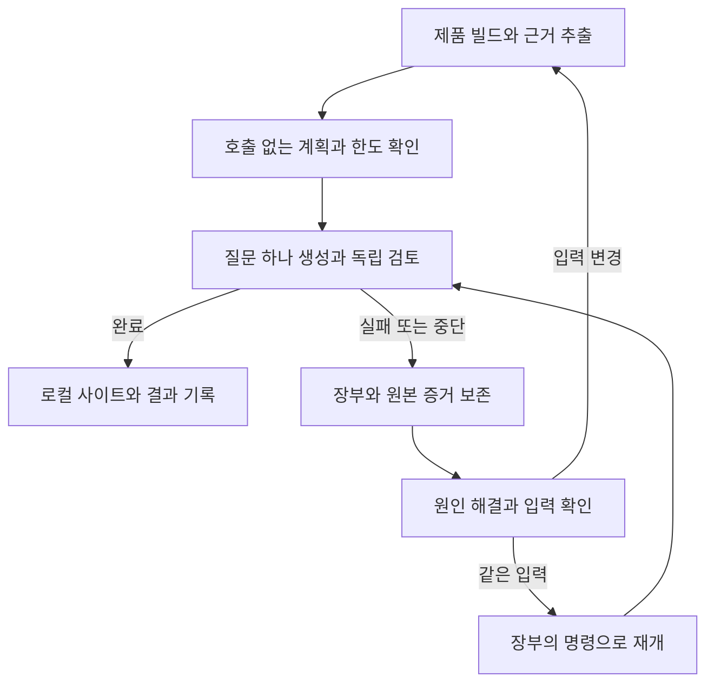

# Camera HAL SDD 작성과 운영

**설정부터 근거 있는 계약 초안과 검증된 사이트까지 직접 수행합니다.** 설정 예시만 주거나 빈 계약을 사람에게 넘기고 끝내지 않습니다. 부족한 필수 정보만 질문하고, 독립적으로 가능한 작업은 계속합니다.

반입 ZIP을 받은 경우 [패키지 시작 안내](../../docs/inhouse/package.md)의 무결성 검사·실행 순서·합격 기준·복구 진입점을 먼저 사용합니다. 안내와 CLI는 같은 커밋의 파일을 사용하며 설치된 스킬만 최신 것으로 바꾸지 않습니다.

릴리스에서 처음 시작하면 `camera-hal-sdd-inhouse-<날짜>.zip`과 그 릴리스의 체크섬·검증 기록을 사용합니다. GitHub 자동 Source code 압축 파일은 반입본이 아닙니다. 설치·파일 수정 전에 `python tools/verify_import.py`를 실행하고 `source_commit`·`verified_files`를 기록합니다. ZIP 안의 `START_PROMPT.txt` 또는 Hermes를 선택한 경우 `START_PROMPT_HERMES.txt`와 같은 버전의 스킬을 사용합니다. Python wheel·제품 툴체인·CLI·모델 인증·Mermaid 자산은 별도 준비 항목입니다. 외부 다운로드는 승인된 준비 환경에서만 수행합니다.

모델 실행은 사용자가 선택한 CLI를 따릅니다. `agent.kind: cli`와 `agent.runner`로 Hermes(`hermes`), OpenCode(`opencode`), Claude Code(`claude`), Codex(`codex`)를 독립 실행합니다. 사내에서 Hermes를 선택했다면 공개 예제나 템플릿의 Codex 기본값으로 되돌리지 않습니다. 선택이 없으면 기존 사내 설정을 유지하고, 신규 적용에서 승인된 실행기가 정해지지 않았으면 모델 호출 전에 확인합니다. [CLI 선택 안내](../../docs/inhouse/cli-agents.md)에 따라 최종 `runner`·`command`·`model`·`args`를 확인하며 모델·제공자·추론 강도는 선택한 CLI에 맞춥니다. CLI 실패를 다른 CLI·직접 API·저장 응답·수동 원고로 대체해 성공으로 보고하지 않습니다.

## 저장소와 실행 환경 찾기

1. 사용자에게 받은 생성기 저장소 경로를 확인합니다. 경로가 없으면 현재 작업 공간에서 `pyproject.toml`, `src/sdd/`, `docs/inhouse/agent.md`가 함께 있는 곳을 찾습니다. 없으면 반입된 생성기 위치를 요청합니다. 이 스킬만으로 생성기를 설치하거나 공개 원격을 임의로 복제하지 않습니다.
2. 생성기와 실제 작업 대상의 `AGENTS.md`를 읽습니다. 이 파일의 문서 링크는 **생성기 저장소 안의 원본 위치 기준**입니다. 스킬을 다른 곳에 설치했으면 생성기 루트에서 `docs/`, `style/`, `examples/`를 찾습니다. 복사된 스킬 폴더의 상대 경로를 그대로 실행하지 않습니다.
3. 반입본에는 Git 이력과 설치된 의존성이 없습니다. `IMPORT-MANIFEST.json`의 `source_commit`을 생성기 버전으로 기록합니다. 의존성을 준비한 뒤 `<PY> tools/run_sdd.py --config <사내 설정>/sdd.yaml ...`로 동봉 소스를 실행할 수 있습니다. 작업 디렉터리 밖에서도 래퍼의 절대 경로를 사용하면 됩니다.
4. 생성기 루트에서 `uv run sdd --config <사내 설정>/sdd.yaml ...`을 실행합니다. 사내에서 준비한 가상 환경의 `sdd` 실행 파일 또는 `python -m sdd.cli`도 사용할 수 있습니다. 실행 도우미가 필요하면 [종료 코드 전달 규칙](../../docs/reference/cli.md#설치된-가상-환경에서-실행)을 따릅니다. 상대 설정 경로는 셸의 현재 디렉터리 기준이고, YAML 내부 경로는 설정 파일 기준입니다.

작업 에이전트와 생성기의 모델은 별개입니다. 전자는 실제 소스에서 질문·범위를 작성하고 후자는 `sdd.yaml`의 `agent`로 선택합니다. 기본 사내 템플릿은 `design_generation: llm`으로 답변을, `generation: llm` 그림 계획으로 시각화를 생성합니다. 이 모드에 `statements`·노드·화살표를 정답으로 미리 넣지 않습니다. 모델 없이 직접 검토한 계약을 선택하려면 LLM 모드를 제거하고 소스에 연결한 `statements`와 그림을 작성합니다.

## 반드시 유지할 경계

- 사내 소스와 파생 설정·facts·원고·프롬프트·로그는 사내에 둡니다. 공개 libcamera 갱신 지시는 사내 입력을 공개 저장소로 보내라는 권한이 아닙니다. 모델·소스 링크·게시·정적 자산의 목적지와 로컬 설정 덮어쓰기를 확인합니다.
- 생성된 Markdown·HTML을 직접 고치지 않습니다. 설명은 `sections.yaml`, 화면은 생성기에서 수정한 뒤 다시 생성합니다.
- 근거 해시만 바꾸거나 필수 질문·시나리오·인용 검사를 지워 통과시키지 않습니다. 코드 변경은 설명을 다시 대조한 뒤 반영합니다.
- 자동 검사와 에이전트 검토를 사람 승인으로 기록하지 않습니다. `sdd accept`의 승인 기록은 사람이 검토를 마쳤다고 직접 지정한 문서·항목에만 수행합니다.
- 기존 게시 관문을 실패 회피 목적으로 내리지 않습니다. 새 템플릿의 승인 전 로컬 미리보기는 허용하되, 사내 게시에는 정해진 승인 정책을 적용합니다. 게시·예약은 사용자가 허용한 사내 대상과 범위에 한합니다.

## 요청별 실행 절차

| 요청 | 읽고 수행할 절차 |
|---|---|
| 처음 적용합니다. | 아래 첫 실행 절차로 질문 하나를 검증하고, [사내 파일럿](../../docs/inhouse/pilot.md)에 제품·빌드 변형·요청 경로의 판정을 남깁니다. |
| 제품 범위를 넓힙니다. | [사내 실행 가이드](../../docs/inhouse/agent.md)의 환경 → 추출·계약 → 문서·화면 → 반복 운영 → 완료 기록을 수행합니다. NDK-build를 기본 사실로 가정하지 않습니다. |
| 계약을 쓰거나 근거 변경을 고칩니다. | [소스에서 계약 작성하기](../../docs/inhouse/contract-authoring.md)를 수행합니다. LLM 모드는 질문·발췌·covers를 작성하고 생성기가 답변과 해시를 만듭니다. |
| 상태·요청·소유권·실패 그림을 자동화합니다. | [그림 생성 절차](../../docs/concepts/site.md#사내-llm으로-초안-자동-생성하기)에 따라 질문을 실제 근거와 연결합니다. 실제 호출 영수증과 변경 전후 재생성을 검증합니다. |
| 새 커밋을 반영합니다. | 아래 갱신 절차와 [갱신 시스템](../../docs/inhouse/03-update-system.md)을 수행합니다. |
| 추출·생성·게시가 실패했습니다. | 아래 실패 대응과 [문제 해결](../../docs/inhouse/troubleshooting.md)에서 원인을 좁힙니다. |

처음 계약을 쓰거나 편집할 때는 [집필 규칙](../../style/README.md)의 두 원문과 [독자별 품질](../../docs/concepts/reader-quality.md)을 읽습니다. 필수 항목과 형식은 [sections.yaml 참조](../../docs/reference/sections.md)가 기준입니다. 다른 파일에 스키마를 새로 정의하지 않습니다.

사용자가 실제 LLM으로 자동 생성 시험을 요청하면 에이전트가 작성한 `statements`나 `response-bundle`로 대신하지 않습니다. [선택한 CLI의 시험 절차](../../docs/inhouse/cli-agents.md#공개-입력으로-재생성-시험)를 사용하고, 실제 대상 문서는 별도 출력 경로에서 생성·검사·번역·사이트 검증·반복 빌드를 확인합니다. 실행한 섹션과 미실행 범위, 원응답·영수증을 기록하며 작은 공개 시험을 전체 문서나 사내 HAL 검증 완료로 표시하지 않습니다. Ollama는 선택한 CLI 뒤의 제공 서버로 사용할 수 있습니다. [직접 HTTP 비교 시험](../../docs/inhouse/contract-authoring.md#사내-llm-생성-시험)은 사용자가 별도로 요청한 경우에만 수행하며 CLI 시험과 구분합니다. 소스 구조에서 직접 만드는 색인·그림과 LLM이 쓰는 설명을 구분하고 실패한 실행도 보존합니다. 자동 검사 결과를 의미 검토나 사람 승인으로 기록하지 않습니다.

## 첫 실행과 중단 후 재개

**실제 제품의 질문 하나로 계획·생성·독립 검토·로컬 확인을 먼저 끝냅니다.** [첫 실행 안내](../../docs/inhouse/02-first-run.md)가 명령과 판정의 기준입니다. 반입 릴리스에 `START_PROMPT_ISSUE251.txt`가 있으면 제품 하나·빌드 변형 하나·캡처 요청 경로 하나의 파일럿에 사용합니다. 없는 버전에서는 동봉 시작 프롬프트와 가이드를 따릅니다.

그림은 첫 실행 순서와 재개 경로를 보여 줍니다. 같은 입력이어도 재사용 여부는 생성기의 검증 결과로 판단하며, 로컬 확인은 사람 승인·사내 게시와 구분합니다.

1. 제품·변형·소스 SHA와 첫 질문의 통과 조건을 고정합니다. `doctor`로 로컬 입력·도구를 확인하고 실제 제품 빌드의 compile DB·생성 헤더를 준비한 뒤 `extract`를 실행합니다. `doctor --header <경로>`로 필요한 헤더를 확인할 수 있습니다. 실행 파일이 있다는 결과를 CLI 인증·모델 접근 성공으로 해석하지 않습니다.
2. [호출·시간 한도](../../docs/inhouse/02-first-run.md#5-호출-없이-계획을-확인한-뒤-질문-하나를-실행하기)를 먼저 정합니다. `review.max_calls`·`review.max_seconds`는 각 호출 명령에 따로 적용되므로 여러 명령·재개의 누적 한도가 필요하면 같은 `publication.operation_id`와 `publication.budget`을 사용합니다. 질문·근거·그림을 연결한 작은 섹션으로 `generate --sections <ID> --plan-only`를 실행하고, 계획의 범위·재사용 후보·한도와 생성·독립 검토의 실제 `runner`·`command`·`model`·`args`·timeout을 확인합니다. 이 단계는 모델 호출·원고·검토 판정을 만들지 않습니다.
3. 계획 확인 후 설정이나 한도를 바꿨다면 `--plan-only`를 다시 실행해 대조합니다. 작은 시험 설정의 링크 대상과 로컬 사이트 범위를 확인한 뒤 승인된 생성 CLI로 `generate --sections <ID>`를 실행합니다. `audit-docs`와 별도 승인 프로필의 `audit-consistency`를 수행하고, 필수 조건·예외가 검토 보고서의 `claims`에 포함됐는지 확인합니다.
4. 실패하거나 중단되면 해당 `build/generation-runs/<실행 ID>.json`의 완료·재사용·실패·미시작 항목과 원본 stdout·stderr·영수증을 확인합니다. 실행별 한도라면 같은 입력과 `resume_argv`의 명령으로 재개할 수 있습니다. 누적 `publication.budget`을 소진했다면 기존 한도로는 더 호출할 수 없으므로, 추가 작업과 예산이 승인된 경우에만 예산을 조정하고 계획을 다시 확인한 뒤 재개합니다. 승인되지 않았다면 남은 일을 기록하고 멈춥니다. 작업 ID·장부·facts·체크포인트·원고·정상 사이트·승인 기록을 보존하며, 그 밖의 실패는 원인을 해결한 뒤 재개합니다. 소스·질문 등 입력을 바꿨다면 추출과 계획부터 다시 확인합니다.
5. [재개 결과](../../docs/inhouse/02-first-run.md#6-결과를-확인하고-중단-지점에서-재개하기)에서 새 호출과 검증된 재사용을 구분합니다. `review.cli_checkpoint: true`와 명시한 CLI 모델·동일 입력이 있어도 완료 응답의 검증을 거쳐야 재사용할 수 있습니다. 미완성 호출이나 모델을 CLI 기본값에 맡긴 단위의 재사용을 보장하지 않습니다. 첫 질문의 원고·그림·로컬 사이트와 장부를 확인한 후 제품 범위를 넓힙니다.

## 계약을 작성할 때

독자는 **For Vendor(연동·구현 담당자)**와 **For Developer(신입·타팀 개발자)**입니다. Developer가 기존 HAL 구조를 안다고 가정하지 않습니다. 첫 파일·진입점 → 요청과 결과 흐름 → 증상별 코드 탐색 → 수정 후 확인 순서로 안내하고, 상세 수명·스레드 계약은 필요한 자리에서 연결합니다.

메뉴는 독자 → 수행할 작업 → 문서로 구성합니다. `group`으로 두 독자 그룹을 유지하고 `nav_section`으로 작업을 지정합니다. 새 설정은 사내 템플릿의 분류를 사용하고, 기존 설정은 실제 문서의 목적에 맞게 명시적으로 이전합니다. 장치 이름·클래스 이름을 작업 소분류와 같은 단계에 섞지 않으며 없는 문서의 소분류를 만들지 않습니다. `generate`·`export-site`로 재생성해 분류·순서·시나리오 상속을 확인하고, HTML을 직접 편집하지 않습니다. 정확한 키와 순서는 [설정 참조](../../docs/reference/sections.md)를 따릅니다.

1. 제출·완료·정지 경로의 실제 정의와 호출자, 큐 소비자, 오류 처리를 찾습니다. `reader_profile: vendor`와 `reader_profile: developer`를 유지하고 필수 질문을 실제 모듈에 연결합니다.
2. 최초에는 선택자만 설정하고 `extract`로 발췌를 확보합니다. 기본 LLM 모드에서는 발췌 원문을 읽고 질문·`covers`·그림 계획을 작성한 뒤 승인 모델로 생성합니다. 직접 검토하는 고정 계약은 주장·`evidence`·해시를 작성합니다. 새 해시를 얻었다는 이유만으로 이전 설명이 맞다고 판단하지 않습니다.
3. 동일 계약의 상세 설명은 한 문서에 둡니다. 다른 페이지에는 독자에게 필요한 결론과 링크를 적습니다. 조건·예외·소유권·비동기 경계를 삭제해서 문장을 줄이지 않습니다.
4. 소스로 확인한 동작과 실기기에서 확인할 항목을 나눕니다. `limitation`만으로 필수 질문에 답하지 않습니다. 의심스러운 구현도 실제대로 설명하고, 결함인지 결정해야 할 사항은 위치와 함께 남깁니다.
5. [문장별 대조](../../docs/inhouse/contract-authoring.md#3-문장별-대조)로 콜백 재진입·수명·빌드 조건까지 확인합니다. 생성한 문서로 역할별 읽기 과제를 수행하고 답을 원문과 대조합니다. 자동 검사·에이전트 의미 검토·사람 승인·실기기 시험을 별도로 기록합니다.
6. [작성 맥락 없이 읽는 시험](../../docs/concepts/reader-quality.md#작성-맥락-없이-읽는-시험)을 수행합니다. 새 평가자에게 사이트와 과제만 주고 첫 코드·요청 흐름·구성 실패·완료 누락·정지 문제의 답과 관측 분기를 찾게 합니다. 실패하면 설정·생성기를 보완하고 재평가하며, 평가 전후 build_id와 답·URL을 남깁니다. 독립 평가를 못 했으면 자체 검토와 구분합니다.

## 항목별 그림과 장시간 검토

최종 조립 문서의 독립 질문마다 [항목별 시각화 기준](../../docs/concepts/reader-quality.md#항목별-시각화-검토)을 적용합니다. 긴 설명과 상태·순서·분기·책임·소유권이 복잡한 항목에는 질문에 답하는 그림을 보완합니다. 짧거나 표로 충분하면 개별 생략 사유를 남깁니다. 페이지 전체 그림 수로 판단하지 않습니다. [항목별 검사](../../docs/reference/visual-audit.md)에 따라 실제 검토한 소스 창·항목 ID·입력 지문·그림 ID 또는 생략 사유·미검토 범위를 기록합니다. 원고와 최종 사이트의 판정은 구분하며, 공개 libcamera의 검토 장부를 사내 소스에 재사용하지 않습니다. 별도 LLM 검토는 사내 승인 설정을 사용합니다.

장시간 작업은 [진행 감시 절차](../../docs/concepts/site.md#실행-중-진행-기록을-감시하기)에 따라 별도 `watch-progress` 프로세스를 실행합니다. Codex에서는 현재 `--codex-thread`, 다른 환경에서는 이번 실행의 `--activity` 파일을 지정하고 Windows에서는 `--desktop`을 사용합니다. 기존 감시가 살아 있으면 중복 실행하지 않으며 실행별 종료 표식·알림 파일을 사용합니다. 완료하거나 명시적으로 중단하면 종료 표식을 남깁니다.

진행 장부는 사내 설정 저장소에 둡니다. 생성기·소스 커밋, 기준 build_id, 항목별 판정·근거·입력 지문, 다른 작업의 검토 대기, 남은 발행 단계와 다음 명령을 기록합니다. 이어서 작업할 때 최신 장부와 실행 중인 CLI부터 확인합니다. 기존 결과는 보존하고 입력 동일성이 확인된 결과만 재사용합니다. 입력이 바뀐 항목과 최종 통합 산출물은 재검증하며 보조 코드·테스트 진척을 문서 판정 완료 수로 계산하지 않습니다.

## 갱신할 때

분석 전용 체크아웃의 실제 대상 ref와 제품 빌드 구성을 확인한 뒤 `update --to <대상 ref>`를 실행합니다. 커밋마다 DB와 생성 헤더가 갱신되어야 합니다. [종료 코드 표](../../docs/reference/cli.md#update-종료-코드)를 기준으로 행동합니다.

- 성공하면 문서·사이트 검사와 허용된 게시 확인으로 이어갑니다. 새 커밋이 없으면 자동으로 더 좋은 문서가 생긴 것으로 보고하지 않습니다.
- 범위 검토가 남으면 `impact-review.md`에서 미결 항목과 LLM 판정을 구분합니다. 문서화할 항목은 설정에 포함하고 다시 실행합니다. 범위 밖이라는 승인 판단이 필요하면 근거와 선택지를 준비해 전달합니다.
- 원고 재검토가 남으면 원인을 조사하고 계약 수정·검증까지 진행합니다. 사람이 할 승인을 대신 기록하지 않습니다.
- 실행 실패는 원인과 재개 명령을 남깁니다. `build/`의 상태와 승인 장부를 지워 실패를 숨기지 않습니다. 같은 설정을 동시에 실행하지 않습니다.

주석·공백 등 자동 분류와 LLM의 관문 통과는 승인 기록이 아닙니다. 실제 변경 전후 두 커밋 시험과 근거 변경 차단·재개 시험은 운영 도입 시 별도 설정에서 수행합니다.

## 실패 대응

**오류 원문과 실패한 단계부터 확인합니다.** [문제 해결](../../docs/inhouse/troubleshooting.md)의 조치가 이 빌드 시스템에 적용되는지 판단합니다.

| 실패 | 먼저 확인할 것 |
|---|---|
| 파싱·compile DB | 실제 제품의 헤더·매크로·컴파일러·DB 경로를 확인합니다. 추측한 include나 시험용 플래그로 제품 빌드를 대체하지 않습니다. |
| 모호하거나 없는 진입점 | 실제 정의의 네임스페이스·클래스·인자와 DB 포함 여부를 확인합니다. [진입점 규칙](../../docs/reference/sections.md#hal3-진입점-작성-규칙)을 따릅니다. 콜백·큐의 정적 추적 경계는 숨기지 않습니다. |
| 필수 답변·근거 해시 | [계약 작성과 재검토](../../docs/inhouse/contract-authoring.md)로 돌아갑니다. 질문 삭제나 해시 일괄 갱신으로 해결하지 않습니다. |
| 그림·문서 한도·중복 | 담당 문서와 선택 범위를 나눕니다. 필요한 정보가 유지되는지 검토한 뒤 정당한 경우에만 명시적으로 한도를 조정합니다. |
| 승인·게시·네트워크 | 검증된 로컬 결과와 기존 게시물을 보존합니다. 승인 대상 또는 허용된 사내 연결 경로를 확인하고, 막힌 단계만 미완료로 보고합니다. |

같은 원인을 새 근거 없이 반복 시도하지 않습니다. 새로운 로그·설정·소스 근거로 원인이 좁혀지면 그에 따른 수정과 재검증을 계속합니다. 환경 정보가 없으면 정확히 필요한 값과 찾은 후보를 전달합니다.

## 완료 보고

[인수인계 형식](../../docs/inhouse/agent.md#5-완료-기록)에 따라 **사내 설정 저장소**에 `handoff.md`를 작성합니다. 최소한 실제 설정 경로·기준 SHA·재실행 명령·검증 증거·남은 질문·실패 후 재개 방법을 포함합니다.

완료를 한 단어로 합치지 않습니다. 초기 경로 검증, 제품 범위 확장, 사내 게시, 사람 승인·실기기 검증을 각각 보고합니다. 게시하지 않았으면 로컬 검증 완료로, 승인 전이면 검토용 초안으로 표시합니다. `ok`·`mapped`·`documented`는 자동 검사 상태입니다.
